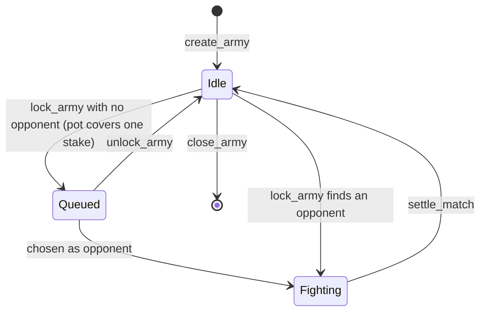
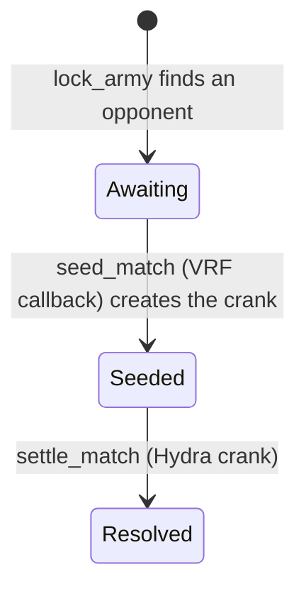

# Accounts and instructions

The program is Anchor. Every account begins with the 8-byte discriminator `SHA-256("account:<Name>")[..8]`. Every instruction begins with `SHA-256("global:<snake_name>")[..8]`. Integers are little-endian. The program id is `Hm19JfKaKCRphRwF7DbxhJWmLpHgMG1SnEnKGRyN9Z7c`.

## PDA seeds

| account | seeds | notes |
| --- | --- | --- |
| Config | `[b"config"]` | one per program |
| program identity | `[b"identity"]` | space 0; signs the VRF request |
| Battleground | `[b"battleground", &[battleground_id]]` | `battleground_id` is one byte |
| Behavior | `[b"behavior", hash]` | `hash = SHA-256(canonical body)` |
| Army | `[b"army", owner, index_le]` | `index` is `u32` |
| Pot | `[b"pot", battleground_pubkey, owner]` | one per player and battleground; every army the owner locks there stakes from it |
| Battle | `[b"match", battleground_pubkey, seq_le]` | `seq` is `u64`, the battleground's `match_seq` at creation |
| crank vault | `[b"crank-fund", battle_pubkey]` | system account; pays for the battle's settlement crank, empty after `seed_match` |

The scoped VRF identity is a different account, owned by the derivation under the VRF program: `[b"identity", horizon_program_id]`. It signs `seed_match`. It is not the program identity above.

The battle's settlement crank is a Hydra account, `[b"crank", crank_vault, battle_pubkey]` under `Hydra17i1feui9deaxu6d1TzSQMRNHeBRkDR1Awy7zea`. See [Settlement crank](matchmaking.md#settlement-crank).

## Status bytes

Army `status`:

| value | name |
| --- | --- |
| 0 | Idle |
| 1 | Queued |
| 2 | Fighting |

Battle `status`: `0` Awaiting (the VRF request is out), `2` Seeded (the seed is stored and the settlement crank is scheduled), `1` Resolved. The values keep `1` for Resolved so readers that test for it did not change.

Battle `outcome`: `0` pending, `1` side A, `2` side B, `3` draw.

In the program these are the enums `ArmyStatus`, `BattleStatus`, and `Outcome` (`programs/horizon-zero/src/state.rs`), stored with `#[borsh(use_discriminant = true)]` so each is one byte equal to the id above. An account holding any other byte fails to deserialize. The `HZ_MATCH_RESOLVED` log line prints the outcome byte.



`update_army` and `close_army` are legal only in Idle. No instruction leaves Fighting except `settle_match`.



## Layouts

Sizes include the 8-byte discriminator. The indexer decodes an account only when the discriminator and the length both match.

### Config — 41 bytes

| offset | field |
| --- | --- |
| 8 | `admin` pubkey |
| 40 | `bump` |

The indexer does not store Config.

### Behavior — 119 bytes

| offset | field |
| --- | --- |
| 8 | `creator` pubkey |
| 40 | `len` u8 |
| 41 | `body`, 77 bytes, the first `len` of which are canonical |
| 118 | `bump` |

The stored hash is the PDA seed, not a field. Canonical bytes have no padding:

```text
u8 element count                         1..=4
for each element:
  u8 movement_present                    0 or 1
  if 1: u8 kind, u8 extremum, u8 stat, u8 side, u8 stop
  u8 action count                        0..=3
  for each action: u8 type, u8 extremum, u8 stat, u8 side
```

`kind` is approach `0`, flee `1`, flank left `2`, flank right `3`. `extremum` is lowest `0` or highest `1`. `stat` is distance `0`, hp `1`, or atk `2`. `side` is enemy `0` or ally `1`. `stop` is continue `0` or stop if an action triggers `1`. Action `type` is attack `0` or cast `1`. A present movement spends the whole movement pool. An empty sequence, more than 4 elements, more than 3 actions in one element, a bad enum (including a side other than `0` or `1`), or trailing bytes is rejected. The maximum body is 77 bytes: `1 + 4 * (1 + 5 + 1 + 3 * 4)`. An element with no movement has no `side` byte and no `stop` byte. A body that still carries the old mode byte, or that omits `side`, is trailing or short data and is rejected.

### Battleground — 576 bytes

| offset | field |
| --- | --- |
| 8 | `admin` pubkey |
| 40 | `battleground_id` u8 |
| 41 | `budget` u16 |
| 43 | `stake_lamports` u64 |
| 51 | `cols` u8 |
| 52 | `rows` u8 |
| 53 | `zone_depth` u8, always 2 |
| 54 | `queue_len` u8 |
| 55 | `queue` 16 pubkeys |
| 567 | `match_seq` u64 |
| 575 | `bump` |

`MAX_QUEUE` is 16. `enqueue` appends. `remove` swap-removes and clears the vacated slot. A 17th enqueue fails with `QueueFull`.

Zone A is rows `0..zone_depth`, every column. Zone B is rows `rows-zone_depth..rows`, every column. The instruction does not take a tile list. `cols` must be `1..=32` and `rows` must be `4..=32`, which is `horizon_combat::Geometry::playable`. A grid outside that range fails with `BadGrid`.

### Army — 1360 bytes

| offset | field |
| --- | --- |
| 8 | `owner` pubkey |
| 40 | `battleground` pubkey |
| 72 | `race` |
| 73 | `index` u32 |
| 77 | `unit_count` |
| 78 | `units`, 10 slots of 128 bytes |
| 1358 | `status` |
| 1359 | `bump` |

Each `ArmyUnit` is 128 bytes:

| offset | field |
| --- | --- |
| 0 | `kind` u8 |
| 1 | `behavior` pubkey |
| 33 | `len` u8 |
| 34 | `body`, 77 bytes |
| 111 | `col` u8 |
| 112 | `row` u8 |
| 113 | `cost` u16 |
| 115 | `hp` u8 |
| 116 | `atk` u8 |
| 117 | `range` u8, the attack range |
| 118 | `speed` u8 |
| 119 | cast `damage` u8 |
| 120 | cast `range` u8 |
| 121 | cast `aoe` u8 |
| 122 | cast `effect` u8 |
| 123 | cast `aim` u8 |
| 124 | cast `power` u8 |
| 125 | cast `rounds` u8 |
| 126 | cast `cooldown` u8 |
| 127 | `actions` u8, attacks or casts per turn |

`col` and `row` are zone-local. The body is the canonical sequence copied from the behavior account. Cost, hp, atk, attack range, speed, the eight cast bytes, and `actions` are copied from `stats_for(race, kind)` when the army is saved. The cast bytes follow the battle rules chapter. Unused slots are zero. `status` is at offset 1358 because the unit array is fixed. `race` is the catalog id. Kind ids belong to that race.

### Battle — 2145 bytes

| offset | field |
| --- | --- |
| 8 | `battleground` pubkey |
| 40 | `army_a` pubkey |
| 72 | `army_b` pubkey |
| 104 | `player_a` pubkey |
| 136 | `player_b` pubkey |
| 168 | `stake` u64 |
| 176 | `seq` u64 |
| 184 | `count_a` |
| 185 | `count_b` |
| 186 | `cols` |
| 187 | `rows` |
| 188 | `units_a`, 10 slots of 96 bytes |
| 1148 | `units_b`, 10 slots of 96 bytes |
| 2108 | `status` |
| 2109 | `seed`, 32 bytes |
| 2141 | `outcome` |
| 2142 | `race_a` |
| 2143 | `race_b` |
| 2144 | `bump` |

Each snapshot unit is 96 bytes: `kind`, `len`, `body` (77 bytes), `col`, `row`, `cost` u16, `hp`, `atk`, `range`, `speed`, then cast `damage`, `range`, `aoe`, `effect`, `aim`, `power`, `rounds`, and `cooldown`, then `actions`. `col` and `row` are the zone-local position copied from the army, and `body` is that unit's canonical behavior. The stats and the cast are the same bytes the army stored. Side A is the army that was already queued. Side B is the army that called `lock_army` and opened the match. `race_a` and `race_b` are those armies' race ids. `cols` and `rows` are copied from the battleground so `settle_match` can call `simulate` without another account. `seed` is zero until `seed_match`. `simulate` reads the stored stats and cast. It does not look the kind up in the catalog.

### Pot — 92 bytes

| offset | field |
| --- | --- |
| 8 | `owner` pubkey |
| 40 | `battleground` pubkey |
| 72 | `budget` u64, lamports a match may stake |
| 80 | `winnings` u64, payouts set aside while `segregate` is on |
| 88 | `segregate`, `0` or `1` |
| 89 | `fighting` u16, the owner's armies in battles that have not settled |
| 91 | `bump` |

The account's lamports are its rent plus at least `budget + winnings`. Queuing an army reserves nothing: a stake leaves the budget only when a match opens. One pot therefore backs any number of queued armies, and the armies after the budget runs under one stake stay queued but cannot be met (see [Pots](matchmaking.md#pots)).

## Instructions

### `initialize`

Accounts: admin signer writable, config init, identity writable, system program.

Sets `config.admin` to the signer and creates the program identity PDA with space 0. The first successful caller is the admin. There is no admin transfer.

### `create_battleground(battleground_id: u8, budget: u16, stake_lamports: u64, cols: u8, rows: u8)`

Accounts: admin signer writable, config, battleground init, system program.

The signer must be `config.admin`. The battleground stores that admin, the five arguments, `zone_depth` 2, an empty queue, and `match_seq` 0. `cols` and `rows` must describe a playable grid.

Log: `HZ_BATTLEGROUND <battleground> <id> <budget> <stake> <cols> <rows>`.

### `create_behavior(hash: [u8; 32], body: Vec<u8>)`

Accounts: creator signer writable, behavior init, system program.

Any signer may create one. `body` is the canonical byte string. It must parse, and `SHA-256(body)` must equal `hash`. The init address is the PDA of that hash, so a second create of the same body fails because the account exists. Nothing updates or closes a behavior.

The instruction data after the discriminator is the 32-byte hash, then a little-endian `u32` length, then the body bytes.

Log: `HZ_BEHAVIOR <behavior> <creator> <len>`.

### `create_army(index: u32, race: u8, units: Vec<UnitInput>)`

Accounts: owner signer writable, battleground, army init, system program, then one readonly behavior account per unit, in order.

`UnitInput` is `kind` u8, `behavior` pubkey, `col` u8, `row` u8. The vector is a `u32` length followed by 35-byte elements. `race` must be a catalog race: Ashborn is `0`, Rootborn is `1`, and Deeplings is `2`; any other byte fails with `BadRace`. The vector must be non-empty and at most 10. Each kind must be in that race's catalog, or the instruction fails with `BadUnit`: Rootborn has kinds `0` to `2`, so kind `3` is an Ashborn Vanguard but no Rootborn unit. `col` must be less than `cols` and `row` must be `0` or `1`. Two units cannot share that zone-local tile. The sum of catalog costs must be less than or equal to `battleground.budget`. Each behavior account must deserialize, its body must be valid, and its address must be `[b"behavior", sha256(body)]` under this program. The army copies `kind`, the behavior pubkey, the canonical body, the zone-local position, and the catalog cost, hp, atk, attack range, speed, and cast, then sets Idle. The catalog lookup is a `match`. The client does not send the numbers.

An empty roster and a roster longer than 6 both return `TooManyUnits`. A position outside the zone returns `BadPosition`. A repeated tile returns `DuplicatePosition`.

Log: `HZ_ARMY <army> <owner> <battleground>`.

### `update_army(race: u8, units: Vec<UnitInput>)`

Accounts: owner signer, battleground, army writable. Behavior accounts are remaining accounts, same rules as create.

The signer must own the army, the army's battleground must be the passed battleground, and status must be Idle. Replaces `race`, `unit_count`, and `units`, including positions. Owner, index, and battleground stay. The web client does not send this instruction.

Log: `HZ_ARMY_UPDATE <army>`.

### `fund_pot(amount: u64)`

Accounts: owner signer writable, battleground, pot (created if needed), system program.

Creates the owner's pot on that battleground the first time, with `segregate` off, then transfers `amount` from the owner into it and adds it to `budget`. The owner pays the pot's rent on creation.

Log: `HZ_POT <pot> <owner> <budget> <winnings> <segregate> <fighting>`, also sent by every instruction below that changes a pot, and by `lock_army` and `settle_match` for both pots.

### `withdraw_pot(amount: u64)`

Accounts: owner signer writable, pot writable. The signer must be the pot's owner (`NotOwner`).

Takes `amount` from `winnings` first, then from `budget`, and moves it to the owner. More than `winnings + budget` fails with `PotShort`. A withdrawal may leave the budget under one stake while armies are queued; they stay queued, and no locker can meet them until the pot is funded again.

### `set_segregation(segregate: bool)`

Accounts: owner signer writable, pot writable. The signer must be the pot's owner.

Off, a payout goes back into `budget` and can be staked again. On, it goes to `winnings`, which no match stakes. Switching does not move what either balance holds.

### `close_pot`

Accounts: owner signer writable, pot writable. The signer must be the pot's owner.

`fighting` must be zero (`PotBusy`), so every battle that staked from the pot has settled. The account closes onto the owner, who gets the rent, the budget and the winnings.

Log: `HZ_POT_CLOSE <pot>`.

### `lock_army`

No instruction arguments. Account order after the `#[vrf]` macro expands `LockArmy`:

1. player, signer, writable
2. battleground, writable
3. army, writable
4. the player's pot `[b"pot", battleground, player]`, writable
5. battle, writable (created in this instruction when a match opens; uninitialized when the army only queues)
6. oracle queue, writable, owned by the VRF program
7. program identity `[b"identity"]`
8. VRF program
9. `SysvarS1otHashes111111111111111111111111111`
10. system program
11. remaining: each distinct behavior on the army, readonly

To open a match the client then passes, in any order, each queued army it offers as a candidate (writable), each of their owners' pots once (writable), and the battle's crank vault `[b"crank-fund", battle]` (writable). With no candidates it passes nothing more.

The player must own the army. The army must belong to this battleground, be Idle, and have `unit_count > 0`. Each stored behavior is loaded again and its canonical bytes must still match the army. The lock copies each unit's kind, behavior body, zone-local position, stats, and cast into the battle snapshot, copies `cols` and `rows` onto the battle, and stores each army's race as `race_a` and `race_b`. The program writes the new battle into its account field by field, in `Battle`'s order, and reads the opponent's army onto the heap: a `Battle` value with two 10-slot snapshots would not fit the 4 KB SBF stack frame.

The player's pot must exist (Anchor's `AccountNotInitialized` otherwise) and its `budget` must be at least `stake_lamports` (`PotTooLow`), whether the army queues or matches.

Candidates are queue entries whose account was passed, whose status is Queued, whose owner is not the player, and whose owner's pot was passed with a `budget` of at least `stake_lamports`. A passed account counts as a pot when this program owns it, it is 92 bytes, it deserializes as `Pot`, and its `battleground` is this one; pots exist only at their PDA, so no derivation is needed. A player therefore queues behind their own waiting armies instead of matching them, and an army whose pot ran dry is skipped.

When the candidate list is empty the instruction appends the army to the battleground queue and sets Queued. No lamports move. Log: `HZ_QUEUED <army> <battleground>`.

When the list is not empty, opponent choice, the stakes, and the VRF request are specified in [Matchmaking, pots, and VRF](matchmaking.md).

The client and the tests prepend a compute-budget instruction that sets the unit limit to `1_400_000`. That limit is not a program constant.

### `unlock_army`

Accounts: player signer writable, battleground writable, army writable.

The player must own the army. Status must be Queued and the army must still sit in the battleground queue. The instruction removes the army from the queue and sets Idle. No lamports move: a queued army holds no stake of its own.

Log: `HZ_UNLOCK <army>`.

### `close_army`

Accounts: owner signer writable, army writable.

The signer must own the army (`NotOwner`) and status must be Idle (`BadStatus`). A queued army unlocks first. The army account is closed onto the owner, who gets its rent back. Battles keep their own unit snapshots, so a closed army's past battles still replay. The index is free again: `create_army` with the same index makes a new account at the same address. The web client sends this instruction from the Delete button.

Log: `HZ_ARMY_CLOSE <army>`.

### `seed_match(randomness: [u8; 32])`

The VRF callback. `#[vrf_callback]` inserts the scoped VRF identity as the first account. It must be a signer and must equal `[b"identity", program_id]` derived under the VRF program. The remaining accounts, in order, are battle, crank vault and crank (writable), the Hydra program, and the system program.

The battle must be Awaiting, and its address must be `[b"match", battleground, seq]` with the stored bump. The vault and the crank must be the battle's (see [PDA seeds](#pda-seeds)).

The instruction stores `randomness` in `seed`, sets the battle Seeded, and creates the one-shot settlement crank through Hydra `Create`, paid by the vault, then moves the rest of the vault onto the crank. [Settlement crank](matchmaking.md#settlement-crank) has the crank's parameters. A second call fails with `AlreadyResolved`.

Log: `HZ_MATCH_SEEDED <battle> <crank> <seed hex>`.

### `settle_match`

Accounts, in order, which are also the crank's stored template: battle, army A, army B, pot A, pot B, player B, crank (all writable), the Hydra program, and the instructions sysvar. Each army and player B must match the battle's stored keys. Pot A must be `[b"pot", battleground, player_a]` and pot B `[b"pot", battleground, player_b]`, each checked with its stored bump.

The battle must be Seeded. Both armies must be Fighting. The battle address must be `[b"match", battleground, seq]`, and the crank must be the battle's. The instruction must run at the top level, directly after Hydra `Trigger` on that crank, as the instructions sysvar shows; otherwise it fails with `NotCranked`.

The instruction first cancels the crank through Hydra `Cancel`, signed by the battle as the crank's authority, which sends the crank's balance to player B. `simulate` then runs on the stored snapshots, the stored seed, and the stored `cols` and `rows`. The battle's balance above rent must be at least `2 * stake`.

| outcome | payment from the battle account |
| --- | --- |
| A wins (`Some(0)` → outcome 1) | `2 * stake` to pot A |
| B wins (`Some(1)` → outcome 2) | `2 * stake` to pot B |
| draw (outcome 3) | `stake` to pot A and `stake` to pot B |

Each payment is added to the pot's `budget`, or to its `winnings` when `segregate` is on, and each pot's `fighting` drops by one. The instruction then sets the battle Resolved, stores the outcome, and sets both armies to Idle. Rent remains on the battle account.

Log: `HZ_MATCH_RESOLVED <battle> <outcome> <seed hex>`.
