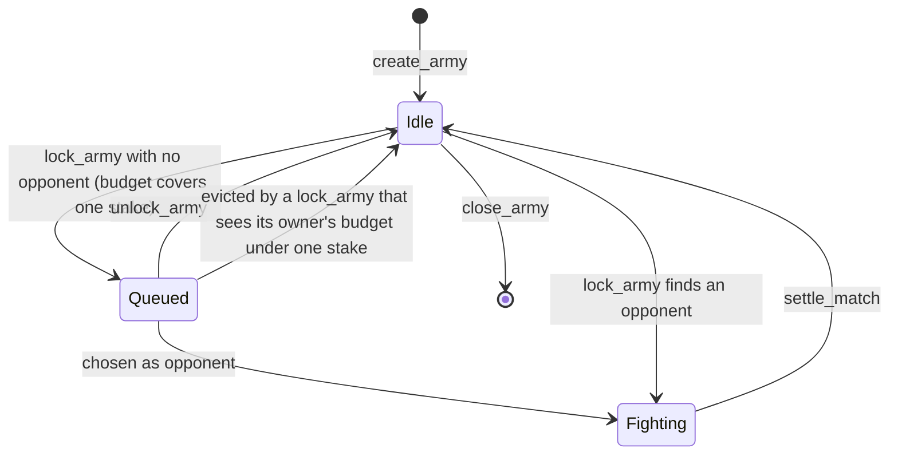
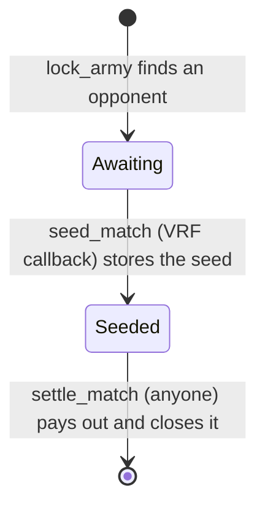

# Accounts and instructions

The program is Anchor. Every account begins with the 8-byte discriminator `SHA-256("account:<Name>")[..8]`. Every instruction begins with `SHA-256("global:<snake_name>")[..8]`. Integers are little-endian. The program id is `Hm19JfKaKCRphRwF7DbxhJWmLpHgMG1SnEnKGRyN9Z7c`.

## PDA seeds

| account | seeds | notes |
| --- | --- | --- |
| Config | `[b"config"]` | one per program; also holds the claimable fees |
| program identity | `[b"identity"]` | space 0; signs the VRF request |
| Battleground | `[b"battleground", &[battleground_id]]` | `battleground_id` is one byte |
| Player | `[b"player", owner]` | one per wallet; its lamports are the owner's balance on every battleground |
| Outbox | `[b"outbox", owner]` | one per wallet, created with the Player |
| treasury Outbox | `[b"outbox", config]` | one per program; pays the claimed fees to the admin |
| Behavior | `[b"behavior", hash]` | ephemeral; `hash = SHA-256(canonical body)` |
| Army | `[b"army", owner, index_le]` | ephemeral; `index` is `u32` |
| Battle | `[b"match", battleground_pubkey, seq_le]` | ephemeral; `seq` is `u64`, the battleground's `match_seq` at creation |

The scoped VRF identity is a different account, owned by the derivation under the VRF program: `[b"identity", horizon_program_id]`. It signs `seed_match`. It is not the program identity above.

## Ephemeral accounts

Behavior, Army and Battle are ephemeral accounts: they exist only in the MagicBlock rollup, hold 0 lamports, and are owned by this program. The program creates one with the magic program's `CreateEphemeralAccount`, through `ephemeral_rollups_sdk::ephemeral_accounts::EphemeralAccount`. The sponsor is a Player PDA, which signs with its seeds `[b"player", owner, bump]`. The new account signs with its own PDA seeds. The sponsor pays `(len + 60) * 32` lamports of rent to the ephemeral vault. Closing refunds that rent to the sponsor.

| account | sponsor | length | rent (lamports) | closed by |
| --- | --- | --- | --- | --- |
| Behavior | creator's Player | 119 | 5 728 | never |
| Army | owner's Player | 1360 | 45 440 | `close_army` |
| Battle | locker's (player B's) Player | 2147 | 70 624 | `settle_match` |

The rent comes only from the sponsor's free lamports (see [Player](#player--68-bytes)). If they do not cover it, the create fails with `RentShort`, so storage never spends a budget, winnings, or a locked stake.

Every instruction that creates or closes an ephemeral account takes two more accounts: the vault `MagicVau1t999999999999999999999999999999999` (writable) and the magic program `Magic11111111111111111111111111111111111111`. The program checks both addresses.

The `inline-mock-magic` feature is for LiteSVM, which has no magic program. Under it, an ephemeral account is an ordinary PDA. Its rent is the Solana rent-exempt minimum, moved from the sponsor after the system program allocates the account and assigns it to this program. Closing moves the account's lamports back to the sponsor, empties it, and assigns it back to the system program. The vault and magic program accounts are not checked.

## Status bytes

Army `status`:

| value | name |
| --- | --- |
| 0 | Idle |
| 1 | Queued |
| 2 | Fighting |

Battle `status`: `0` Awaiting (the VRF request is out), `2` Seeded (the seed is stored; anyone may settle), `1` Resolved. No account stores `1`: `settle_match` closes the battle. The value stays reserved for readers that record the outcome from the `HZ_MATCH_RESOLVED` log.

Battle `outcome`: `0` pending, `1` side A, `2` side B, `3` draw.

In the program these are the enums `ArmyStatus`, `BattleStatus`, and `Outcome` (`programs/horizon-zero/src/state.rs`), stored with `#[borsh(use_discriminant = true)]` so each is one byte equal to the id above. An account holding any other byte fails to deserialize. The `HZ_MATCH_RESOLVED` log line prints the outcome byte.



`update_army` and `close_army` are legal only in Idle. No instruction leaves Fighting except `settle_match`.



## Layouts

Sizes include the 8-byte discriminator. The indexer decodes an account only when the discriminator and the length both match.

### Config — 51 bytes

| offset | field |
| --- | --- |
| 8 | `admin` pubkey |
| 40 | `fee_bps` u16, the protocol fee rate in basis points |
| 42 | `fees` u64, claimable fee lamports |
| 50 | `bump` |

The account's lamports are its rent plus `fees`. `fee_bps` is at most `1000` (`MAX_FEE_BPS`); `DEFAULT_FEE_BPS` in `programs/horizon-zero/src/fees.rs` is `500`. The indexer does not store Config.

### Player — 68 bytes

| offset | field |
| --- | --- |
| 8 | `owner` pubkey |
| 40 | `budget` u64, lamports a match may stake |
| 48 | `winnings` u64, payouts set aside while `segregate` is on |
| 56 | `locked` u64, stakes in battles that have not settled |
| 64 | `segregate`, `0` or `1` |
| 65 | `fighting` u16, the owner's armies in battles that have not settled |
| 67 | `bump` |

The Player's lamports are the owner's money. The counters split them:

```text
free = lamports - rent_exempt_min(68) - budget - winnings - locked
```

Free lamports pay ephemeral rent and are what `fund_budget` can move into the budget. The program keeps `lamports >= rent_exempt_min + budget + winnings + locked`: stakes move as counters until `settle_match`, and an ephemeral create fails with `RentShort` rather than dip below the free balance. A lamport transfer into the Player lands in free lamports.

### Outbox — 49 bytes

| offset | field |
| --- | --- |
| 8 | `owner` pubkey |
| 40 | `amount` u64 |
| 48 | `bump` |

A one-shot cash-out account. `owner` is the wallet `release_outbox` pays, and `amount` is the withdrawal waiting to be paid, or 0. The account's lamports are its rent plus `amount`.

`register_player` creates a wallet's Outbox with `owner` = the wallet and `amount` 0. `init_treasury_outbox` creates the treasury Outbox with `owner` = the admin. `fund_outbox` and `fund_treasury_outbox` set `amount`; `release_outbox` pays it and sets it back to 0. See [Money in and out](matchmaking.md#money-in-and-out).

### Behavior — 119 bytes

| offset | field |
| --- | --- |
| 8 | `creator` pubkey |
| 40 | `len` u8 |
| 41 | `body`, 77 bytes, the first `len` of which are canonical |
| 118 | `bump` |

The stored hash is the PDA seed, not a field. Canonical bytes have no padding:

```text
u8 element count                         1..=4
for each element:
  u8 movement_present                    0 or 1
  if 1: u8 kind, u8 extremum, u8 stat, u8 side, u8 stop
  u8 action count                        0..=3
  for each action: u8 type, u8 extremum, u8 stat, u8 side
```

`kind` is approach `0`, flee `1`, flank left `2`, flank right `3`. `extremum` is lowest `0` or highest `1`. `stat` is distance `0`, hp `1`, or atk `2`. `side` is enemy `0` or ally `1`. `stop` is continue `0` or stop if an action triggers `1`. Action `type` is attack `0` or cast `1`. A present movement spends the whole movement pool. An empty sequence, more than 4 elements, more than 3 actions in one element, a bad enum (including a side other than `0` or `1`), or trailing bytes is rejected. The maximum body is 77 bytes: `1 + 4 * (1 + 5 + 1 + 3 * 4)`. An element with no movement has no `side` byte and no `stop` byte. A body that still carries the old mode byte, or that omits `side`, is trailing or short data and is rejected.

### Battleground — 576 bytes

| offset | field |
| --- | --- |
| 8 | `admin` pubkey |
| 40 | `battleground_id` u8 |
| 41 | `budget` u16 |
| 43 | `stake_lamports` u64 |
| 51 | `cols` u8 |
| 52 | `rows` u8 |
| 53 | `zone_depth` u8, always 2 |
| 54 | `queue_len` u8 |
| 55 | `queue` 16 pubkeys |
| 567 | `match_seq` u64 |
| 575 | `bump` |

`MAX_QUEUE` is 16. `enqueue` appends. `remove` swap-removes and clears the vacated slot. A 17th enqueue fails with `QueueFull`.

Zone A is rows `0..zone_depth`, every column. Zone B is rows `rows-zone_depth..rows`, every column. The instruction does not take a tile list. `cols` must be `1..=32` and `rows` must be `4..=32`, which is `horizon_combat::Geometry::playable`. A grid outside that range fails with `BadGrid`.

### Army — 1360 bytes

| offset | field |
| --- | --- |
| 8 | `owner` pubkey |
| 40 | `battleground` pubkey |
| 72 | `race` |
| 73 | `index` u32 |
| 77 | `unit_count` |
| 78 | `units`, 10 slots of 128 bytes |
| 1358 | `status` |
| 1359 | `bump` |

Each `ArmyUnit` is 128 bytes:

| offset | field |
| --- | --- |
| 0 | `kind` u8 |
| 1 | `behavior` pubkey |
| 33 | `len` u8 |
| 34 | `body`, 77 bytes |
| 111 | `col` u8 |
| 112 | `row` u8 |
| 113 | `cost` u16 |
| 115 | `hp` u8 |
| 116 | `atk` u8 |
| 117 | `range` u8, the attack range |
| 118 | `speed` u8 |
| 119 | cast `damage` u8 |
| 120 | cast `range` u8 |
| 121 | cast `aoe` u8 |
| 122 | cast `effect` u8 |
| 123 | cast `aim` u8 |
| 124 | cast `power` u8 |
| 125 | cast `rounds` u8 |
| 126 | cast `cooldown` u8 |
| 127 | `actions` u8, attacks or casts per turn |

`col` and `row` are zone-local. The body is the canonical sequence copied from the behavior account. Cost, hp, atk, attack range, speed, the eight cast bytes, and `actions` are copied from `stats_for(race, kind)` when the army is saved. The cast bytes follow the battle rules chapter. Unused slots are zero. `status` is at offset 1358 because the unit array is fixed. `race` is the catalog id. Kind ids belong to that race.

### Battle — 2147 bytes

| offset | field |
| --- | --- |
| 8 | `battleground` pubkey |
| 40 | `army_a` pubkey |
| 72 | `army_b` pubkey |
| 104 | `player_a` pubkey |
| 136 | `player_b` pubkey |
| 168 | `stake` u64 |
| 176 | `seq` u64 |
| 184 | `count_a` |
| 185 | `count_b` |
| 186 | `cols` |
| 187 | `rows` |
| 188 | `units_a`, 10 slots of 96 bytes |
| 1148 | `units_b`, 10 slots of 96 bytes |
| 2108 | `status` |
| 2109 | `seed`, 32 bytes |
| 2141 | `outcome` |
| 2142 | `race_a` |
| 2143 | `race_b` |
| 2144 | `fee_bps` u16, Config's rate when the battle opened |
| 2146 | `bump` |

Each snapshot unit is 96 bytes: `kind`, `len`, `body` (77 bytes), `col`, `row`, `cost` u16, `hp`, `atk`, `range`, `speed`, then cast `damage`, `range`, `aoe`, `effect`, `aim`, `power`, `rounds`, and `cooldown`, then `actions`. `col` and `row` are the zone-local position copied from the army, and `body` is that unit's canonical behavior. The stats and the cast are the same bytes the army stored. Side A is the army that was already queued. Side B is the army that called `lock_army` and opened the match. `race_a` and `race_b` are those armies' race ids. `cols` and `rows` are copied from the battleground so `settle_match` can call `simulate` without another account. `seed` is zero until `seed_match`. `simulate` reads the stored stats and cast. It does not look the kind up in the catalog. `fee_bps` is what `settle_match` charges, so a `set_fee` after the lock does not change an open battle.

## Instructions

### `initialize(fee_bps: u16)`

Accounts: admin signer writable, config init, identity writable, system program.

`fee_bps` above `1000` fails with `FeeTooHigh`. Sets `config.admin` to the signer, stores `fee_bps` with `fees` 0, and creates the program identity PDA with space 0. The first successful caller is the admin. There is no admin transfer.

### `set_fee(fee_bps: u16)`

Accounts: admin signer, config writable.

The signer must be `config.admin` (`NotAdmin`), and `fee_bps` must be at most `1000` (`FeeTooHigh`). Battles already open keep the rate they copied at `lock_army`.

Log: `HZ_FEE <fee_bps>`.

### `create_battleground(battleground_id: u8, budget: u16, stake_lamports: u64, cols: u8, rows: u8)`

Accounts: admin signer writable, config, battleground init, system program.

The signer must be `config.admin`. The battleground stores that admin, the five arguments, `zone_depth` 2, an empty queue, and `match_seq` 0. `cols` and `rows` must describe a playable grid.

Log: `HZ_BATTLEGROUND <battleground> <id> <budget> <stake> <cols> <rows>`.

### `register_player(deposit: u64)`

Accounts: owner signer writable, player init `[b"player", owner]`, outbox init `[b"outbox", owner]`, system program.

Creates the wallet's Player and Outbox, both paid by the owner, then transfers `deposit` from the owner into the Player, where it is free lamports. A second call fails because the accounts exist.

Log: `HZ_PLAYER <player> <owner> <budget> <winnings> <locked> <segregate> <fighting>`. `fund_budget`, `set_segregation` and `fund_outbox` send it too, and `lock_army` (when a match opens) and `settle_match` send it for both Players. The instructions that only pay ephemeral rent from a Player (`create_behavior`, `create_army`, `close_army`) do not.

### `fund_budget(amount: u64)`

Accounts: owner signer, player writable `[b"player", owner]`.

Moves `amount` from free lamports into `budget`. No lamports move. More than the free balance fails with `BalanceShort`.

### `set_segregation(segregate: bool)`

Accounts: owner signer, player writable `[b"player", owner]`.

Off, a won payout goes into `budget` and can be staked again. On, it goes to `winnings`, which no match stakes. Switching does not move what either balance holds. A draw always returns the stake to `budget`.

### `create_behavior(hash: [u8; 32], body: Vec<u8>)`

Accounts: creator signer, the creator's player writable `[b"player", creator]`, behavior writable, vault writable, magic program, system program.

Any registered wallet may create one. `body` is the canonical byte string. It must parse (`InvalidBehavior`), and `SHA-256(body)` must equal `hash` (`HashMismatch`). The behavior address must be `[b"behavior", hash]` (`BadPda`) and must hold no data yet (`AlreadyExists`), so a second create of the same body fails. The behavior is an ephemeral account sponsored by the creator's Player. Nothing updates or closes a behavior.

The instruction data after the discriminator is the 32-byte hash, then a little-endian `u32` length, then the body bytes.

Log: `HZ_BEHAVIOR <behavior> <creator> <len>`.

### `create_army(index: u32, race: u8, units: Vec<UnitInput>)`

Accounts: owner signer, the owner's player writable `[b"player", owner]`, battleground, army writable, vault writable, magic program, system program, then one readonly behavior account per unit, in order.

The army address must be `[b"army", owner, index_le]` (`BadPda`) and must hold no data yet (`AlreadyExists`). The army is an ephemeral account sponsored by the owner's Player.

`UnitInput` is `kind` u8, `behavior` pubkey, `col` u8, `row` u8. The vector is a `u32` length followed by 35-byte elements. `race` must be a catalog race: Ashborn is `0`, Rootborn is `1`, and Deeplings is `2`; any other byte fails with `BadRace`. The vector must be non-empty and at most 10. Each kind must be in that race's catalog, or the instruction fails with `BadUnit`: Rootborn has kinds `0` to `2`, so kind `3` is an Ashborn Vanguard but no Rootborn unit. `col` must be less than `cols` and `row` must be `0` or `1`. Two units cannot share that zone-local tile. The sum of catalog costs must be less than or equal to `battleground.budget`. Each behavior account must deserialize, its body must be valid, and its address must be `[b"behavior", sha256(body)]` under this program. The army copies `kind`, the behavior pubkey, the canonical body, the zone-local position, and the catalog cost, hp, atk, attack range, speed, and cast, then sets Idle. The catalog lookup is a `match`. The client does not send the numbers.

An empty roster and a roster longer than 10 both return `TooManyUnits`. A position outside the zone returns `BadPosition`. A repeated tile returns `DuplicatePosition`.

Log: `HZ_ARMY <army> <owner> <battleground>`.

### `update_army(race: u8, units: Vec<UnitInput>)`

Accounts: owner signer, battleground, army writable. Behavior accounts are remaining accounts, same rules as create.

The signer must own the army, the army's battleground must be the passed battleground, and status must be Idle. Replaces `race`, `unit_count`, and `units`, including positions. Owner, index, and battleground stay. The web client does not send this instruction.

Log: `HZ_ARMY_UPDATE <army>`.

### `lock_army`

No instruction arguments. Account order after the `#[vrf]` macro expands `LockArmy`:

1. player, signer, writable
2. the player's Player `[b"player", player]`, writable
3. config `[b"config"]`
4. battleground, writable
5. army, writable
6. battle, writable (created in this instruction when a match opens; untouched when the army only queues)
7. vault, writable
8. magic program
9. oracle queue, writable, owned by the VRF program
10. program identity `[b"identity"]`
11. VRF program
12. `SysvarS1otHashes111111111111111111111111111`
13. system program
14. remaining: each distinct behavior on the army, readonly

To open a match the client then passes, in any order, each queued army it offers as a candidate (writable) and each of their owners' Players once (writable). With no candidates it passes nothing more.

The player must own the army. The army must belong to this battleground, be Idle, and have `unit_count > 0`. Each stored behavior is loaded again and its canonical bytes must still match the army. The lock copies each unit's kind, behavior body, zone-local position, stats, and cast into the battle snapshot, copies `cols` and `rows` onto the battle, stores each army's race as `race_a` and `race_b`, and copies `config.fee_bps`. The program writes the new battle into its account field by field, in `Battle`'s order, and reads the opponent's army onto the heap: a `Battle` value with two 10-slot snapshots would not fit the 4 KB SBF stack frame.

The player's Player must have a `budget` of at least `stake_lamports` (`BudgetTooLow`), whether the army queues or matches.

A passed account counts as a Player when this program owns it, it is 68 bytes, it deserializes as `Player`, and its address is `[b"player", owner]` with its stored bump. The program then looks at each queue entry whose account was passed, whose status is Queued, and whose owner is not the player. A player therefore queues behind their own waiting armies instead of matching them.

- If the entry's owner's Player was passed with a `budget` of at least `stake_lamports`, the entry is a candidate.
- If the owner's Player was passed with less, the entry is evicted: it leaves the queue and becomes Idle, and the instruction logs `HZ_EVICT <army>`. Such an army could never be met, and left in place it would hold one of the 16 queue slots for good. Its owner can lock it again once the budget covers a stake.
- If the owner's Player was not passed, the entry is skipped and stays queued. Only a passed, authentic Player is evidence for an eviction.

Evictions happen before the army is queued or the match opens, whichever follows.

When the candidate list is empty the instruction appends the army to the battleground queue and sets Queued. No lamports move and no counter changes. Log: `HZ_QUEUED <army> <battleground>`.

When the list is not empty, opponent choice, the stakes, and the VRF request are specified in [Matchmaking, stakes, and VRF](matchmaking.md). The battle is an ephemeral account sponsored by the player's Player, so its free lamports must cover the battle's rent (`RentShort`).

The client and the tests prepend a compute-budget instruction that sets the unit limit to `1_400_000`. That limit is not a program constant.

### `unlock_army`

Accounts: player signer writable, battleground writable, army writable.

The player must own the army. Status must be Queued and the army must still sit in the battleground queue. The instruction removes the army from the queue and sets Idle. No lamports move: a queued army holds no stake of its own.

Log: `HZ_UNLOCK <army>`.

### `close_army`

Accounts: owner signer, the owner's player writable `[b"player", owner]`, army writable, vault writable, magic program.

The army must be owned by this program and sit at `[b"army", owner, index_le]` (`BadPda`). The signer must own it (`NotOwner`) and status must be Idle (`BadStatus`). A queued army unlocks first. The army is closed and its rent goes back to the owner's Player, which sponsored it. Battles keep their own unit snapshots, so a closed army's past battles still replay. The index is free again: `create_army` with the same index makes a new account at the same address. The web client sends this instruction from the Delete button.

Log: `HZ_ARMY_CLOSE <army>`.

### `seed_match(randomness: [u8; 32])`

The VRF callback. `#[vrf_callback]` inserts the scoped VRF identity as the first account. It must be a signer and must equal `[b"identity", program_id]` derived under the VRF program. The only other account is the battle, writable.

The battle must be Awaiting, and its address must be `[b"match", battleground, seq]` with the stored bump. The instruction stores `randomness` in `seed` and sets the battle Seeded. A second call fails with `AlreadyResolved`.

Log: `HZ_MATCH_SEEDED <battle> <seed hex>`.

### `settle_match`

Permissionless. No instruction arguments. Accounts, in order: battle, army A, army B, player A's Player, player B's Player, config (all writable), vault (writable), magic program.

The battle account is read by hand, because the instruction closes it. An account with no data fails with `AlreadyResolved`, which is what a second settlement gets, since the first one closed the battle. An account this program does not own fails with `BadPda`. An Awaiting battle fails with `NotSeeded`, and any status other than Seeded with `AlreadyResolved`. Its address must be `[b"match", battleground, seq]` with the stored bump. Each army must be the battle's, and each Player must be `[b"player", player_a]` and `[b"player", player_b]` with its stored bump (`BadPda` otherwise). Both armies must be Fighting.

`simulate` runs on the stored snapshots, the stored seed, and the stored `cols` and `rows`. The battle is then closed and its rent goes back to player B's Player, which sponsored it. The close comes before the payout: in the rollup it is a CPI, and the runtime checks at a CPI that lamports moved only between the accounts it is given. With `pot = 2 * stake` and `fee = pot * fee_bps / 10_000` rounded down, using the battle's `fee_bps`:

| outcome | lamports | counters |
| --- | --- | --- |
| A wins (`Some(0)` → outcome 1) | Player B sends `stake - fee` to Player A and `fee` to Config | Player A credits `pot - fee`; `config.fees += fee` |
| B wins (`Some(1)` → outcome 2) | Player A sends `stake - fee` to Player B and `fee` to Config | Player B credits `pot - fee`; `config.fees += fee` |
| draw (outcome 3) | none | each `budget += stake`; no fee |

A credit goes to `budget`, or to `winnings` when the winner's `segregate` is on. For both Players, `locked -= stake` and `fighting` drops by one. Every counter change is checked: an overflow fails with `BalanceShort`, and a `locked` or `fighting` that would go below zero fails with `NoStake`. Both armies return to Idle. `programs/horizon-zero/src/fees.rs` (`win_payout`) holds the arithmetic.

Log: `HZ_MATCH_RESOLVED <battle> <outcome> <fee> <seed hex> <player_b>`. The outcome byte is the `Outcome` id. `player_b` is the locker's wallet, whose Player got the battle rent back.

### `fund_outbox(amount: u64)`

Rollup. Accounts: owner signer, player writable `[b"player", owner]`, outbox writable `[b"outbox", owner]`. Both must record the signer as `owner` (`NotOwner`).

An Outbox whose `amount` is not 0 fails with `OutboxBusy`: it has not been released yet. An `amount` of 0 fails with `NothingToWithdraw`. The amount comes from free lamports first, then `winnings`, then `budget`. It never comes from `locked`, and more than `free + winnings + budget` fails with `BalanceShort`. The instruction lowers the counters, moves `amount` lamports from the Player to the Outbox, and sets `outbox.amount`. The Player keeps its rent and the locked stakes.

Send `withdraw` after it in the same transaction. The rollup refuses an instruction that both moves lamports into an account and schedules that account's commit, so the two cannot be one instruction.

Logs: `HZ_PLAYER …`, then `HZ_WITHDRAW <outbox> <amount>`.

### `withdraw`

Rollup. Accounts: owner signer writable, outbox writable `[b"outbox", owner]`, magic context writable (`MagicContext1111111111111111111111111111111`), magic program (`Magic11111111111111111111111111111111111111`).

The Outbox is read by hand, because the magic program takes it over during the instruction and Anchor would write a typed account back afterwards. It must be owned by this program (`BadPda`), record the signer as `owner` (`NotOwner`), and hold a non-zero `amount` (`NothingToWithdraw`). The instruction then schedules a commit-and-undelegate of the Outbox alone. A post-undelegate action calls `release_outbox` on Solana with the accounts outbox (writable) and owner (writable). The wallet pays the intent and is the action's escrow authority. No escrow account has to exist.

No log. The release on Solana logs `HZ_RELEASE`.

### `release_outbox`

Solana. Permissionless. Accounts: outbox writable, owner writable, which must be `outbox.owner` (`ConstraintAddress`) and a system account. When the delegation program runs it as the post-undelegate action, it appends three more accounts: the destination program, the escrow authority, and the escrow PDA, which signs. The instruction ignores them.

The Outbox is a typed account, so while it is still delegated, and owned by the delegation program on Solana, the instruction fails. Once the Outbox is undelegated, the instruction moves `amount` lamports to the owner and sets `amount` to 0. The Outbox keeps its rent. Anyone may call it again; that call pays 0.

Log: `HZ_RELEASE <outbox> <amount>`.

### `init_treasury_outbox`

Solana. Accounts: admin signer writable, config, outbox init `[b"outbox", config]`, system program.

The signer must be `config.admin` (`NotAdmin`). It pays the rent. The treasury Outbox starts with `owner` = admin and `amount` 0. A second call fails because the account exists.

### `fund_treasury_outbox`

Rollup. Accounts: admin signer, config writable, treasury outbox writable `[b"outbox", config]`.

The signer must be `config.admin` (`NotAdmin`). An unreleased treasury Outbox fails with `OutboxBusy`, and `config.fees` of 0 fails with `NothingToWithdraw`. The instruction moves all of `config.fees` from Config to the treasury Outbox, sets `outbox.owner` to the admin and `outbox.amount` to the fees, and sets `config.fees` to 0. Config keeps its rent. Send `claim_fees` after it in the same transaction.

Log: `HZ_CLAIM <outbox> <amount>`.

### `claim_fees`

Rollup. Accounts: admin signer writable, config, treasury outbox writable `[b"outbox", config]`, magic context writable, magic program.

`withdraw` for the treasury Outbox. The signer must be `config.admin` and the Outbox's `owner` (`NotAdmin`), and `amount` must not be 0 (`NothingToWithdraw`). The admin pays the intent. The post-undelegate `release_outbox` pays the admin.
