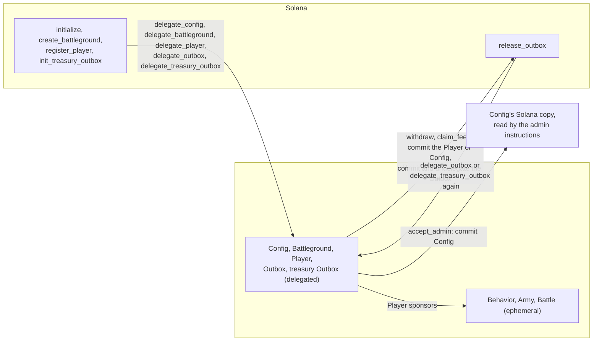
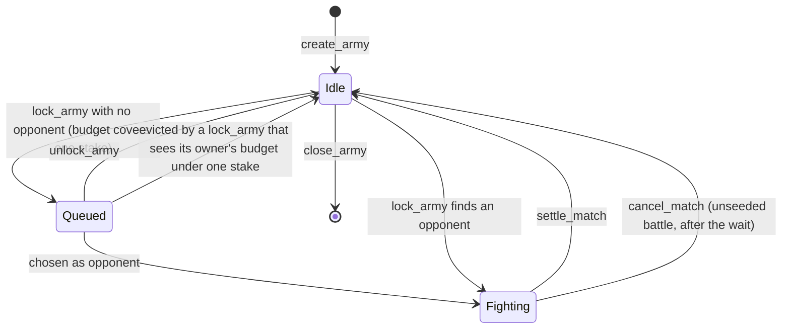
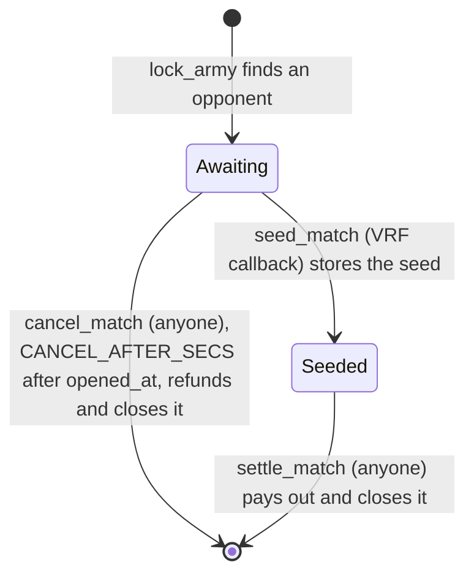

# Accounts and instructions

The program is Anchor. Every account begins with the 8-byte discriminator `SHA-256("account:<Name>")[..8]`. Every instruction begins with `SHA-256("global:<snake_name>")[..8]`. Integers are little-endian. The program id is `zeroDcScmnx7TSvWvnKBa81Gcq34T1QSRWH182YdqRg`.

## PDA seeds

| account | seeds | notes |
| --- | --- | --- |
| Config | `[b"config"]` | one per program; also holds the claimable fees |
| program identity | `[b"identity"]` | space 0; signs the VRF request |
| Battleground | `[b"battleground", &[battleground_id]]` | `battleground_id` is one byte |
| Player | `[b"player", owner]` | one per wallet; its lamports are the owner's balance on every battleground |
| Outbox | `[b"outbox", owner]` | one per wallet, created with the Player |
| treasury Outbox | `[b"outbox", config]` | one per program; pays the claimed fees to the admin |
| Behavior | `[b"behavior", hash]` | ephemeral; `hash = SHA-256(canonical body)` |
| Army | `[b"army", owner, index_le]` | ephemeral; `index` is `u32` |
| Battle | `[b"match", battleground_pubkey, seq_le]` | ephemeral; `seq` is `u64`, the battleground's `match_seq` at creation |

The scoped VRF identity is a different account, owned by the derivation under the VRF program: `[b"identity", horizon_program_id]`. It signs `seed_match`. It is not the program identity above.

## Where each account lives

| account | created on Solana by | delegated to the rollup by | leaves the rollup |
| --- | --- | --- | --- |
| Config | `initialize` | `delegate_config` | never; each `claim_fees` and `accept_admin` commits it and it stays delegated |
| Battleground | `create_battleground` | `delegate_battleground` | never |
| Player | `register_player` | `delegate_player` | never; each `withdraw` commits it and it stays delegated |
| Outbox | `register_player` | `delegate_outbox`, before each withdrawal | `withdraw` commits and undelegates it |
| treasury Outbox | `init_treasury_outbox` | `delegate_treasury_outbox`, before each claim | `claim_fees` commits and undelegates it |
| program identity | `initialize` | not delegated | — |
| Behavior, Army, Battle | not on Solana | ephemeral: created in the rollup (see [Ephemeral accounts](#ephemeral-accounts)) | never |

The first five are program PDAs. Each is delegated to the rollup validator built into the program (see [Delegation](#delegation)). Once delegated, each one's Solana copy is owned by the delegation program `DELeGGvXpWV2fqJUhqcF5ZSYMS4JTLjteaAMARRSaeSh`; the rollup holds the live copy.

Nothing commits on a timer: every delegation uses the SDK's default commit frequency, `u32::MAX` ms. Commits happen when cash leaves the rollup, and when the admin changes. Money leaves only through an Outbox (see [Money in and out](matchmaking.md#money-in-and-out)). In one intent bundle, `withdraw` commits the owner's Player and commits and undelegates their Outbox; `claim_fees` commits Config and commits and undelegates the treasury Outbox. `accept_admin` commits Config alone, so the admin instructions that run on Solana see the new admin. The Player and Config stay delegated. A Battleground is never committed.

The commit is what keeps the validator's books exact. A top-up reaches the Player only in the rollup; on Solana its lamports end in the validator's fees vault (see [Money in and out](matchmaking.md#money-in-and-out)). A commit that raises a delegated account's Solana balance is paid by the rollup validator's identity. Committing the source (Player or Config) with the Outbox sets its Solana copy to the rollup's balance, so the identity pays out, for that account, what the rollup holds for it, against the top-ups its fees vault took in. Between withdrawals a Player's Solana copy is stale: it shows the data and lamports of its last commit, or of its delegation if it was never committed. Top-ups, budgets, stakes and payouts live in the rollup until the next withdrawal.

The program has no instruction that undelegates Config, a Battleground or a Player. The delegation program can still undelegate one: it then calls `process_undelegation`, which `#[ephemeral]` adds (see [Delegation](#delegation)), and the account is this program's again on Solana. A Player returned that way can be delegated again with `delegate_player`, whose ownership check passes once more. The flows that need the rollup (creating behaviors and armies, `lock_army`, `settle_match`, `fund_outbox`, `withdraw`, `fund_treasury_outbox`, `claim_fees`) run there once the accounts they write are delegated. The program does not check which side it runs on; an instruction that writes an account the rollup does not hold delegated fails there.

Each account must exist before it is delegated, and `initialize` comes first. Otherwise the order does not matter: every instruction that runs on Solana and reads Config reads it by hand (see [`init_treasury_outbox`](#init_treasury_outbox)), so `create_battleground`, `init_treasury_outbox` and the other four delegate instructions work before or after `delegate_config`.



## Ephemeral accounts

Behavior, Army and Battle are ephemeral accounts: they exist only in the MagicBlock rollup, hold 0 lamports, and are owned by this program. The program creates one with the magic program's `CreateEphemeralAccount`, through `ephemeral_rollups_sdk::ephemeral_accounts::EphemeralAccount`. The sponsor is a Player PDA, which signs with its seeds `[b"player", owner, bump]`. The new account signs with its own PDA seeds. The sponsor pays `(len + 60) * 32` lamports of rent to the ephemeral vault. Closing refunds that rent to the sponsor.

| account | sponsor | length | rent (lamports) | closed by |
| --- | --- | --- | --- | --- |
| Behavior | creator's Player | 119 | 5 728 | never |
| Army | owner's Player | 1360 | 45 440 | `close_army` |
| Battle | locker's (player B's) Player | 2155 | 70 880 | `settle_match` or `cancel_match` |

The rent comes only from the sponsor's free lamports (see [Player](#player--68-bytes)). If they do not cover it, the create fails with `RentShort`, so storage never spends a budget, winnings, or a locked stake.

Every instruction that creates or closes an ephemeral account takes two more accounts: the vault `MagicVau1t999999999999999999999999999999999` (writable) and the magic program `Magic11111111111111111111111111111111111111`. The program checks both addresses.

The `inline-mock-magic` feature is for LiteSVM, which has no magic program. Under it, an ephemeral account is an ordinary PDA. Its rent is the Solana rent-exempt minimum, moved from the sponsor after the system program allocates the account and assigns it to this program. Closing moves the account's lamports back to the sponsor, empties it, and assigns it back to the system program. The vault and magic program accounts are not checked.

## Status bytes

Army `status`:

| value | name |
| --- | --- |
| 0 | Idle |
| 1 | Queued |
| 2 | Fighting |

Battle `status`: `0` Awaiting (the VRF request is out), `2` Seeded (the seed is stored; anyone may settle), `1` Resolved. No account stores `1`: `settle_match` closes the battle. The value stays reserved for readers that record the outcome from the `HZ_MATCH_RESOLVED` log.

Battle `outcome`: `0` pending, `1` side A, `2` side B, `3` draw.

In the program these are the enums `ArmyStatus`, `BattleStatus`, and `Outcome` (`programs/horizon-zero/src/state.rs`), stored with `#[borsh(use_discriminant = true)]` so each is one byte equal to the id above. An account holding any other byte fails to deserialize. The `HZ_MATCH_RESOLVED` log line prints the outcome byte.



`update_army` and `close_army` are legal only in Idle. Only `settle_match` and `cancel_match` leave Fighting.



## Layouts

Sizes include the 8-byte discriminator. The indexer decodes an account only when the discriminator and the length both match.

### Config — 83 bytes

| offset | field |
| --- | --- |
| 8 | `admin` pubkey |
| 40 | `fee_bps` u16, the protocol fee rate in basis points |
| 42 | `fees` u64, claimable fee lamports |
| 50 | `pending_admin` pubkey, the admin `set_admin` proposed; all zeros when none is |
| 82 | `bump` |

The rollup validator is not stored here: it is built into the program (see [Delegation](#delegation)). `pending_admin` took the offset and size of the `validator` field it replaced, so the account is still 83 bytes.

The account's lamports are its rent plus `fees`. Only `fees` can be claimed: `fund_treasury_outbox` moves exactly `config.fees` and keeps the rest, so lamports sent to Config directly stay there for good. `fee_bps` is at most `1000` (`MAX_FEE_BPS` in `programs/horizon-zero/src/fees.rs`); the program has no default, and the bootstrap passes `500`. The indexer does not store Config.

### Player — 68 bytes

| offset | field |
| --- | --- |
| 8 | `owner` pubkey |
| 40 | `budget` u64, lamports a match may stake |
| 48 | `winnings` u64, payouts set aside while `segregate` is on |
| 56 | `locked` u64, stakes in battles that have not settled |
| 64 | `segregate`, `0` or `1` |
| 65 | `fighting` u16, the owner's armies in battles that have not settled |
| 67 | `bump` |

The Player's lamports are the owner's money. The counters split them:

```text
free = lamports - rent_exempt_min(68) - budget - winnings - locked
```

Free lamports pay ephemeral rent and are what `fund_budget` can move into the budget. The program keeps `lamports >= rent_exempt_min + budget + winnings + locked`: stakes move as counters until `settle_match`, and an ephemeral create fails with `RentShort` rather than dip below the free balance. A lamport transfer into the Player lands in free lamports.

### Outbox — 49 bytes

| offset | field |
| --- | --- |
| 8 | `owner` pubkey |
| 40 | `amount` u64 |
| 48 | `bump` |

A one-shot cash-out account. `owner` is the wallet `release_outbox` pays, and `amount` is the withdrawal waiting to be paid, or 0. The account's lamports are its rent plus `amount`.

`register_player` creates a wallet's Outbox with `owner` = the wallet and `amount` 0. `init_treasury_outbox` creates the treasury Outbox with `owner` = the admin. `fund_outbox` and `fund_treasury_outbox` set `amount`; `release_outbox` pays it and sets it back to 0. See [Money in and out](matchmaking.md#money-in-and-out).

### Behavior — 119 bytes

| offset | field |
| --- | --- |
| 8 | `creator` pubkey |
| 40 | `len` u8 |
| 41 | `body`, 77 bytes, the first `len` of which are canonical |
| 118 | `bump` |

The stored hash is the PDA seed, not a field. Canonical bytes have no padding:

```text
u8 element count                         1..=4
for each element:
  u8 movement_present                    0 or 1
  if 1: u8 kind, u8 extremum, u8 stat, u8 side, u8 stop
  u8 action count                        0..=3
  for each action: u8 type, u8 extremum, u8 stat, u8 side
```

`kind` is approach `0`, flee `1`, flank left `2`, flank right `3`. `extremum` is lowest `0` or highest `1`. `stat` is distance `0`, hp `1`, or atk `2`. `side` is enemy `0` or ally `1`. `stop` is continue `0` or stop if an action triggers `1`. Action `type` is attack `0` or cast `1`. A present movement spends the whole movement pool. An empty sequence, more than 4 elements, more than 3 actions in one element, a bad enum (including a side other than `0` or `1`), or trailing bytes is rejected. The maximum body is 77 bytes: `1 + 4 * (1 + 5 + 1 + 3 * 4)`. An element with no movement has no `side` byte and no `stop` byte. A body that still carries the old mode byte, or that omits `side`, is trailing or short data and is rejected.

### Battleground — 576 bytes

| offset | field |
| --- | --- |
| 8 | `admin` pubkey, informational: Config's admin at creation; nothing reads it |
| 40 | `battleground_id` u8 |
| 41 | `budget` u16 |
| 43 | `stake_lamports` u64 |
| 51 | `cols` u8 |
| 52 | `rows` u8 |
| 53 | `zone_depth` u8, always 2 |
| 54 | `queue_len` u8 |
| 55 | `queue` 16 pubkeys |
| 567 | `match_seq` u64 |
| 575 | `bump` |

`MAX_QUEUE` is 16. `enqueue` appends. `remove` swap-removes and clears the vacated slot. A 17th enqueue fails with `QueueFull`.

Zone A is rows `0..zone_depth`, every column. Zone B is rows `rows-zone_depth..rows`, every column. The instruction does not take a tile list. `cols` must be `1..=32`, `rows` must be `4..=10`, and `cols * rows` must be at most 120, which is `horizon_combat::Geometry::playable` (see [Battle](battle.md)). A grid outside that range fails with `BadGrid`.

### Army — 1360 bytes

| offset | field |
| --- | --- |
| 8 | `owner` pubkey |
| 40 | `battleground` pubkey |
| 72 | `race` |
| 73 | `index` u32 |
| 77 | `unit_count` |
| 78 | `units`, 10 slots of 128 bytes |
| 1358 | `status` |
| 1359 | `bump` |

Each `ArmyUnit` is 128 bytes:

| offset | field |
| --- | --- |
| 0 | `kind` u8 |
| 1 | `behavior` pubkey |
| 33 | `len` u8 |
| 34 | `body`, 77 bytes |
| 111 | `col` u8 |
| 112 | `row` u8 |
| 113 | `cost` u16 |
| 115 | `hp` u8 |
| 116 | `atk` u8 |
| 117 | `range` u8, the attack range |
| 118 | `speed` u8 |
| 119 | cast `damage` u8 |
| 120 | cast `range` u8 |
| 121 | cast `aoe` u8 |
| 122 | cast `effect` u8 |
| 123 | cast `aim` u8 |
| 124 | cast `power` u8 |
| 125 | cast `rounds` u8 |
| 126 | cast `cooldown` u8 |
| 127 | `actions` u8, attacks or casts per turn |

`col` and `row` are zone-local. The body is the canonical sequence copied from the behavior account. Cost, hp, atk, attack range, speed, the eight cast bytes, and `actions` are copied from `stats_for(race, kind)` when the army is saved. The cast bytes follow the battle rules chapter. Unused slots are zero. `status` is at offset 1358 because the unit array is fixed. `race` is the catalog id. Kind ids belong to that race.

### Battle — 2155 bytes

| offset | field |
| --- | --- |
| 8 | `battleground` pubkey |
| 40 | `army_a` pubkey |
| 72 | `army_b` pubkey |
| 104 | `player_a` pubkey |
| 136 | `player_b` pubkey |
| 168 | `stake` u64 |
| 176 | `seq` u64 |
| 184 | `count_a` |
| 185 | `count_b` |
| 186 | `cols` |
| 187 | `rows` |
| 188 | `units_a`, 10 slots of 96 bytes |
| 1148 | `units_b`, 10 slots of 96 bytes |
| 2108 | `status` |
| 2109 | `seed`, 32 bytes |
| 2141 | `outcome` |
| 2142 | `race_a` |
| 2143 | `race_b` |
| 2144 | `fee_bps` u16, Config's rate when the battle opened |
| 2146 | `opened_at` i64, the clock's `unix_timestamp` when `lock_army` opened the battle |
| 2154 | `bump` |

Each snapshot unit is 96 bytes: `kind`, `len`, `body` (77 bytes), `col`, `row`, `cost` u16, `hp`, `atk`, `range`, `speed`, then cast `damage`, `range`, `aoe`, `effect`, `aim`, `power`, `rounds`, and `cooldown`, then `actions`. `col` and `row` are the zone-local position copied from the army, and `body` is that unit's canonical behavior. The stats and the cast are the same bytes the army stored. Side A is the army that was already queued. Side B is the army that called `lock_army` and opened the match. `race_a` and `race_b` are those armies' race ids. `cols` and `rows` are copied from the battleground so `settle_match` can call `simulate` without another account. `seed` is zero until `seed_match`. `simulate` reads the stored stats and cast. It does not look the kind up in the catalog. `fee_bps` is what `settle_match` charges, so a `set_fee` after the lock does not change an open battle. `opened_at` is what `cancel_match` waits from.

## Instructions

### `initialize(fee_bps: u16)`

Solana. Accounts: admin signer writable, config init, identity writable, system program, this program (`zeroDcScmnx7TSvWvnKBa81Gcq34T1QSRWH182YdqRg`), its ProgramData `[program_id]` under `BPFLoaderUpgradeab1e11111111111111111111111`.

Only the program's upgrade authority may call it. The program account must name the passed ProgramData as its own, and the ProgramData's `upgrade_authority_address` must be the signer; either mismatch fails with `NotUpgradeAuthority`, as does a program with no upgrade authority. So nobody can run `initialize` between the deploy and the deployer's bootstrap and become the admin. The program must be deployed through the upgradeable loader; a program loaded without ProgramData cannot be initialized. The check is the same in every build, including the mock features.

`fee_bps` above `1000` fails with `FeeTooHigh`. Sets `config.admin` to the signer, stores `fee_bps` with `fees` 0 and no `pending_admin`, and creates the program identity PDA with space 0, owned by this program. Lamports sent to the identity address beforehand do not block it: the instruction tops the account up to the rent-exempt minimum from the admin when it holds less, then assigns it to this program, signed by the PDA's seeds. The admin is the upgrade authority at the time of the call; a later authority change does not move it. `set_admin` and `accept_admin` move it.

### `set_fee(fee_bps: u16)`

Rollup once Config is delegated. Accounts: admin signer, config writable `[b"config"]`.

Config is a typed account here, not read by hand, so the instruction runs where Config is writable by this program: in the rollup once Config is delegated, or on Solana before `delegate_config`. The signer must be `config.admin` (`NotAdmin`), and `fee_bps` must be at most `1000` (`FeeTooHigh`). Battles already open keep the rate they copied at `lock_army`.

Log: `HZ_FEE <fee_bps>`.

### `set_admin(new_admin: Pubkey)`

Rollup once Config is delegated. Accounts: admin signer, config writable `[b"config"]`.

The same accounts and rule as `set_fee`: the signer must be `config.admin` (`NotAdmin`). Stores `new_admin` as `config.pending_admin`. Nothing else changes: the current admin keeps the role until `new_admin` signs `accept_admin`. A later call replaces the proposal, and the all-zero key withdraws it.

Log: `HZ_ADMIN_PROPOSED <new_admin>`.

### `accept_admin`

Rollup. Accounts: new admin signer writable, config writable, magic context writable, magic program.

The signer must be `config.pending_admin` (`NotPendingAdmin`; with no proposal, nobody matches) and must not be `VALIDATOR`, the rollup validator identity (`NotPendingAdmin`). A Config created by an older build stored that identity at offset 50, so after an in-place upgrade it reads as a proposal; the check keeps the rollup operator from taking the role. Config is committed, so it is an unchecked account read by hand, as in [`init_treasury_outbox`](#init_treasury_outbox), and must also be owned by this program (`BadPda`). Sets `config.admin` to the signer and clears `pending_admin`, writing Config by hand before it schedules a plain commit of Config, paid by the signer; Config stays delegated. The commit is what lets the Solana admin instructions, which read Config's committed copy, accept the new admin and refuse the old one. Config must be delegated: the instruction runs in the rollup only.

Two steps keep a mistyped key from taking the role: the proposed key must sign. It must also sign in the rollup, which every rollup admin instruction (`set_fee`, `set_admin`, `fund_treasury_outbox`, `claim_fees`) needs. A key that cannot sign a rollup transaction, such as a multisig vault PDA, cannot accept, and the old admin keeps the role.

Log: `HZ_ADMIN <new_admin>`.

### `create_battleground(battleground_id: u8, budget: u16, stake_lamports: u64, cols: u8, rows: u8)`

Solana. Accounts: admin signer writable, config, battleground init, system program.

The signer must be `config.admin` (`NotAdmin`). Config is read by hand, as in [`init_treasury_outbox`](#init_treasury_outbox), so the instruction works whether or not Config is delegated. The battleground stores that admin, the five arguments, `zone_depth` 2, an empty queue, and `match_seq` 0. `cols` and `rows` must describe a playable grid.

Log: `HZ_BATTLEGROUND <battleground> <id> <budget> <stake> <cols> <rows>`.

### `register_player(deposit: u64)`

Accounts: owner signer writable, player init `[b"player", owner]`, outbox init `[b"outbox", owner]`, system program.

Creates the wallet's Player and Outbox, both paid by the owner, then transfers `deposit` from the owner into the Player, where it is free lamports. A second call fails because the accounts exist.

Log: `HZ_PLAYER <player> <owner> <budget> <winnings> <locked> <segregate> <fighting>`. `fund_budget`, `set_segregation` and `fund_outbox` send it too, and `lock_army` (when a match opens) and `settle_match` send it for both Players. The instructions that only pay ephemeral rent from a Player (`create_behavior`, `create_army`, `close_army`) do not.

### `fund_budget(amount: u64)`

Accounts: owner signer, player writable `[b"player", owner]`.

Moves `amount` from free lamports into `budget`. No lamports move. More than the free balance fails with `BalanceShort`.

### `set_segregation(segregate: bool)`

Accounts: owner signer, player writable `[b"player", owner]`.

Off, a won payout goes into `budget` and can be staked again. On, it goes to `winnings`, which no match stakes. Switching does not move what either balance holds. A draw always returns the stake to `budget`.

### `create_behavior(hash: [u8; 32], body: Vec<u8>)`

Accounts: creator signer, the creator's player writable `[b"player", creator]`, behavior writable, vault writable, magic program, system program.

Any registered wallet may create one. `body` is the canonical byte string. It must parse (`InvalidBehavior`), and `SHA-256(body)` must equal `hash` (`HashMismatch`). The behavior address must be `[b"behavior", hash]` (`BadPda`) and must hold no data yet (`AlreadyExists`), so a second create of the same body fails. The behavior is an ephemeral account sponsored by the creator's Player. Nothing updates or closes a behavior.

The instruction data after the discriminator is the 32-byte hash, then a little-endian `u32` length, then the body bytes.

Log: `HZ_BEHAVIOR <behavior> <creator> <len>`.

### `create_army(index: u32, race: u8, units: Vec<UnitInput>)`

Accounts: owner signer, the owner's player writable `[b"player", owner]`, battleground, army writable, vault writable, magic program, system program, then one readonly behavior account per unit, in order.

The army address must be `[b"army", owner, index_le]` (`BadPda`) and must hold no data yet (`AlreadyExists`). The army is an ephemeral account sponsored by the owner's Player.

`UnitInput` is `kind` u8, `behavior` pubkey, `col` u8, `row` u8. The vector is a `u32` length followed by 35-byte elements. `race` must be a catalog race: Ashborn is `0`, Rootborn is `1`, and Deeplings is `2`; any other byte fails with `BadRace`. The vector must be non-empty and at most 10. Each kind must be in that race's catalog, or the instruction fails with `BadUnit`: Rootborn has kinds `0` to `2`, so kind `3` is an Ashborn Vanguard but no Rootborn unit. `col` must be less than `cols` and `row` must be `0` or `1`. Two units cannot share that zone-local tile. The sum of catalog costs must be less than or equal to `battleground.budget`. Each behavior account must deserialize, its body must be valid, and its address must be `[b"behavior", sha256(body)]` under this program. The army copies `kind`, the behavior pubkey, the canonical body, the zone-local position, and the catalog cost, hp, atk, attack range, speed, and cast, then sets Idle. The catalog lookup is a `match`. The client does not send the numbers.

An empty roster and a roster longer than 10 both return `TooManyUnits`. A position outside the zone returns `BadPosition`. A repeated tile returns `DuplicatePosition`.

Log: `HZ_ARMY <army> <owner> <battleground>`.

### `update_army(race: u8, units: Vec<UnitInput>)`

Accounts: owner signer, battleground, army writable. Behavior accounts are remaining accounts, same rules as create.

The signer must own the army, the army's battleground must be the passed battleground, and status must be Idle. Replaces `race`, `unit_count`, and `units`, including positions. Owner, index, and battleground stay. The web client does not send this instruction.

Log: `HZ_ARMY_UPDATE <army>`.

### `lock_army`

No instruction arguments. Account order after the `#[vrf]` macro expands `LockArmy`:

1. player, signer, writable
2. the player's Player `[b"player", player]`, writable
3. config `[b"config"]`
4. battleground, writable
5. army, writable
6. battle: writable when a match opens, which creates it here; read-only when the army only queues. The rollup refuses a transaction that passes writable an account it neither holds nor creates (`InvalidWritableAccount`, before the program runs), so the client passes the battle writable only when a candidate's owner's budget covers the stake. Passed read-only to a lock that does open a match, the creation fails.
7. vault, writable
8. magic program
9. oracle queue, writable: the `ORACLE_QUEUE` the program was built with (`HZ_VRF_QUEUE`), owned by the VRF program (`BadQueue`)
10. program identity `[b"identity"]`
11. VRF program
12. `SysvarS1otHashes111111111111111111111111111`
13. system program

The client then passes, in any order, every army in the queue's first `MATCH_WINDOW` (8) entries (writable), the locker's own included, and the Player of each of their owners other than the locker, once (writable). With an empty queue it passes nothing more.

The player must own the army. The army must belong to this battleground and be Idle. The lock passes no behavior accounts: `create_army` and `update_army` already checked each body against its behavior's hash and copied it into the army, refused an empty roster, and a behavior is never changed or closed. The lock copies each unit's kind, behavior body, zone-local position, stats, and cast into the battle snapshot, copies `cols` and `rows` onto the battle, stores each army's race as `race_a` and `race_b`, and copies `config.fee_bps`. The program writes the new battle into its account field by field, in `Battle`'s order, and reads the opponent's army onto the heap: a `Battle` value with two 10-slot snapshots would not fit the 4 KB SBF stack frame.

The player's Player must have a `budget` of at least `stake_lamports` (`BudgetTooLow`), whether the army queues or matches.

A passed account counts as a Player when this program owns it, it is 68 bytes, it deserializes as `Player`, and its address is `[b"player", owner]` with its stored bump. The program then walks the queue's first eight entries. Each entry's army must have been passed (`MissingAccount`). An entry that is not Queued, or whose owner is the player, is skipped, so a player queues behind their own waiting armies instead of matching them. For every other entry the owner's Player must have been passed (`MissingAccount`): a forged copy away from the PDA does not count.

- If the owner's Player has a `budget` of at least `stake_lamports`, the entry is a candidate.
- If it has less, the entry is evicted: it leaves the queue and becomes Idle, and the instruction logs `HZ_EVICT <army>`. Such an army could never be met, and left in place it would hold one of the 16 queue slots for good. Its owner can lock it again once the budget covers a stake.

Entries past the eighth are neither required nor looked at. See [Slot hash](matchmaking.md#slot-hash) for why the program sets the candidates.

Evictions happen before the army is queued or the match opens, whichever follows.

When the candidate list is empty the instruction appends the army to the battleground queue and sets Queued. No lamports move and no counter changes. Log: `HZ_QUEUED <army> <battleground>`.

When the list is not empty, opponent choice, the stakes, and the VRF request are specified in [Matchmaking, stakes, and VRF](matchmaking.md). The battle is an ephemeral account sponsored by the player's Player, so its free lamports must cover the battle's rent (`RentShort`).

The client and the tests prepend a compute-budget instruction that sets the unit limit to `1_400_000`. That limit is not a program constant.

### `unlock_army`

Accounts: player signer, battleground writable, army writable.

The player must own the army. Status must be Queued and the army must still sit in the battleground queue. The instruction removes the army from the queue and sets Idle. No lamports move: a queued army holds no stake of its own.

Log: `HZ_UNLOCK <army>`.

### `close_army`

Accounts: owner signer, the owner's player writable `[b"player", owner]`, army writable, vault writable, magic program.

The army must be owned by this program and sit at `[b"army", owner, index_le]` (`BadPda`). The signer must own it (`NotOwner`) and status must be Idle (`BadStatus`). A queued army unlocks first. The army is closed and its rent goes back to the owner's Player, which sponsored it. Battles keep their own unit snapshots, so a closed army's past battles still replay. The index is free again: `create_army` with the same index makes a new account at the same address. The web client sends this instruction from the Delete button.

Log: `HZ_ARMY_CLOSE <army>`.

### `seed_match(randomness: [u8; 32])`

The VRF callback. `#[vrf_callback]` inserts the scoped VRF identity as the first account. It must be a signer and must equal `[b"identity", program_id]` derived under the VRF program. The only other account is the battle, writable.

The battle must be Awaiting, and its address must be `[b"match", battleground, seq]` with the stored bump. The instruction stores `randomness` in `seed` and sets the battle Seeded. A second call fails with `AlreadyResolved`. A callback that arrives after `cancel_match` closed the battle fails when Anchor loads the battle, which no longer exists, and changes nothing. A battle address is never reused, since `match_seq` only grows.

Log: `HZ_MATCH_SEEDED <battle> <seed hex>`.

### `settle_match`

Permissionless. No instruction arguments. Accounts, in order: battle, army A, army B, player A's Player, player B's Player, config (all writable), vault (writable), magic program.

The battle account is read by hand, because the instruction closes it. An account with no data fails with `AlreadyResolved`, which is what a second settlement gets, since the first one closed the battle. An account this program does not own fails with `BadPda`. An Awaiting battle fails with `NotSeeded`, and any status other than Seeded with `AlreadyResolved`. Its address must be `[b"match", battleground, seq]` with the stored bump. Each army must be the battle's, and each Player must be `[b"player", player_a]` and `[b"player", player_b]` with its stored bump (`BadPda` otherwise). Both armies must be Fighting.

`simulate` runs on the stored snapshots, the stored seed, and the stored `cols` and `rows`. The battle is then closed and its rent goes back to player B's Player, which sponsored it. The close comes before the payout: in the rollup it is a CPI, and the runtime checks at a CPI that lamports moved only between the accounts it is given. With `pot = 2 * stake` and `fee = pot * fee_bps / 10_000` rounded down, using the battle's `fee_bps`:

| outcome | lamports | counters |
| --- | --- | --- |
| A wins (`Some(0)` → outcome 1) | Player B sends `stake - fee` to Player A and `fee` to Config | Player A credits `pot - fee`; `config.fees += fee` |
| B wins (`Some(1)` → outcome 2) | Player A sends `stake - fee` to Player B and `fee` to Config | Player B credits `pot - fee`; `config.fees += fee` |
| draw (outcome 3) | none | each `budget += stake`; no fee |

A credit goes to `budget`, or to `winnings` when the winner's `segregate` is on. For both Players, `locked -= stake` and `fighting` drops by one. Every counter change is checked: an overflow fails with `BalanceShort`, and a `locked` or `fighting` that would go below zero fails with `NoStake`. Both armies return to Idle. `programs/horizon-zero/src/fees.rs` (`win_payout`) holds the arithmetic.

Log: `HZ_MATCH_RESOLVED <battle> <outcome> <fee> <seed hex> <player_b>`. The outcome byte is the `Outcome` id. `player_b` is the locker's wallet, whose Player got the battle rent back.

### `cancel_match`

Permissionless. No instruction arguments. Accounts, in order: battle, army A, army B, player A's Player, player B's Player (all writable), vault (writable), magic program. These are `settle_match`'s accounts without Config.

Ends a battle whose VRF seed never arrived. The battle is read and checked as in `settle_match`: no data fails with `AlreadyResolved`, an account this program does not own with `BadPda`, and the address, both armies (Fighting) and both Players must be the battle's (`BadPda`, `BadStatus`). A Seeded battle fails with `AlreadySeeded`, and any status other than Awaiting with `AlreadyResolved`. The clock's `unix_timestamp` must be at least `opened_at + CANCEL_AFTER_SECS`, which is 600 seconds (`TooEarly`).

The battle is closed and its rent goes back to player B's Player, which sponsored it. For both Players, `locked -= stake`, `budget += stake` and `fighting` drops by one, each checked (`NoStake` below zero, `BalanceShort` on overflow). No lamports move between Players and no fee is taken. Both armies return to Idle. A later `settle_match` or `cancel_match` fails with `AlreadyResolved`, and a late VRF callback fails without effect.

A seeded battle cannot be cancelled. Its outcome is fixed by the stored seed, and anyone can replay it off-chain before deciding what to send. If a seeded battle could be cancelled, its loser would cancel instead of losing. Anyone may settle a seeded battle instead.

Logs: `HZ_PLAYER …` for both Players, then `HZ_MATCH_CANCELLED <battle>`.

### `fund_outbox(amount: u64)`

Rollup. Accounts: owner signer, player writable `[b"player", owner]`, outbox writable `[b"outbox", owner]`. Both must record the signer as `owner` (`NotOwner`).

An Outbox whose `amount` is not 0 fails with `OutboxBusy`: it has not been released yet. An `amount` of 0 fails with `NothingToWithdraw`. The amount comes from free lamports first, then `winnings`, then `budget`. It never comes from `locked`, and more than `free + winnings + budget` fails with `BalanceShort`. The instruction lowers the counters, moves `amount` lamports from the Player to the Outbox, and sets `outbox.amount`. Afterwards the Player must still hold `rent + budget + winnings + locked`, all as checked sums (`BalanceShort` otherwise), so it keeps its rent and every claimed counter.

Send `withdraw` after it in the same transaction. The rollup refuses an instruction that both moves lamports into an account and schedules that account's commit, so the two cannot be one instruction. If `fund_outbox` lands without `withdraw`, the lamports wait in the delegated Outbox, and `OutboxBusy` blocks the next `fund_outbox`. A later `withdraw` on its own schedules the release. No instruction moves them back to the Player.

Logs: `HZ_OUTBOX_FUND <outbox> <owner> <amount>`, then `HZ_PLAYER …`.

### `withdraw`

Rollup. Accounts: owner signer writable, player writable `[b"player", owner]` (`ConstraintSeeds`), outbox writable `[b"outbox", owner]`, magic context writable (`MagicContext1111111111111111111111111111111`), magic program (`Magic11111111111111111111111111111111111111`).

The Player and the Outbox are unchecked accounts read by hand: the magic program takes both over during the instruction, and Anchor would write a typed account back afterwards. The Player must be owned by this program (`BadPda`). The Outbox must be owned by this program (`BadPda`), record the signer as `owner` (`NotOwner`), and hold a non-zero `amount` (`NothingToWithdraw`). The instruction then schedules one intent bundle with two intents: a plain commit of the Player, which stays delegated, and a commit-and-undelegate of the Outbox. A post-undelegate action calls `release_outbox` on Solana with the accounts outbox (writable) and owner (writable). The wallet signs as the intent's payer and is the action's escrow authority. No escrow account has to exist. The validator identity sends and pays the Solana transactions. The Player commit sets the Player's Solana copy to its rollup balance (see [Where each account lives](#where-each-account-lives)).

Log: `HZ_WITHDRAW <outbox> <amount>`, with the amount read from the Outbox. Under `inline-mock-magic` the instruction runs its checks and logs, and schedules nothing.

### `release_outbox`

Solana. Permissionless. Accounts: outbox writable, owner writable, which must be `outbox.owner` (`ConstraintAddress`). The owner is not otherwise checked, so a program account such as a multisig can be paid. When the delegation program runs it as the post-undelegate action, it appends three more accounts: the destination program, the escrow authority, and the escrow PDA, which signs. The instruction ignores them.

The Outbox is a typed account, so while it is still delegated, and owned by the delegation program on Solana, the instruction fails. Once the Outbox is undelegated, the instruction moves `amount` lamports to the owner and sets `amount` to 0. The Outbox keeps its rent. Anyone may call it again: with `amount` 0 it returns at once, moves nothing and logs nothing.

It runs only on Solana. In the rollup the owner wallet is not delegated, and the rollup rejects any transaction that changes an undelegated account (`InvalidWritableAccount`; `InvalidAccountForFee` when the owner pays the fee). After `withdraw`, the rollup's Outbox belongs to the delegation program, so the typed check fails there too. The local stack confirmed both, and the base action paid exactly once in every case.

Log: `HZ_RELEASE <outbox> <amount>`, only when `amount` is not 0.

### `init_treasury_outbox`

Solana. Accounts: admin signer writable, config, outbox init `[b"outbox", config]`, system program.

The signer must be `config.admin` (`NotAdmin`). Every instruction that runs on Solana and reads Config (the admin instructions `create_battleground`, `init_treasury_outbox`, `delegate_config`, `delegate_battleground` and `delegate_treasury_outbox`, ) reads it by hand rather than as a typed account, so it works whether or not Config is delegated. A delegated Config's Solana copy is owned by the delegation program and keeps its delegation-time data. The account must be owned by this program or by the delegation program (`BadPda`), carry the Config discriminator (`AccountDiscriminatorMismatch`), and sit at `[b"config"]` with its stored bump (`BadPda`). The read trusts that stale copy. That is sound only because Solana reads just `admin`, and `accept_admin`, the one instruction that changes it, commits Config in the same transaction. Until the validator carries that commit out, the Solana copy still names the previous admin. The admin pays the rent. The treasury Outbox starts with `owner` = admin and `amount` 0. A second call fails because the account exists.

### `fund_treasury_outbox`

Rollup. Accounts: admin signer, config writable, treasury outbox writable `[b"outbox", config]`.

The signer must be `config.admin` (`NotAdmin`). An unreleased treasury Outbox fails with `OutboxBusy`, and `config.fees` of 0 fails with `NothingToWithdraw`. The instruction moves all of `config.fees` from Config to the treasury Outbox, sets `outbox.owner` to the admin and `outbox.amount` to the fees, and sets `config.fees` to 0. Afterwards Config must still hold its rent (`BalanceShort`). Send `claim_fees` after it in the same transaction. If it lands without `claim_fees`, the fees wait in the delegated treasury Outbox until a later `claim_fees`. No instruction moves them back to Config.

Log: `HZ_OUTBOX_FUND <outbox> <admin> <amount>`.

### `claim_fees`

Rollup. Accounts: admin signer writable, config writable, treasury outbox writable `[b"outbox", config]`, magic context writable, magic program.

`withdraw` for the treasury Outbox, with Config in the Player's place. Config is committed, so it is an unchecked account read by hand, as in [`init_treasury_outbox`](#init_treasury_outbox), and must also be owned by this program (`BadPda`). The signer must be `config.admin` (`NotAdmin`), and `amount` must not be 0 (`NothingToWithdraw`). When the Outbox's `owner` is another key, because it was funded under the previous admin and not claimed before `accept_admin`, the instruction rewrites `owner` to the signer before the commit is scheduled. The bundle commits Config, which stays delegated, and commits and undelegates the treasury Outbox. The admin signs as the intent's payer. The post-undelegate `release_outbox` pays the admin.

Log: `HZ_CLAIM <outbox> <amount>`, with the amount read from the Outbox.

## Delegation

Five Solana instructions delegate the program's PDAs to the rollup. None takes an argument: each delegates to `VALIDATOR`, the rollup validator identity built into the program. `programs/horizon-zero/build.rs` reads it from `HZ_VALIDATOR` (base58) at build time. `scripts/deploy.mjs` sets it from `--validator`, and the local stack sets it to `mAGicPQYBMvcYveUZA5F5UNNwyHvfYh5xkLS2Fr1mev`. An SBF build without `inline-mock-magic` and without `HZ_VALIDATOR` fails, so a deployable build always names one. Host builds and the LiteSVM mock build, which delegate nothing, use the all-zero key. The SDK's default identity is not the local rollup's, so the program never falls back to it. The program cannot check the identity: a wrong one delegates every account to a validator that does not serve them, and nothing undelegates a Player. The bootstrap stops when Config's delegation record names another identity than the rollup's (see [Bootstrap](deployment.md#bootstrap)).

Changing the validator takes a new build and an upgrade. Accounts already delegated stay with the old validator, and only new delegations go to the new one, so an upgrade that changes `HZ_VALIDATOR` splits the game across two rollups. Change it only on a fresh deployment. The commit frequency is the SDK's default, `DelegateConfig::default()`, which is `u32::MAX` ms (about 49.7 days): nothing schedules commits (see [Where each account lives](#where-each-account-lives)). The signer pays the rent of the delegation record and metadata.

Each instruction CPIs the delegation program `DELeGGvXpWV2fqJUhqcF5ZSYMS4JTLjteaAMARRSaeSh`, which takes the account over. The delegated account is an unchecked account, so Anchor does not write it back after the CPI. `#[delegate]` (`ephemeral-rollups-sdk` 0.17.3) sets the account order: before the delegated account `<a>` come its buffer `[b"buffer", a]` under this program, its delegation record `[b"delegation", a]` and its delegation metadata `[b"delegation-metadata", a]` under the delegation program, all writable. After the last listed account come this program's id, the delegation program and the system program. Before the CPI each instruction requires the account it delegates to be owned by this program (`BadPda`). That refuses an account that does not exist yet, which would otherwise be handed to the delegation program empty, and one that is already delegated.

`#[ephemeral]` on the program module adds `process_undelegation(account_seeds: Vec<Vec<u8>>)`, which the delegation program calls on Solana when it undelegates an account, to give the account back to this program with its committed data. Clients do not send it.

Under `inline-mock-magic` the five instructions and `process_undelegation` are compiled out: LiteSVM has no delegation program. The mock build answers them with Anchor's `InstructionFallbackNotFound`.

### `delegate_player`

Solana. Accounts: owner signer writable, buffer, delegation record, delegation metadata, player writable `[b"player", owner]` (`ConstraintSeeds`), this program, delegation program, system program.

Delegates the signer's Player. The Player must be owned by this program (`BadPda`).

### `delegate_outbox`

Solana. Accounts: owner signer writable, buffer, delegation record, delegation metadata, outbox writable `[b"outbox", owner]` (`ConstraintSeeds`), this program, delegation program, system program.

Delegates the signer's Outbox again before a withdrawal, since every `withdraw` undelegates it. The Outbox is read by hand before the CPI: it must be owned by this program (`BadPda`, which an Outbox still delegated also gets), carry the Outbox discriminator, and have `amount` 0 (`OutboxBusy`). An Outbox that `withdraw` undelegated but `release_outbox` has not paid yet is refused, so the payment is never locked back into the rollup. `register_player` leaves the Outbox at 0, so the first delegation needs no release.

### `delegate_config`

Solana, admin only. Accounts: admin signer writable, buffer, delegation record, delegation metadata, config writable `[b"config"]` (`ConstraintSeeds`), this program, delegation program, system program.

The signer must be `config.admin` (`NotAdmin`), read by hand. Config must then be owned by this program (`BadPda`): an already delegated Config passes the admin check and is refused here.

### `delegate_battleground(battleground_id: u8)`

Solana, admin only. Accounts: admin signer writable, config, buffer, delegation record, delegation metadata, battleground writable `[b"battleground", &[battleground_id]]` (`ConstraintSeeds`), this program, delegation program, system program.

The signer must be `config.admin` (`NotAdmin`), read by hand. The battleground must be owned by this program (`BadPda`).

### `delegate_treasury_outbox`

Solana, admin only. Accounts: admin signer writable, config, buffer, delegation record, delegation metadata, treasury outbox writable `[b"outbox", config]` (`ConstraintSeeds`), this program, delegation program, system program.

The signer must be `config.admin` (`NotAdmin`), read by hand. Delegates the treasury Outbox again before a claim, since every `claim_fees` undelegates it. The same rule as `delegate_outbox` applies: the Outbox must be owned by this program (`BadPda`) and have `amount` 0 (`OutboxBusy`), so an unpaid claim is released first.
