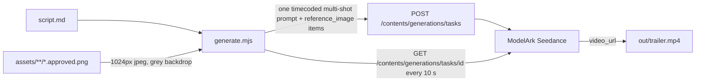

# Asset studio

`tools/asset-studio` is a local review tool for `assets/`. It is not a Render service. `render.yaml` does not mention it. The process listens on `127.0.0.1` and `PORT` or `4712`. When that address is already serving this studio, a later start logs the URL and waits for a signal. The first process keeps the port. When another program holds the port, this process prints the listen error and exits. It answers 403 to any request whose `Host` is not `127.0.0.1:<port>` or `localhost:<port>`, or that carries an `Origin` other than those two, so another website (or a DNS-rebound name) cannot delete folders, rewrite the catalog, or start paid generations through it. A JSON body over 1 MiB fails with 400.

Start it with `pnpm --filter asset-studio start` from a workspace install. Tests are `pnpm --filter asset-studio test`, which check prompt concatenation, saving one prompt level, the candidate png path for a parent folder and a leaf, descendant image paths under a parent, Codex image and text CLI arguments, create, rename, and remove path checks, a second start when the port is already taken, that image, prompt, and 3D jobs start together and report `queued`, `running`, `done`, and `failed`, that a Meshy job for a race folder such as `units/ashborn/warden` writes `<name>.glb` beside the task json or fails with Meshy's error and no glb, that the model path for `units/ashborn/warden` is the glb in that folder, that a random studio army of any race stays inside a battleground's budget and the 10-unit cap and fights through `simulate_json`, and that a Balance save of a Rootborn unit rewrites its `RootbornKind::` arm.

`ASSET_STUDIO_ASSETS`, when set to a directory, is the tree the studio reads and writes. Unset, that tree is the repo `assets/` folder.

## Tree

A leaf is a directory under `assets/` that contains `prompt.md` and no child directories. The prompt sent for a selected folder is every non-empty `prompt.md` from `assets/` down through that folder, parents first, joined by a blank line. The chain stops at the selected folder. A missing or blank `prompt.md` is omitted.

Leaves in the repo:

| path | role |
| --- | --- |
| `assets/units/ashborn/guard` | Guard |
| `assets/units/ashborn/skirmisher` | Skirmisher |
| `assets/units/ashborn/archer` | Archer |
| `assets/units/ashborn/vanguard` | Vanguard |
| `assets/units/ashborn/warden` | Warden |
| `assets/units/rootborn/thornling` | Thornling |
| `assets/units/rootborn/briarsling` | Briarsling |
| `assets/units/rootborn/elderoak` | Elderoak |
| `assets/units/deeplings/clawling` | Clawling |
| `assets/units/deeplings/eelsnare` | Eelsnare |
| `assets/units/deeplings/spineshot` | Spineshot |
| `assets/units/deeplings/tidecaller` | Tidecaller |
| `assets/board/tile` | board tile |
| `assets/board/marker` | board marker |
| `assets/board/rubble` | blocked tile |

`assets/prompt.md`, `assets/units/prompt.md`, and `assets/board/prompt.md` are inherited by the leaves under them. The game and the studio Battle board load `/assets/units/<race>/<kind>/<kind>.approved.glb`. The race folder is the catalog `slug`: race 0 is `ashborn`, race 1 is `rootborn`, and race 2 is `deeplings`. A missing file is a colored box. Ashborn's five units live under `units/ashborn/`, Rootborn's three under `units/rootborn/`, and the Deeplings' four under `units/deeplings/`. `units/prompt.md` names no race; each race folder's `prompt.md` describes its people, and `units/rootborn/prompt.md` allows a tree, bramble, or flower body so the Briarsling's rose and the Elderoak's oak share one race prompt.

The left panel is an indented tree of every directory under `assets/`. The root node is labeled world and edits `assets/prompt.md`. Child folders sit under their parent. A node with children has a disclosure triangle; collapsing it hides its descendants, sections start expanded, and that choice lasts until the page reloads. Selecting a name loads that folder's own `prompt.md` into the editor. The inherited prompt is shown beside it and is not editable. Image generation uses that same chain: parent prompts, then this folder's `prompt.md`.

Right-click a row to open a menu at the pointer. That click does not change the selection. A left-click elsewhere, or Escape, closes the menu. Regenerate image enqueues one image job for the clicked folder. Regenerate model enqueues one 3D job when that folder is a leaf, the same check Generate 3D uses before Meshy; a folder that is not a leaf is a failed queue row and Meshy is not called. Regenerate images in children enqueues an image job for every descendant folder, including folders under a collapsed branch, and not for the clicked folder. That item is disabled when the folder has no descendants. Regenerate models in children enqueues a 3D job for each descendant leaf that already has an approved png and no Meshy task in progress. Other descendants are skipped. If none can be modeled, one failed queue row says so. Image jobs use the current image provider. The menu requests return as soon as the jobs are queued, and those jobs run in parallel.

Save prompt sends `POST /api/prompt` with `{ path, prompt }` and writes only that folder's `prompt.md`. It does not rewrite parent or child prompts. An empty string is stored as an empty file. A missing `prompt.md` is created on save. A path that resolves outside `assets/` is rejected.

## Folders

The selected folder can be created, renamed, or removed from the page. The controls are a folder name field and the buttons New folder, Rename, and Remove. A name is one path segment: a lowercase slug of letters, digits, and hyphens. Empty names, `..`, slashes, and any other character are rejected. A name that already exists as a sibling is rejected.

New folder sends `POST /api/create` with `{ path, name }`. `path` is the selected folder, or `.` when world is selected. The new child directory is created there with an empty `prompt.md`. The tree reloads, the parent is expanded, and the new folder is selected. Rename sends `POST /api/rename` with `{ path, name }` and renames that directory on disk. Prompt files, png, glb, and meshy json inside it move with the directory. Nothing outside that subtree is rewritten. Remove sends `POST /api/remove` with `{ path }` only after Confirm remove, an inline button shown by the first Remove click. It deletes that folder and its descendants. The assets root cannot be renamed or removed. Symlinks are unlinked and are not followed, so a link that points outside `assets/` does not delete that target.

Every path is resolved under `assets/`. Traversal returns 400. After each operation the tree reloads. Create and rename select the folder that was just written. Remove selects the parent.

## Files

Generate image, approve image, and the image preview apply to every selected folder, including `assets/`, `assets/units`, and `assets/board`. The candidate png is written in that folder. The assets root is labeled world, so its files are `assets/world.png` and `assets/world.approved.png`. Every other folder uses its own directory name as `<name>`:

For a folder named `<name>`:

| file | meaning |
| --- | --- |
| `<name>.png` | candidate image |
| `<name>.approved.png` | approved image |
| `<name>.glb` | candidate model |
| `<name>.approved.glb` | approved model |
| `<name>.meshy.json` | Meshy task id and status |

Git ignores candidate png, glb, and `*.meshy.json`. Approved png and glb stay tracked.

Approval is a rename. The candidate is removed and the approved name replaces any previous approved file.

## Task queue

Generate image, Regenerate prompt, and Generate 3D each enqueue a job and return that job. The tree menu does the same for the clicked folder, and for every descendant when the action says children. The request does not wait for the CLI or for Meshy. The page lists the jobs and polls `GET /api/tasks`. It does not reload. Buttons stay usable, so a second click enqueues another job for the same folder and the same kind.

`GET /api/tasks` returns `{ tasks }` for this process. Each task has `id`, `node` (the folder path, `.` for the assets root), `kind` (`image`, `prompt`, or `3d`), `status`, and `error`. `status` is `queued` until that job starts, then `running`, then `done` or `failed`. A 3D job stays `running` through Meshy polling and the glb download. It is `done` only after `<name>.glb` is in that folder. A missing executable, a non-zero exit, or an image run that does not write the candidate png sets `failed` and stores the error text. Other jobs keep running. There is no single worker in front of the list: each job starts on its own and is its own child process.

Finished tasks stay in the list. Clear finished sends `POST /api/tasks/clear`, which removes `done` and `failed` tasks and leaves the rest. The list is in memory. Restarting the studio clears it. When a job for the selected folder reaches `done` or `failed`, the page reloads that folder's prompt and files.

## Image provider

`POST /api/generate` enqueues an image job for the selected folder and returns the task. The job writes the candidate png. The page has an Image provider control labeled Codex and Agent. Changing the control sends `POST /api/provider` and stores the choice in `tools/asset-studio/provider.json`, which is gitignored. That request does not generate an image. The next Generate click sends the selected provider on `POST /api/generate`. When that body includes `provider`, `ASSET_IMAGE_PROVIDER` is ignored. On load, if `provider.json` is absent, the control starts from `ASSET_IMAGE_PROVIDER`, or `codex`.

Codex is `ASSET_CODEX_BIN`, or `codex` on `PATH`. The studio writes the inherited prompt to a temp file, then runs:

```text
codex exec --json --color never --ephemeral --skip-git-repo-check --approve-for-me --cd <repo> --add-dir <temp> <instruction>
```

`codex exec` rejects `--sandbox` together with `--approve-for-me`. Help for `--approve-for-me` says it routes approvals through the workspace-write sandbox, so the studio keeps `--approve-for-me` and does not pass `--sandbox`. The instruction tells Codex to use the built-in `image_gen` tool once, read that temp file, ask for a square PNG with a transparent background, and copy it to `<folder>/<name>.png` in the selected folder. The temp directory is deleted when the process exits. The child environment does not include `OPENAI_API_KEY`. Codex CLI 0.147 has no `image` subcommand, and `codex exec --help` has no size or background flag. The built-in tool takes a prompt, not a pixel size or a background mode, so the studio asks for a square transparent PNG in the instruction. If the process exits without writing `<name>.png`, the studio copies `saved_path` from the JSONL events, or else the newest PNG written under `$CODEX_HOME/generated_images` during the run (`CODEX_HOME` empty means `~/.codex`).

`provider` `agent` runs `ASSET_AGENT_BIN` or `agent` with `-p` and a prompt that asks for that png and no other file. Any other provider value fails before a job is enqueued. If the selected executable is missing, that job is `failed` and the queue shows the error.

## Text provider

The page has a Text provider control labeled Codex and Agent, separate from Image provider. Changing it sends `POST /api/provider` with `{ textProvider }` and stores that field in the same `tools/asset-studio/provider.json`. The request does not generate text or an image. On load, if `textProvider` is absent, the control starts from `ASSET_TEXT_PROVIDER`, or `codex`. Image provider stays in the `provider` field and is unchanged by a text-provider update.

Regenerate prompt is shown for the selected folder, with an optional Direction field beside the button. It sends `POST /api/regenerate-prompt` with `{ path, textProvider, direction }` and returns the queued task. An empty direction is omitted. A non-empty direction is a hard constraint in that job's instruction and is shown on the queue row; it is not written into `prompt.md` by itself, and clearing the field means the next click does not reuse it. The button does not wait for the CLI. The job gives the model the parent prompts as read-only context and the current text of this level. The reply replaces this level only. When the job is `done`, the new text is in that folder's `prompt.md` and the editor reloads it. Parent and sibling `prompt.md` files are not rewritten. A missing executable or a non-zero exit marks that job `failed`, the queue shows the error, and the existing `prompt.md` is left in place.

Codex text is `ASSET_CODEX_BIN` or `codex`. It uses the signed-in session and does not receive `OPENAI_API_KEY`. The command does not pass `--sandbox` together with `--approve-for-me`, and it does not ask for an image:

```text
codex exec --color never --ephemeral --skip-git-repo-check --sandbox read-only --cd <repo> --output-last-message <file> <instruction>
```

`--sandbox read-only` is enough because the model only prints the replacement. `--output-last-message` is where the CLI writes that reply. The studio uses that file when it is non-empty, otherwise stdout. JSONL agent messages and a surrounding code fence are stripped so `prompt.md` is only the prompt.

Agent text is `ASSET_AGENT_BIN` or `agent`:

```text
agent -p --output-format text --mode ask <instruction>
```

`--mode ask` is read-only. `--print` and `--output-format text` are the non-interactive print path. Those flags are in `agent --help`.

## Meshy

`POST /api/generate-3d` enqueues a 3D job and returns the task. The job requires a leaf, `<name>.approved.png`, and `MESHY_API_KEY`. A folder that is not a leaf is rejected before a job is enqueued. The job stays `running` until `<name>.glb` is in that same folder, or until Meshy reports `FAILED`. It fails when the approved png is missing. It does not become `done` without the glb. When `<name>.meshy.json` has a task id, `<name>.glb` is not on disk, and the stored status is not `FAILED`, Generate 3D polls that task instead of creating another one. A `FAILED` task stores Meshy's error in the json, the queue row shows that error, and a later Generate 3D starts a new task. The tree menu's Regenerate model uses that same leaf check. When the folder is not a leaf, `POST /api/regenerate-model` records a failed queue row and does not call Meshy. `POST /api/regenerate-models` enqueues a 3D job only for descendant leaves that already have an approved png and no Meshy task in progress. If none do, it records one failed row on the clicked folder.

The call is `POST https://api.meshy.ai/openapi/v1/image-to-3d` with the approved png as a base64 `image_url`, `should_texture` true, `target_formats` `["glb"]`, and `ai_model` `latest`. The body does not include `lowpoly`. A leaf under `assets/units/` also sends `pose_mode: "a-pose"`. The studio polls `GET /openapi/v1/image-to-3d/{id}` every 4 seconds, up to 120 times. On `SUCCEEDED` it downloads `model_urls.glb` to `<folder>/<name>.glb`, next to `<name>.meshy.json`. On `FAILED` it writes Meshy's error into that json and marks the queue row failed. The model preview loads `GET /files/<folder>/<name>.approved.glb` when that file is in the folder, and otherwise `GET /files/<folder>/<name>.glb`, including before Approve model. `GET /files/` sends a glb as `model/gltf-binary`. The canvas camera looks at the mesh and frames it. On that Model canvas, left-drag orbits the framed mesh, the scroll wheel zooms toward and away from it within a clamped distance, and right-drag or middle-drag pans.

`POST /api/approve-image` and `POST /api/approve-model` perform the renames and wait for the rename. `GET /api/tree` describes the folder hierarchy. `GET /api/element?path=` describes one folder: its own prompt, the inherited prompt, the image and model flags, and `model`, the relative glb path or an empty string. `POST /api/generate` and `POST /api/approve-image` accept any folder under `assets/`. `POST /api/generate-descendants` enqueues an image job for every descendant folder and not the folder in `path`. `POST /api/generate-3d` and `POST /api/approve-model` still require a leaf. `GET /api/tasks` is the job list. `GET /files/...` serves a png or glb from `assets/`. `GET /assets/...` serves that same tree at the path the shared board uses, so `/assets/units/<race>/<kind>/<kind>.approved.glb` resolves on the studio origin. `GET /board-view.js` serves `app/src/board-view.js`. `GET /theme.css` serves `app/src/theme.css`, the design tokens and `hz-*` components of the studio page. The game no longer loads that file: it has its own stylesheet in the landing page's look (see [Client and dev mode](client.md#look)). The page loads its fonts (Grenze Gotisch, Alegreya SC, Alegreya Sans) from Google Fonts.

## Unit models

Each unit's `<kind>.approved.glb` is a rigged, animated, mobile-sized model, about 2 to 3.5 MB. The Meshy image-to-3D output it came from is kept beside it as `<kind>.source.glb` (2 to 3.5 million triangles, 64 to 107 MB; the Elderoak's is 242 MB). The Elderoak is the exception in size: its leafy canopy has so many texture seams that the simplifier stops near 96,000 triangles even after `gltf-transform weld` and a looser error, so its approved file is that mesh with `gltf-transform quantize` (`KHR_mesh_quantization`, which three.js reads without a decoder), 5.7 MB. `.gitignore` ignores every glb except `*.approved.glb`, so the sources stay local.

An approved unit file has one skinned mesh on a 24-bone humanoid skeleton (`Hips`, `Spine`, `LeftHand`, `RightHand`, …) under an `Armature` node scaled 0.01, with its origin at the feet. It carries seven clips named for the board: `idle`, `run`, `attack`, `cast`, `defend`, `hit`, and `death`. They come from Meshy's animation library:

| unit | idle | attack | cast | defend | hit | death |
| --- | --- | --- | --- | --- | --- | --- |
| Guard | Combat Stance | Thrust Slash | Shield Push Left | Block1 | Hit Reaction | Knock Down |
| Skirmisher | Combat Stance | Double Combo Attack | Double Blade Spin | Sword Parry | Hit Reaction | Dying Backwards |
| Archer | Idle | Archery Shot | Draw and Shoot from Back | Hit Reaction with Bow | Hit Reaction 1 | Shot and Fall Backward |
| Vanguard | Combat Stance | Charged Slash | Charged Ground Slam | Two-handed Parry | Hit Reaction | Knock Down |
| Warden | Idle | Right-hand Sword Slash | Angry Ground Stomp | Block2 | Hit Reaction to Waist | Fall Dead from Abdominal Injury |
| Thornling | Combat Stance | Reaping Swing | Axe Spin Attack | Block1 | Hit Reaction | Knock Down |
| Briarsling | Idle | Baseball Pitching | Crouch Charge and Throw | Block3 | Hit Reaction 1 | Dying Backwards |
| Elderoak | Idle | Heavy Hammer Swing | Charged Spell Cast | Block2 | Hit Reaction to Waist | Fall Dead from Abdominal Injury |
| Clawling | Combat Stance | Kung Fu Punch | Charged Axe Chop | Block1 | Hit Reaction | Knock Down |
| Eelsnare | Combat Stance | Left Slash | Crouch Pull and Throw | Sword Parry | Hit Reaction | Dying Backwards |
| Spineshot | Idle | Baseball Pitching | Crouch Charge and Throw | Block3 | Hit Reaction 1 | Shot and Fall Backward |
| Tidecaller | Idle | Mage Spell Cast | Charged Spell Cast | Block2 | Hit Reaction to Waist | Fall Dead from Abdominal Injury |

`run` is Run 2 for every unit.

`tools/unit-rig/` rebuilds those files. It is not part of the workspace: run `npm install` there, then work from `tools/unit-rig/work/`, which git ignores.

1. `../optimize.sh <race> <unit>` simplifies `<unit>.source.glb` to about 25,000 triangles and a 1024 px JPEG texture, writing `<unit>.light.glb`. Meshy's rigging rejects inputs above 300,000 faces.
2. Units holding a large shield are split first, because auto-rigging skins a shield to several bones and it stretches. `node ../split.mjs warden component 1` takes the separate shield piece. `node ../split.mjs guard "darkx>" 0.26` cuts by position and texture brightness, for a shield fused to the body, and moves small leftovers on that side to the shield. Each writes `<unit>.body.glb` and `<unit>.shield.glb`.
3. `node ../animate.mjs <unit>` (or `<unit>:body` for a split unit) sends the light or body model to `POST /openapi/v1/rigging` as a data URI with an estimated height, downloads the rigged glb, then requests the seven library actions in one `POST /openapi/v1/animations` call with `action_ids` and downloads the merged `animation_glb_url` as `<unit>.anim.glb` (or `<unit>-body.anim.glb`). Task ids are saved in `tools/unit-rig/tasks.json` after each step, so a rerun resumes and does not pay twice. Rigging costs 5 credits and each action 3. `node ../single.mjs <id> <action_id>` requests one more action on an existing rig.
4. `node ../assemble.mjs <unit>…` renames the clips in that order and, for a split unit, adds the shield back as a second primitive weighted 100% to `LeftHand`. The shield is first moved into the rig's space with the scale and offset that map the body's bounding box onto the rigged mesh (`fit.mjs`). It is then pre-rotated by the matrix in `grip.json`, so it stands upright at the hand on the first idle frame. `grip.html` computes that matrix with three.js from `<unit>-body.anim.glb`; serve `work/` over HTTP to open it. `REPLACE` in `assemble.mjs` swaps one clip for a separately requested one; the Warden's attack is replaced this way so its shield is not raised overhead. Results go to `work/final/<unit>.glb`, which is copied to `assets/units/<race>/<unit>/<unit>.approved.glb`.

## Terrain models

`assets/board/prompt.md` asks for one square block of ground seen from a three-quarter angle above, chunky with a flat top and straight edges, because image-to-3D needs the top and two side faces. `board/tile` is a cracked ash-grey flagstone floor block with an ember seam, and `board/rubble` is a blocked tile: fallen masonry, a snapped iron beam and charred timber on a flagstone base. Both went through the studio: Codex image, Approve image, Meshy image-to-3D. The raw Meshy model is kept as `<name>.source.glb` (tile 0.8 million triangles, 28 MB; rubble 2.4 million, 76 MB). The approved file is that model simplified with `gltf-transform simplify` and a JPEG texture: `tile.approved.glb` is about 5,000 triangles with a 512 px texture (0.34 MB), and `rubble.approved.glb` about 25,000 triangles with a 1024 px texture (1.5 MB). Texture seams stop the simplifier below that. `board/marker` has a prompt and no image or model; the board marks units with rings instead.

## Battle

Assets and Battle are the first control in the left side panel, as a pair of tabs. The choice is kept in `sessionStorage` for the browser session. Switching tabs does not cancel queued generation jobs.

With Assets selected, the side panel shows the image and text providers, the asset tree, folder name with New folder, Rename, and Remove, the prompt editor, Direction, Regenerate prompt, and the image and model actions. The main area shows the image preview, the model, the inherited prompt, and the generation queue.

With Battle selected, the side panel replaces those tools with the battleground, Generate army, the draft, side A, and side B, Fight, Speed, Step back, Step forward, Play, and Simulate many with its game list. The main area mounts `app/src/board-view.js`, the same board the game uses, and lists the step sentences beside it. Fight, Step back, Step forward, Play, Speed, and a batch replay drive that board. The sentences stay in the studio. Each row can change kind and behavior before Fight or Simulate many. A kind change copies that kind's catalog stats and cast, and is rejected when the roster would pass the battleground budget or 10 units. A behavior change copies that standard's body, including its stop byte. Editing side A or side B clears an in-progress Fight so the next Fight uses the edited roster. A stored batch row still replays the armies saved with that game.

Battle does not write `data/local-ledger.db` and does not use a wallet. Armies live in the page. A batch sends side A in the request body. Fights call `simulate_json` and `blocked_json` from `app/src/combat-node`, the same node build the local ledger uses. The studio does not reimplement movement, actions, stop-on-action, defense, zones, or seed obstacles.

The battlegrounds are Outpost (8×6, budget 8), Garrison (10×8, budget 16), and Citadel (12×10, budget 32). The Battle tab shows the selected race: Ashborn, Rootborn, or Deeplings. Battlegrounds, races, unit stats, and the ten standard behavior bodies are read from `content/catalog.json` at startup; the studio names a battleground by its catalog `slug`. A missing file is an error. Generate army builds a legal roster from that race's units (Guard, Skirmisher, Archer, Vanguard, and Warden for Ashborn; Thornling, Briarsling, and Elderoak for Rootborn; Clawling, Eelsnare, Spineshot, and Tidecaller for Deeplings), duplicates allowed, at most 10 units, cost at or under the budget, and distinct tiles in the owner's two-row zone. The draft names the race. Each unit uses one of the ten standards (March, Charge, Kite, Flank left, Flank right, and the cast variant of each). March and Kite stop if an action fires. Charge and both flanks continue. A cast variant keeps that movement and stop and uses Cast. Kite and Kite cast then flee. Each row has a kind menu, a behavior menu, and the zone-local tile. The operator keeps a roster as side A or side B.

Fight asks the server for one battle with a random 32-byte seed. The reply is the winner, the trace lines, one sentence per line, the blocked tiles, and the seed. The shared board places each unit with the game's zone mapping and then steps the trace: move, attack, cast, defend, death, and end. A round line and the end line do not move a mesh. Beside the board, every step is a sentence in order, including the final outcome, and playback highlights the current sentence. Each row shows an A or B badge in the board side colors and, when the trace has an actor, a unit badge; clicking a badge toggles a filter chip above the list, a row stays when every active filter matches its actor, round-end and outcome rows have no unit badge and hide while a unit filter is active, and clicking the row seeks that trace line and pauses. An action sentence names the acting unit and the target unit when there is one, by side and kind, so two Archers stay distinct. A move names the actor and the destination and says there is no target. A cast sentence names its effect: the push and its tiles, `2x movement`, `+2 attack range`, `taunted toward the caster` with its rounds, or the hp healed; a self cast says `itself`. An `X` line reads `Side A Archer 1: reach ends`, and it has a unit badge like any other actor line. Speed is 0.5×, 1×, 2×, or 4× and applies on the next interval. Pause freezes playback. Step back and Step forward move one line, update the board, and pause. Play pauses that playback. The outcome is A, B, or draw.

Simulate many keeps side A, and for each round generates a new opponent and seed on the server. The round count defaults to 20 and cannot exceed 200. The request returns immediately. The page polls `GET /api/battle/batch` and shows wins, losses, draws, how many rounds are done, and the games in that batch. Each row is the round index, the outcome from side A's point of view (win, loss, or draw), and the seed. The row also carries both armies, the trace, the sentences, and the blocked tiles. The list grows as rounds finish. Clicking a row replays that stored game on the board and shows its sentences. Event filters stay for that same replay and clear when a different batch game loads. Step back and Step forward work on that replay. It does not roll a new seed. Stop ends the batch between rounds.

## Balance

Balance is the third tab in the side panel, beside Assets and Battle. It is for tuning unit characteristics with many simulated games. It uses `tools/asset-studio/balance.js` and the same `simulate_json` node build as Battle; the studio does not reimplement any rule.

A Race picker above the battleground picks the race whose units the table shows; it starts on Ashborn. Changing it reloads that race's catalog stats with `GET /api/balance?race=<id>` and drops unsaved edits. Run and Save send the same `race` in their body, and a request without one tunes race 0. Both sides of an Armies run are that race.

The main area shows a table with one row per unit of the race: cost, hp, atk, range, speed, actions (attacks or casts per turn, each unit of both races 1), and the cast's effect and aim (named choices: none, push, sprint, reach, taunt, heal; chosen, foe, ally, self), power, rounds, cooldown, damage, range, and area. Each row also picks a trial behavior from the ten standards (Guard and Warden start on March, Skirmisher, Vanguard, and Thornling on Charge, Archer and Briarsling on Kite, Elderoak, Clawling, and Tidecaller on March cast, Eelsnare on Charge cast, Spineshot on Kite cast). Values are whole numbers within these bounds: cost 1–32, hp 1–255, atk 0–99, range 1–10, speed 0–10, actions 0–4, cast effect and aim from their lists, power 0–30, rounds 0–12, cooldown 0–12, cast damage 0–99, cast range 0–10, area 0–4. A value that differs from the catalog is outlined, and hovering it shows the catalog value. Warnings under the table name a unit with 0 action points (it never attacks, casts, or defends), with speed 0 (it never moves), with no damage at all, with a cast that changes nothing (no damage, and no power on an effect that needs it), or with a lasting effect of 0 rounds. Reset to catalog restores every value.

Run sends the table to `POST /api/balance/run` with a battleground, a test, and a game count. Each run draws one random base seed and plays every game twice on the same per-game seeds: once with the table's stats and once with the catalog's stats and the same trial behaviors. Results show the tuned numbers with the change from the catalog run under each.

- Duels: every unit against every unit, one on one, in the middle of each zone, from 1 to 500 games per pairing. Odd games swap sides and tiles. Each cell is how often the row unit beats the column unit; Overall is its rate against the other kinds, mirror matches left out.
- Armies: from 1 to 2000 games between two random budget-legal hosts, drawn from a seeded generator so both runs field the same draws when costs are unchanged. Per unit: how many are fielded per game, the win rate of games it was in, damage dealt and taken and hp healed per unit fielded, how often it survives, and damage dealt per cost point. The summary gives the draw rate and the rounds per game.

`GET /api/balance` returns the race id, the list of races, that race's catalog stats, the standard behavior names, the bounds, the effect and aim names, and the game limits.

Save to catalog asks for a confirmation, then sends the table to `POST /api/balance/save`. It rewrites each unit's line in `content/catalog.json`, leaving the rest of the file untouched, and the matching `cost`, `hp`, `atk`, `range`, `speed`, `actions`, and `cast` in that race's table (`ashborn_stats`, `rootborn_stats`, or `deeplings_stats`), found by its `<Race name>Kind::` arm (effect and aim written as `Effect` and `Aim` enum variants in Rust, with catalog `self` as `Aim::Caster`, and as their names in the catalog) in `crates/combat/src/catalog.rs`, so the test `catalog_file_matches_stats_and_the_ten_behaviors` keeps passing. It also updates the studio's in-memory catalog, so Battle and the next comparison use the new values without a restart. The game client reads `content/catalog.json` directly; the on-chain program uses the Rust table only after it is rebuilt and deployed. Trial behaviors are not saved.

## Landing site

`landing/` is the Render static site `horizon-zero-landing`. It is not the game and it does not bundle approved files; it ships only the trailer from `landing/public/trailer/`. It loads `world.png`, each unit's `<name>.approved.png`, and the board tile and rubble pngs from the `horizon-zero` web service, and bundles `content/catalog.json` for its numbers. See [Indexer and Render](indexer.md).

The reel under the hero is `trailer.mp4` with `first.jpg` as its poster and `trailer.vtt` as English captions, shown by default (the narrator lines of `tools/trailer/script.md` at their shot timecodes). It plays once, muted, when at least half of it is on screen and the tab is visible, pauses while it is scrolled away, and stops on its last frame. The file starts loading 600 px before the reel arrives, except with reduced motion or Save-Data, where nothing loads until the viewer presses play. Two buttons sit in its corner. Pause holds the reel until Play, wherever the page scrolls; it shows only while the reel runs. The other reads Sound, a toggle (`aria-pressed`) that turns the narrator on and off and, before the reel has started, starts it with sound; Play, with reduced motion, before anything plays; and Again once it has ended. "The front"'s pulse line is not a live region, so its ticking "updated" time is not announced.

"The front" is the live section, linked from the header. Once it comes within 400 px of the viewport it reads `<VITE_WEB_ORIGIN>/api/stats`, then again every 30 seconds while the tab is visible and whenever the tab becomes visible, never with two requests out at once. It shows battles fought (counted up from the last value unless motion is reduced), battles settled in the last day, SOL staked, commanders, armies locked and waiting, and the share of draws, then one row per catalog battleground with its stake, a bar of its battles relative to the busiest, its battles fought, and how many armies wait there. The header reads "Live · updated …" with a pulsing ember diamond. If the first request fails the section says the front is quiet and the header reads "No signal"; a later failure keeps the last numbers.

`/api/stats` is the indexer's `GET /stats` in production, through `app/server.js`'s `/api` proxy. In dev, the game's Vite server proxies `/api` to the indexer (`INDEXER_URL`, default `http://127.0.0.1:4714`) like the production server, and when the game runs without a chain (`VITE_DEV_MODE=true`, so `pnpm dev:all`) it sends `/api/stats` to the local ledger's `GET /api/local/stats`, which returns the same shape from the dev ledger file. The ledger stores a `resolved_at` time on each match for the last-day count; matches stored before that column existed do not count toward it.

## Trailer

`tools/trailer` makes a 30-second trailer from the approved art as one Seedance clip on the ModelArk (Ark) API. Nothing is stitched: the whole trailer is a single generation request. `tools/trailer/script.md` is the only input. Its front matter holds the model, `ratio`, `resolution`, `generate_audio`, `watermark`, the clip-wide `style` and `narrator` text, and `image1` to `imageN`, each a folder under `assets/`. Each `## N. Title` section is one shot with a `duration`, an optional `voiceover`, and a `prompt` block that names references as `@ImageN`.

```sh
pnpm trailer --dry-run   # print the request, send nothing
pnpm trailer             # generate tools/trailer/out/trailer.mp4
pnpm trailer --force     # generate a new take of an unchanged script
```

It needs `ARK_API_KEY`, and `ffmpeg` on `PATH` for the reference images. `ARK_BASE_URL` defaults to the BytePlus `ap-southeast` endpoint; `ARK_VIDEO_MODEL` or `--model` overrides the script's model. The model must accept the summed shot durations in one clip and the number of reference images; the script uses Seedance 2.5, and Seedance 2.0 stops at 15 seconds. The Ark account must have that model activated in the Ark Console, or the create call fails with `ModelNotOpen`.



The generator writes each shot as a `[start-end]` timecoded paragraph of one prompt, with the shot's voice-over quoted at the end, then appends `style` and one narrator line for the whole clip. The total of the shot durations is the request `duration`. Reference image N is sent as the Nth `reference_image` content item. The script has seven shots summing to 30 seconds and 14 reference images: the twelve units of the three races and the board tile and rubble. The shots introduce each people in turn (the Ashborn rising from ash, the Rootborn grove walking, the Deeplings climbing out of a drowned harbor), then a Deeplings and Rootborn deployment, a fight and a cast exchange that mix the races, and a closing shot with one survivor of each people. Third-party write-ups of Seedance 2.5 give 30 reference images as its limit; ModelArk's own reference did not state one when this was written. `tools/trailer/out/state.json` records the task id and a hash of the request. A rerun keeps the finished video while the request is unchanged, resumes polling an unfinished task instead of paying for a new one, and creates a new task when the script or a reference image changed. `tools/trailer/out/` is gitignored. The landing page plays a compressed copy, not that file. After a new take, refresh it from the repo root:

```sh
ffmpeg -i tools/trailer/out/trailer.mp4 -c:v libx264 -preset slow -crf 26 -pix_fmt yuv420p -vf scale=1280:-2 -c:a aac -b:a 128k -movflags +faststart landing/public/trailer/trailer.mp4
ffmpeg -ss 0.4 -i tools/trailer/out/trailer.mp4 -frames:v 1 -vf scale=1280:-2 -q:v 4 landing/public/trailer/first.jpg
```
