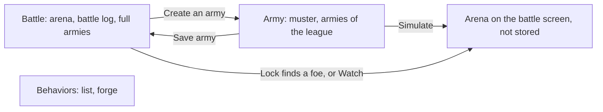

# Client and dev mode

The app is a Vite React page. `app/src/main.tsx` branches on `import.meta.env.VITE_DEV_MODE === "true"`. Vite reads that variable from the repo-root `.env` and does not override a value already set in the process. `pnpm dev:all` sets `VITE_DEV_MODE=true` on the game process. `pnpm dev` and `pnpm --filter app dev` follow `.env` unless the variable is already set. Both start Vite and the local ledger.

In that mode the root renders `DevApp` only. Wallet adapters, `ConnectionProvider`, and `WalletProvider` are loaded only on the Solana branch, so this page does not load Phantom or Solflare and it never constructs a `Connection`. A "Dev" tag in the header says no Solana node is connected. The header shows the local player's short label. There is no wallet prompt. `installDevSimulate` loads `simulate_json` from `app/src/combat-wasm` before the first render so the page can replay a stored battle. Account reads and writes go to the local ledger over `/api/local`.

Any other value, including unset, uses the Solana shell. The endpoint and the VRF queue come from `app/src/network.ts`: `VITE_RPC_URL` and `VITE_ORACLE_QUEUE` when set; otherwise, under `vite dev`, the local stack at `http://127.0.0.1:8899` and its test queue `GKE6d7iv8kCBrsxr78W3xVdjGLLLJnxsGiuzrsZCGEvb`, and in a production build devnet and the default queue. `pnpm dev:chain` runs the game this way against `pnpm localnet`; see [Networks and deployment](deployment.md). Wallets are Phantom and Solflare. Chain reads and writes go through `createSolanaChain`. The ledger process still listens, and the Solana page does not call it.

## ChainAdapter

`app/src/devChain.ts` defines the surface both backends implement:

| method | role |
| --- | --- |
| `owner` | current player |
| `behaviors` | every behavior the backend knows |
| `battlegrounds` | battlegrounds with queue, grid, and `matchSeq` |
| `armies(owner)` | that owner's armies |
| `createBehavior(elements)` | create the PDA from a sequence of elements |
| `createArmy(battlegroundId, units, race)` | create an army of that race; each unit has `kind`, `behavior`, `col`, `row` |
| `lock(army)` | queue, or open a match |
| `unlock(army)` | leave the queue |
| `closeArmy(army)` | delete an Idle army |
| `pot(battlegroundId)` | the current player's pot there, `{ budget, winnings, segregate }` in lamport strings, or `null` before it is first funded |
| `fundPot(battlegroundId, lamports)` | add to the battle budget |
| `withdrawPot(battlegroundId, lamports)` | take from the winnings first, then the budget |
| `setSegregation(battlegroundId, segregate)` | set winnings aside, or stake them again |
| `matches(owner)` | that owner's latest battles, newest first |
| `match(pubkey)` | one battle record |

`lock` returns the opened match, or `null` when the army only queued.

## Walkthrough

The first time the page is connected on a browser (a wallet connects on the Solana shell, or at once in dev mode), `App` opens a walkthrough from `app/src/Walkthrough.tsx`. It has six steps: a welcome, then the behaviors screen with the "Forge a new behavior" button, the muster, the Simulate button, the battle screen's armies, and the battle log. Each step switches to its screen, scrolls its element into view, and rings it in ember while the rest of the page is dimmed. The card sits on the half of the screen away from that element. Next, Back, and the arrow keys move between steps. Skip, Escape, or "Start playing" on the last step close it and store `hz-walkthrough-done` in `localStorage`, so it does not open again on that browser. The flag is per browser, not per wallet. When storage is unavailable the walkthrough opens on every visit. The Guide button in the header reopens it at any time. In dev mode the lock step says that dev mode has a single player, so a locked army waits in the queue, and points at Simulate; on the Solana shell it says the battle opens when a foe locks on the same battleground.

## Screens

Screens are battle, army, and behaviors, in that order, and the page opens on battle.

### Battle

When a fight is open, the arena sits at the top of the battle screen: the board, playback, the result, both hosts' health, and the chronicle (see [Replay and board](#replay-and-board)). Leave the field closes it. A fight opens from Lock when a match comes back, from Watch in the battle log, or from Simulate on the army screen.

The battle log lists `matches(owner)` in a list of fixed height that scrolls. Each row shows the outcome from the player's side (Victory, Defeat, Draw, or "Awaiting the seed" while the battle is not resolved), the battleground named from its grid, the 2D art of both hosts, and Watch, which replays that match. Watch is disabled while the seed is pending.

Under the log, a battleground picker (Outpost, Garrison, Citadel, each with stake, budget, and grid, and the number of ready armies) selects the league. The battleground picked here is the one the army screen shows. Both pickers, this one and the muster's, also show how many armies are locked in each battleground and waiting for a foe, from every player, for example "2 armies locked": the length of the battleground's queue from `ChainAdapter.battlegrounds()` (the indexer on chain, the local ledger in dev mode). A battleground with waiting armies shows the count in ember with a filled diamond; zero shows in grey. The counts load with the rest of the page and refresh every 15 seconds while the tab is visible. Your own queued armies count too, though locking never matches you with them. Only full armies of that battleground are listed: an army is full when its catalog cost has reached the budget, or no unit of its race still fits in what is left, or it has 10 units (`isFull` in `app/src/armyRules.ts`). The program only checks the budget ceiling, so armies saved before this rule may not be full; the battle screen hides them and says how many wait on the army screen. Each card shows the race, the index, the status, the unit art, and the cost against the budget. Lock (with the stake) is offered on an Idle army and Unlock on a Queued one. Lock is disabled while the battle budget is under one stake. Delete asks to confirm, then sends `closeArmy`; it is disabled unless the army is Idle. Create an army opens the army screen.

After Save, a notice confirms the host is mustered. Lock on an Idle army opens the arena when a match comes back. When it only queues, a notice says the host waits at the gate of that battleground. The arena uses that battleground's `cols` and `rows`, draws blocked tiles from `blocked_json` on the match seed, and places each unit on its deployed tile. One mesh is created per unit. A missing approved GLB stays a colored box. The chronicle and the meshes show moves, attacks, casts, defense, and deaths.

### Army

The army screen opens on the muster, for the battleground selected on either screen. A meter shows catalog cost against the budget, one segment per budget point. Race and Behavior are custom dropdowns (`Select` in `app/src/ui.tsx`, a listbox with arrow keys, Home, End, Enter, and Escape), not native selects. Each behavior option shows its name and its icon strip in a compact size, the same strip as the behavior cards. The Race dropdown lists every catalog race: Ashborn (race 0), Rootborn (race 1), and Deeplings (race 2). The soldier tray holds one button per catalog unit with its approved 2D art (`/assets/units/<race>/<kind>/<kind>.approved.png`, a colour swatch when the file is missing), its cost, hp, atk, range, and speed; a button whose cost would exceed the budget is disabled.

The owner's starting zone is `cols` by 2. Row 0 is the back row and is drawn on top. A click on an empty tile places the selected soldier with the selected behavior. A click on a placed soldier selects it: the soldier tray and the behavior dropdown then show that soldier, picking another soldier type or behavior changes it (a type that would exceed the budget is refused), a click on an empty tile moves it, and a panel offers Remove and Done. A click on the selected soldier deselects it. A placed soldier can also be dragged with a mouse, pen, or finger: past 6 pixels of travel the press becomes a drag, a copy of the soldier follows the pointer, its own tile dims, and the tile under the pointer lights up. Dropping on an empty tile moves the soldier there; dropping on another soldier swaps their tiles; dropping outside the zone leaves the draft unchanged. A drop never also selects or places. Placed tiles set `touch-action: none` so a touch drag does not scroll the page. The drag uses pointer events with pointer capture, not HTML drag and drop, which touch screens lack. The draft holds at most 10 units. One draft is kept per battleground and race, for the session: switching race keeps the army being built and shows the other race's draft, empty at first.

Save army is enabled only when the draft is full. Under the zone, a line says how much budget is left and what the cheapest soldier costs. Simulate against a random army plays the draft, on side A, against an army that `randomArmy` builds for the same battleground: a random race, random units until nothing more fits or 6 stand, each on a random standard behavior and a random distinct tile, and a random seed. It runs through `simulateTrial` and opens in the arena marked as a simulation; nothing is staked or stored. Back to the muster returns to the army screen.

Below the muster, every army of the selected battleground is listed, full or not, with Copy to the muster, which loads its units into the draft (saving makes a new army), and Delete.

### Behaviors

The behavior screen opens on the list of every known behavior. Each card shows the name, one icon strip per element, and, below it, the plain sentence for each element. A strip holds one group for the move, or a lone Stay icon, then one group per action. A group is the move or action icon followed by its target: Lowest or Highest, then Distance, HP, or ATK, then Enemy or Ally. The move or action icon and the side icon are red for an enemy target and green for an ally target. A row of skill filters above the list holds Stay, Approach, Flee, Flank left, Flank right, Attack, and Cast. Selected filters combine with AND: a behavior is shown only when its elements use every selected skill. A button at the top of the list opens the new-behavior page; All behaviors returns to the list, and a successful Create returns to it with a notice. The new-behavior page (`app/src/BehaviorEditor.tsx`) edits a sequence of up to 4 elements, starting from a standard picked from a row of presets. Every choice is a radio group drawn as icon buttons, not a dropdown. Move is Stay, Approach, Flee, Flank left, or Flank right; Stay means no movement. A move then picks its target with three short groups, Lowest or Highest, then Distance, HP, or ATK, then Enemy or Ally, and a switch for "Stop once an action lands". Each element holds up to 3 actions, each Attack or Cast with the same three target groups. Under a Cast, a note says that each soldier's cast knows whom it lands on (a foe, an ally, or itself), that the target groups only pick among those, and that a cast never wastes itself on a unit it would not change. A new movement or action starts on Lowest, Distance, Enemy. Each element shows a plain sentence for what it does, for example "Approach the nearest enemy, halting once an action lands, then attack the nearest enemy." Create sends the encoded body. A failed Create, such as a body that already exists, stays on the page with the error. Every behavior label in the game, on chain and in dev mode, comes from `nameBehavior` in `content/interpret.mjs` and is at most `MAX_BEHAVIOR_NAME_LEN` (32) characters. A body that matches a standard gets the standard's name. Any other body gets a short summary, one phrase per element joined with " · ": the move, then its actions' verbs. A target is named only when it is not the nearest enemy, and only once when the move and the actions share it. The stop switch is left out of the name, and an empty element reads "Wait". For example, "Approach, attack · Wait" or "Flank right, attack weakest foe". A longer summary, or a stored name over the limit, is cut at a word and ends in "…". The card title's tooltip and the plain sentences under it give the full reading.

Simulate, above Create, opens a trial sheet. It runs the draft through `simulate_json` (`simulateTrial` in `app/src/replay.ts`) on an 8×6 board: one unit, picked from every race's units (Ashborn's five, Rootborn's three, then the Deeplings' four; the Ashborn Skirmisher first), at zone-local `(3, 0)` on side A follows the draft (the sheet states that unit's cast in one line, for example "Skirmisher cast. Doubles its movement for 1 round."), and an Ashborn Warden training dummy, whatever the soldier's race, at `(4, 0)` on side B has the body for one element with no movement and no actions. The engine still has a unit defend when it has an action point left, so the dummy may defend, but it never moves or acts. The first field is a seed whose blocked tiles avoid columns 3 and 4, found by trying up to 24 random seeds; New field draws any random seed, so obstacles can appear. The sheet shows the same board, playback, speed, and sound as the battle screen, both health bars, a chronicle that names the foe "the training dummy", and, when the trace ends, a line with the damage dealt and the rounds taken, or a hint that no blow landed. Escape, Close, or a tap on the backdrop closes it.

## Local ledger

`app/local-ledger.mjs` is the dev-mode backend, started next to Vite by `scripts/dev-app.mjs`. It uses `node:sqlite`. `scripts/load-root-env.mjs` loads the repo-root `.env` and keeps any variable already set in the process. The SQLite file is `LOCAL_LEDGER_PATH`, or `data/local-ledger.db` under the repo root when that variable is unset. Relative paths resolve from the repo root. The file is gitignored. It is a different database from the Carbon indexer's `DATABASE_PATH`, and the process refuses to open that path or `/var/data/horizon.db`.

The process listens on `127.0.0.1` and `LOCAL_LEDGER_PORT`, or port `4713`. Vite stays on `4710` and proxies `/api/local` to the ledger. That port stays off the indexer (`4714`) and the asset studio (`4712`). The browser talks only to the Vite origin. Refreshing the page, restarting Vite, and restarting the ledger all keep the same file.

The first open stores one local user and one practice opponent. Each has its own id. The user id is not a wallet pubkey. The page shows that user's short label, `local` plus four hex characters. Practice armies are rows in the same file, owned by the practice id, so they are not listed as the user's armies.

On that first open the ledger reads `content/catalog.json`. A missing file stops startup. It inserts the three catalog battlegrounds when their ids are missing, and the standard behaviors from that file when their hashes are missing. There is no second copy of those behaviors in the client. A later open replaces a stored row whose name is one of those standards when its hash differs, and deletes a row named Volley. A unit whose behavior id is gone is pointed at March when that id was Volley or a walk body, and at the replacement of the same name when the old body was a standard such as Charge. An Idle army that is no longer full under the current catalog (over budget, a kind that is gone, or budget left that a soldier would fit) is deleted on open, since it can never be locked; armies saved before armies had to be full are dropped this way. Every other army's stored unit stats (cost, hp, atk, range, speed, actions, cast) are rewritten from the catalog on open. A stored match body that is one of the old standard byte strings is rewritten the same way. Behaviors are keyed by the same hash the behavior PDA uses. Names are only for the UI. A new behavior is stored under its `nameBehavior` name, and each open renames any stored non-standard row whose body still encodes to that name, which shortens rows stored under the old full description. New armies are Idle Ashborn and use the next index. Unit stats in dev mode come from the same file. The program still checks stats with `stats_for`, which stays a `match`.

The standards in the file all target enemies. They are:

| name | body |
| --- | --- |
| March | approach lowest distance, attack lowest distance, stop if an action fires |
| Charge | the same approach and attack, continue after an action |
| Kite | March's element, then flee lowest distance with no action |
| Flank left | flank left lowest distance, attack highest ATK, continue |
| Flank right | flank right lowest distance, attack highest ATK, continue |
| March cast | March, casting first and attacking when the cast would change nothing |
| Charge cast | Charge, casting first, then attacking |
| Kite cast | Kite, casting first, then attacking, on the first element; the second element still flees |
| Flank left cast | Flank left, casting first, then attacking |
| Flank right cast | Flank right, casting first, then attacking |

Every standard attacks or casts. A cast variant's element lists the cast and then an attack with the same target rule; with one action point the cast fires when it would change something (see [Casts](battle.md#casts)) and the attack fires otherwise, so a Skirmisher whose sprint is still running, or a Warden with nobody hurt, still strikes.

Every movement spends the whole movement pool. There is no walk mode. March, Kite, and their cast variants use `stop` `1`. Charge, both flanks, and their cast variants use `stop` `0`.

`createBehavior` rejects a duplicate hash, including a second create of one of those standards. `createArmy` rejects an empty roster, more than 10 units, a position outside the owner's zone, a repeated tile, an unknown behavior, and a cost above the battleground budget. Dev mode does not open a Solana socket.

The ledger keeps one pot per local player and battleground, as the program does. `lock` fails with "Pot budget does not cover the battleground stake" while the player's pot holds less than one stake. Opponents are queued armies of other players whose pot still covers a stake. `lock` on an empty opponent list sets Queued and moves nothing. Otherwise it picks `crypto.getRandomValues` modulo the opponent count, draws a fresh 32-byte seed, and resolves through `simulate_json` in `app/src/combat-node`. The match row stores the seed, the outcome, the unit snapshots, and the trace. Both pots lose one stake and take the payout at once, into the budget or, with segregation on, the winnings. Both armies return to Idle, the opponent leaves the queue, and the match is stored already Resolved. This path does not read a slot hash and does not call the VRF program. The page replays that seed with `app/src/combat-wasm`.

`unlock` on a Queued army returns it to Idle. An Idle army is not queued, so unlock is rejected. An army still marked Fighting is rejected with "A matched army cannot unlock".

`DELETE /armies/:pubkey` is `close_army`: only the local user's own army, only while Idle. A missing army is a 404. The row is deleted; matches keep their snapshots.

`GET /matches?player=` returns the 20 latest matches where that id is player A or B, newest first. A match key is `match-<battleground id>-<seq>`, because `seq` counts per battleground.

`POST /practice` queues a Guard with March at zone-local `(0, 0)`, owned by the practice id, and tops the practice pot up to one stake, so the local user has someone to match. The page no longer calls it; the ledger test does. The adapters have no practice method.

The ledger and the Vite proxy both use the `/api/local` prefix. A failed call returns JSON `{ error }` and status 400.

| method | path | result |
| --- | --- | --- |
| `GET` | `/api/local/owner` | `{ owner, label }` for the stored local user |
| `GET` | `/api/local/behaviors` | every behavior |
| `POST` | `/api/local/behaviors` | body `{ elements }` |
| `GET` | `/api/local/battlegrounds` | catalog rows with queue and `matchSeq` |
| `GET` | `/api/local/armies?owner=` | that owner's armies |
| `POST` | `/api/local/armies` | body `{ battlegroundId, units }` |
| `POST` | `/api/local/armies/:pubkey/lock` | the opened match, or `null` when the army only queued |
| `POST` | `/api/local/armies/:pubkey/unlock` | empty object |
| `POST` | `/api/local/practice` | body `{ battlegroundId }` |
| `GET` | `/api/local/pots/:battlegroundId` | the local user's pot, or `null` |
| `POST` | `/api/local/pots/:battlegroundId/fund` | body `{ lamports }` (decimal string); the pot |
| `POST` | `/api/local/pots/:battlegroundId/withdraw` | body `{ lamports }`; the pot |
| `POST` | `/api/local/pots/:battlegroundId/segregation` | body `{ segregate }`; the pot |
| `DELETE` | `/api/local/armies/:pubkey` | empty object |
| `GET` | `/api/local/matches?player=` | that player's latest 20 battles |
| `GET` | `/api/local/matches/:pubkey` | one battle, or `null` |

## Solana chain

Reads are `fetch("/api...")`. The static server proxies that prefix to the indexer. See [Indexer and Render](indexer.md).

Writes are legacy transactions, confirmed at `confirmed`:

- `create_behavior` uses `behaviorPda(canonical body)`
- `create_army` uses the next index above any army the indexer already lists for this wallet, the selected race byte, and the behavior accounts as remaining accounts
- `lock_army` passes the player's pot, loads each queued army from `/army/:pubkey`, skips those owned by the player, and passes the rest, then each of their owners' pots once, then the battle's crank vault `crankFundPda(battle)` when there is at least one. It also passes the behavior accounts, the oracle queue, and a compute budget of `1_400_000`
- `unlock_army` uses the battleground id and the army
- `fund_pot`, `withdraw_pot` and `set_segregation` use `potPda(battleground, wallet)`
- `close_army` passes the owner and the army

After `lock_army` confirms, the client reads `/matches` and returns the first row whose `armyA` or `armyB` is this army. If the indexer has not stored the battle yet, the call returns `null` even though the match is open.

`pot(battlegroundId)` reads the pot account from the RPC and decodes it with `decodePot`; the indexer does not store pots. `armies(owner)` reads `/armies?owner=` from the indexer and then drops every row whose account `getMultipleAccountsInfo` no longer finds, so a closed army disappears at once even before the indexer prunes it. `matches(owner)` reads `/matches` and keeps the first 20 rows where the owner is player A or B.

## Replay and board

`replay` in `app/src/replay.ts` feeds `cols`, `rows`, the match snapshots (including the canonical `body`, zone-local `col` and `row`, and the stored stats and cast), and the hex seed to `simulate_json` and returns the trace lines. The board scene lives in `app/src/board-view.js`. `app/src/board.tsx` asks `blocked_json` for the rubble and mounts that module. The asset studio Battle tab mounts the same module, so the game and the studio share one scene, one unit-mesh loader, and one trace stepper. Side A is placed at `(col, row)` and side B at `(col, rows - 1 - row)`. Each unit model is scaled to 0.95 tile tall from its bounding box and lifted so its lowest point sits on the tile top, which suits both centred meshes and rigs whose origin is at the feet. Unit materials use a lighter three-band toon ramp than the tiles and a warm emissive base (`#3b2a1c`) so figures read against the dark stone, which a hit flash returns to; they get a 0.012-unit ink hull; a skinned mesh gets a skinned hull bound to the same skeleton, so the outline bends with it. Side A faces +Z and side B is turned around, so the two hosts face each other. A unit turns toward the tile it moves to and toward the target it strikes. Clips are found by name: `idle` or a name with stance, `run`, `attack`, `cast`, `defend` or one with block or parry, `hit` or hurt, and `death` or one with dead, dying, or die. A rigged unit plays its idle loop at natural speed whenever it rests, starting at a random point so units do not breathe in step. Clips cross-fade over 0.12 s.

A step lasts 320 ms for `M`, 700 ms for `A`, 760 ms for `C`, 420 ms for `F`, 760 ms for `D`, 360 ms for `X`, and 200 ms for other lines, times 1.45, 1, or 0.55 at speed 1, 2, or 3. `setStepMs` overrides that with one fixed duration. A run clip plays about two cycles per step. A one-shot clip plays at most 3× its natural speed; when it is longer than that allows, its middle stretch plays. While a step plays, a move plays Run (or, without that clip, a bob and a short stride), an attack plays Attack (or lunges toward the target and back), a cast plays Cast (or rises and stretches), each unit that takes damage then plays Hit (or flinches with a knock-back tilt), `F` plays Defend, and `D` plays Death (or sinks). The unit returns to idle when the step ends, a cast still moves a pushed unit to its new tile, defend still scales the defender, death still hides the mesh at the end of its step, and seeking snaps to those resting positions. `data-unit-clips` on the board element lists each fighter's current clip as `side:index:clip`. A cast line with `rounds` above 0 puts a thin aura ring outside the unit's side ring, gold for sprint, sky blue for reach, red for taunt; its `X` line, the unit's death, or a seek back removes it, and the remaining rings close up. `data-unit-statuses` lists the units with a status as `side:index:effect,effect`, with effect names (`sprint`, `reach`, `taunt`). A round line `R` and the end line do not move a mesh. `E draw limit` is a draw because the 12-round cap was reached. Play, pause, and speed on the battle screen call that stepper. Step back seeks by replaying the same lines from deployment.

Each unit loads `/assets/units/<race>/<kind>/<kind>.approved.glb`. `<race>` is the catalog slug (`ashborn` for race 0, `rootborn` for race 1, `deeplings` for race 2), and `<kind>` is the lowercased unit name. A 404 becomes a colored box. The floor loads `/assets/board/tile/tile.approved.glb` and blocked tiles load `/assets/board/rubble/rubble.approved.glb`. Each is baked to one grid square, 0.96 wide with its origin at the bottom centre. Every floor tile that is not blocked is one instance of a single `InstancedMesh`, so the whole floor is one draw call (plus one for its ink hull). The top face sits at y 0.04, where units stand. Each tile turns by a quarter turn picked from a hash of its column and row, so the cracks do not repeat. Each blocked tile gets a rubble piece standing on the same ground, also turned by that hash. Until those files load, and if either is missing, the board draws plain boxes in their place. `data-terrain` on the board element reads `tile:<state> rubble:<state>` with `loading`, `glb`, `box`, or `none`.

The board is drawn cel-shaded. Tiles and units use `MeshToonMaterial` with a three-step light ramp, and both get an inverted-hull ink outline (the fallback boxes get ink edge lines). The tile tint multiplies its stone texture: the player's zone rows are ember, the opponent's cold steel, and the rows between a light and dark checker. Each unit stands on a ring: ember for the player's side and cold steel for the opponent's, as on the landing page. The player's side is the one whose army they locked (`armyA` is side 0). The canvas height is 80% of its width, clamped to 280–520px.

When a step lands, the board shows feedback in an overlay above the canvas. Each `A` line, and each `C` line that dealt damage, pops the damage over the victim (gold when the victim is the opponent's, red when it is the player's) and the victim flashes white for 140 ms. A `C` line that dealt none pops its effect instead: `+N` in green for a heal, `Sprint` or `+N reach` in sky blue, `Taunted` in gold, `Pushed` for a push that moved, and `0` otherwise, as for an attack that did not get through. `X` pops `Sprint fades`, `Reach fades`, or `Taunt fades` over the unit. Every fighter has its own copy of its materials so the flash stays on that unit. `F` pops `Defend`. A hit of 3 or more and every `D` shake the camera briefly; the shake is skipped when the system asks for reduced motion. The popups and the shake run on the board's frame clock, so they pause with playback. `createBoardView` takes an optional `onImpact` callback that receives `{kind, damage, mine, line}` for `hit`, `cast`, `miss`, `defend`, and `death`. The game plays a synthesized sound for each (`app/src/sfx.ts`, Web Audio, no files) and a short cue for victory, defeat, or draw. A Sound on/off toggle on the battle screen is kept in `localStorage` under `hz-sound`. The asset studio passes no callback and plays no sound.

The battle screen has Play, Pause, and Resume, a 1×, 2×, 3× speed group, and Skip to the end, which seeks to the last line. The chronicle names each line in words from the player's side, for example `Your Vanguard strikes the foe's Skirmisher · 12 (2 HP left)`. A cast reads by its effect: `Your Guard shoves the foe's Vanguard · 9 (13 HP left) · pushed to 3,5`, `Your Skirmisher sprints · 2× movement this round`, `Your Archer lengthens its reach · +2 range for 3 rounds`, `Your Vanguard taunts the foe's Archer · it must close in for 2 rounds`, `Your Warden heals your Guard · +5 (14 HP)`. `X` reads `Your Archer: longer reach fades`. It marks `R` as `End of round N`, and keeps the line just played in view inside the list.

The board reports how many trace lines it has played. The battle screen uses that count to show one health bar per fighter: it starts from the snapshot `hp`, takes the target hp from `A` and `C` lines, and sets 0 on `D`. When every line has played, playback stops and a result panel reads Victory, Defeat, or Draw from the match `outcome` seen from the player's side, in ember, cold steel, or bone. It lists the player's units still standing with their hp and the stake; after a simulation it offers Back to the muster instead of the stake. Watch again in the controls seeks to 0 and plays.

## Look

The game wears the landing page's look: ash-black ground with an ember glow at the top, bone text, ember for action and for the player's side, cold steel for the foe, thin lines instead of outlines, Grenze Gotisch for headings and Alegreya Sans for text (Google Fonts in `app/index.html`). Primary buttons are slanted ember plates as on the landing page. `app/src/styles.css` holds every token and component, keeping the `hz-*` class names. The game no longer loads `app/src/theme.css`; the asset studio still does. On phones the screen tabs are a bar fixed to the bottom of the viewport. From 800px they sit in the header.

Unit `color` values come from each unit's `color` in `content/catalog.json` (`#rrggbb`) and are the design system's unit swatches; `app/src/codec.ts`, the board, and the studio all read them there, and the studio's Save keeps them. They tint the 3D fallback box, the 2D art's fallback swatch, filled zone tiles, and the survivor chips.
