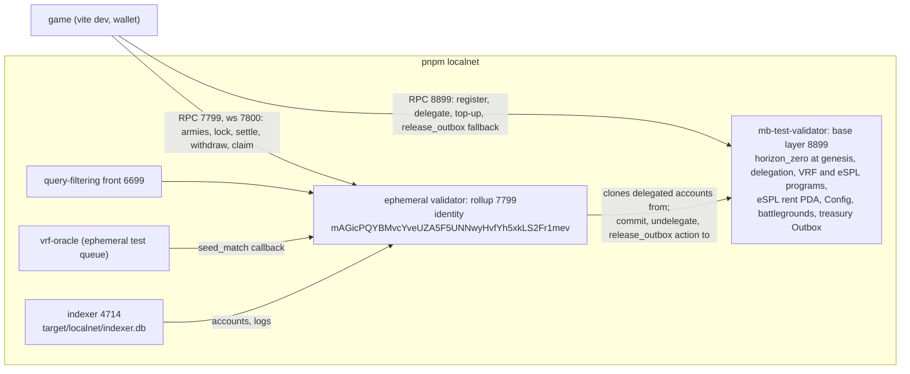

# Networks and deployment

Horizon Zero runs on three clusters. Local development and testing use a local Solana base layer with a MagicBlock ephemeral rollup, never devnet. Devnet and mainnet are deploy targets.

| cluster | Solana RPC | rollup RPC (`VITE_ER_RPC_URL`, indexer `SOLANA_RPC_URL`) | VRF queue | how |
| --- | --- | --- | --- | --- |
| local | `http://127.0.0.1:8899` | `http://127.0.0.1:7799` | `Sc9MJUngNbQXSXGP3F67KvKwVnhaYn6kcioxXNVowYT` (SDK ephemeral test queue) | `pnpm localnet` |
| devnet | `https://api.devnet.solana.com` | the MagicBlock rollup you bootstrap against | `5hBR571xnXppuCPveTrctfTU7tJLSN94nq7kv7FRK5Tc` (SDK `DEFAULT_EPHEMERAL_QUEUE`) | `pnpm deploy:devnet --er-url <rollup>` |
| mainnet | your mainnet RPC (default `https://api.mainnet-beta.solana.com`) | the MagicBlock rollup you bootstrap against | `5hBR571xnXppuCPveTrctfTU7tJLSN94nq7kv7FRK5Tc` | `pnpm deploy:mainnet --confirm-mainnet --er-url <rollup>` |

`lock_army` runs in the rollup, so every queue is an ephemeral one, whose oracle calls back into the rollup. The rollup must be the one serving the validator that `initialize` pins in Config: every delegation names that validator and nothing changes it. A production build has no rollup default and must set `VITE_ER_RPC_URL` (see [Client and dev mode](client.md)).

## Local stack

`pnpm localnet` (`scripts/local-stack.mjs`) needs `solana-test-validator` from the Anza CLI and `mb-stack` and `vrf-oracle` from `npm install -g @magicblock-labs/ephemeral-validator@0.14.10`. It stays in the foreground; Ctrl-C stops every process. In order, it:

1. builds the program with default features (`--no-build` reuses `target/deploy/horizon_zero.so`);
2. starts `mb-stack`: the base validator on `8899` with the delegation, VRF and eSPL programs and the VRF queues preloaded, and `horizon_zero.so` loaded at genesis (`--bpf-program`; `solana program deploy` of a default build is refused by the local validator), the rollup on `7799` (ws `7800`), and the query-filtering front on `6699`. The rollup clones the program from the base layer on first use;
3. starts `vrf-oracle --rpc-url http://127.0.0.1:7799 --websocket-url ws://127.0.0.1:7800`, which answers the ephemeral test queue (delegated to the rollup) with its built-in local key. No oracle watches the base layer: nothing asks for randomness there;
4. airdrops 100 SOL to `target/localnet/admin.json` and runs the bootstrap below with `--espl-rent`;
5. starts the indexer (`scripts/run-indexer.mjs`, compiled on first run) with `SOLANA_RPC_URL=http://127.0.0.1:7799`, `INDEXER_PORT` (default `4714`) and a fresh database at `target/localnet/indexer.db`, and waits until it answers (`--no-indexer` skips it);
6. prints the URLs, the queue, and the app's variables: `VITE_DEV_MODE=false VITE_RPC_URL=http://127.0.0.1:8899 VITE_ER_RPC_URL=http://127.0.0.1:7799 VITE_ORACLE_QUEUE=Sc9MJUngNbQXSXGP3F67KvKwVnhaYn6kcioxXNVowYT`.

Every start is a new chain. `--reset` resets the base ledger; the rollup keeps its accounts in `magicblock-test-storage/` under its working directory, so `mb-stack` runs in `target/localnet` and that directory is removed first. Otherwise ephemeral armies, behaviors and battles from the last run would outlive the base ledger. The indexer's database is removed for the same reason: its rows would name accounts that no longer exist. The logs (`mb-stack.log`, `vrf-oracle.log`, `indexer.log`) and the admin keypair live in `target/localnet/`. `--check` plays one battle and cashes out, then exits (see [Testing](testing.md#local-stack)).

The game sends `register_player`, `delegate_player`, `delegate_outbox`, `delegate_treasury_outbox` and the top-up (`lamportsDelegatedTransferIx`) to the base layer, and its gameplay, withdrawals and claims to the rollup (see [Solana chain](client.md#solana-chain)). The rollup signs the base transaction that commits and undelegates a withdrawn Outbox and runs `release_outbox` in it. The ports are `MB_STACK_BASE_PORT`, `MB_STACK_ER_PORT` and `MB_STACK_PUBLIC_PORT` (defaults 8899, 7799, 6699). The base validator's gossip, dynamic and faucet ports default to `18000`, `18100-18200` and `19900` (`HZ_LOCAL_GOSSIP_PORT`, `HZ_LOCAL_DYNAMIC_PORTS`, `HZ_LOCAL_FAUCET_PORT`) so they do not collide with another local validator. The script refuses to start when something already answers on the base or rollup port, or on the indexer port unless `--no-indexer`.

`pnpm dev:chain` is `pnpm dev:all` with the stack added (which brings its own indexer) and the game in its Solana shell, with the variables above. A `.env` that sets `SOLANA_RPC_URL` does not reach the stack's indexer: the script passes the rollup URL itself. A browser wallet must be set to a custom or localnet RPC at `http://127.0.0.1:8899`. `pnpm localnet:fund <address>` airdrops 10 SOL there. `pnpm dev:all` without `--chain` keeps the no-wallet local ledger and starts no indexer.

Without `VITE_RPC_URL`, `VITE_ER_RPC_URL` and `VITE_ORACLE_QUEUE`, `vite dev` uses the same local values (`app/src/network.ts`). A production build without them uses devnet and MagicBlock's ephemeral queue, and has no rollup: it must set `VITE_ER_RPC_URL`.

## Bootstrap

`app/scripts/bootstrap.mjs --url <solana rpc> --er-url <rollup rpc> --keypair <file>` makes a cluster playable on its rollup and is safe to repeat. Each step is skipped when it is already done:

1. with `--espl-rent` (local stack only): creates the eSPL program's `[b"rent"]` PDA `4RvdEGaUyChj3AketeBZoY1EotNtPveMFUXL8DVetrAp` with `initRentPdaIx` and funds it with 1 SOL. It pays the temporary account behind every top-up; `mb-stack` ships the program but not the PDA, and without it a top-up fails with "insufficient lamports 300000, need 890880". MagicBlock runs it on devnet and mainnet;
2. `initialize(500, validator)`: the keypair becomes the admin. `validator` is `--validator`, or the rollup's `getIdentity` (`mAGicPQYBMvcYveUZA5F5UNNwyHvfYh5xkLS2Fr1mev` locally). On a later run, a Config pinned to another validator stops the script;
3. `create_battleground` for each battleground in `content/catalog.json`: Outpost 0.01 SOL, Garrison 0.05 SOL, Citadel 0.1 SOL;
4. `init_treasury_outbox`;
5. `delegate_config`, `delegate_battleground` for each, and `delegate_treasury_outbox` (skipped while it holds an unreleased claim);
6. waits until the rollup returns Config and every battleground as this program's.

It does not create standard behaviors: behaviors live in the rollup and a Player pays their rent, so the first player to use one creates it. The script fails when the program is not deployed on that cluster.

## Devnet and mainnet

`scripts/deploy.mjs <devnet|mainnet>` deploys or upgrades the program, then bootstraps:

1. Mainnet requires `--confirm-mainnet`.
2. The program keypair `target/deploy/horizon_zero-keypair.json` must be `Hm19JfKaKCRphRwF7DbxhJWmLpHgMG1SnEnKGRyN9Z7c`, the `declare_id!`. Keep that file; without it the program cannot be upgraded at the same address.
3. `cargo-build-sbf` with default features, unless `--skip-build`. `inline-mock-vrf` and `inline-mock-magic` never reach a real cluster.
4. `solana program deploy` with `--keypair` (default `~/.config/solana/id.json`) as payer and upgrade authority, and `--with-compute-unit-price` when `--priority` is given.
5. The bootstrap above with `--er-url` (required unless `--skip-bootstrap`) and `--validator` when given, unless `--skip-bootstrap`. The first bootstrap pins that rollup's validator in Config for good.

It ends by printing the build variables for the game (`VITE_DEV_MODE=false`, `VITE_RPC_URL`, `VITE_ER_RPC_URL`, and `VITE_ORACLE_QUEUE` = `5hBR571xnXppuCPveTrctfTU7tJLSN94nq7kv7FRK5Tc`) and the indexer's `SOLANA_RPC_URL`, the same rollup URL. `render.yaml` lists `VITE_RPC_URL` and `VITE_ER_RPC_URL` (set them in the dashboard) and `VITE_ORACLE_QUEUE` for the game service, and `SOLANA_RPC_URL` (the rollup) for the indexer.

On every network, a battle settles through `settle_match`, which any wallet may send once the VRF callback has seeded the battle. The callback only seeds the battle, so every battle fits; see [Settlement and fee](matchmaking.md#settlement-and-fee).
