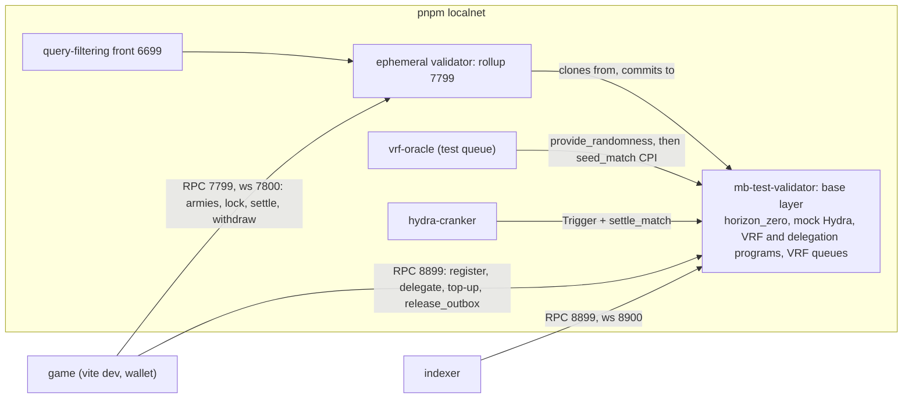

# Networks and deployment

Horizon Zero runs on three clusters. Local development and testing use a local Solana base layer with a MagicBlock ephemeral rollup, never devnet. Devnet and mainnet are deploy targets.

| cluster | Solana RPC | game's VRF queue (`app/src/network.ts`) | scripts' VRF queue | how |
| --- | --- | --- | --- | --- |
| local | `http://127.0.0.1:8899` | `Sc9MJUngNbQXSXGP3F67KvKwVnhaYn6kcioxXNVowYT` (SDK ephemeral test queue) | `GKE6d7iv8kCBrsxr78W3xVdjGLLLJnxsGiuzrsZCGEvb` (SDK base test queue) | `pnpm localnet` |
| devnet | `https://api.devnet.solana.com` | `5hBR571xnXppuCPveTrctfTU7tJLSN94nq7kv7FRK5Tc` (SDK `DEFAULT_EPHEMERAL_QUEUE`) | `Cuj97ggrhhidhbu39TijNVqE74xvKJ69gDervRUXAxGh` (SDK base default) | `pnpm deploy:devnet` |
| mainnet | your mainnet RPC (default `https://api.mainnet-beta.solana.com`) | `5hBR571xnXppuCPveTrctfTU7tJLSN94nq7kv7FRK5Tc` | `Cuj97ggrhhidhbu39TijNVqE74xvKJ69gDervRUXAxGh` | `pnpm deploy:mainnet --confirm-mainnet` |

The game sends `lock_army` to the rollup, so its default queue is an ephemeral one, whose oracle calls back into the rollup. The scripts column is what `scripts/local-stack.mjs`, `scripts/dev-all.mjs --chain`, `app/scripts/localnet-assert.mjs` and `scripts/deploy.mjs` still use: the base-layer queues. The game also needs a rollup RPC, `VITE_ER_RPC_URL`, which has no production default (see [Client and dev mode](client.md)).

## Local stack

`pnpm localnet` (`scripts/local-stack.mjs`) needs `solana-test-validator` from the Anza CLI and `mb-stack` and `vrf-oracle` from `npm install -g @magicblock-labs/ephemeral-validator@0.14.10`. It builds the program with default features and `programs/mock-hydra`, starts the stack with both loaded (the mock at the Hydra id, since `mb-stack` has no Hydra), starts the oracle, funds an admin keypair in `target/localnet/admin.json`, runs `app/scripts/bootstrap.mjs`, and starts the local Hydra cranker `app/scripts/hydra-cranker.mjs` with a funded `target/localnet/cranker.json`. It stays in the foreground; Ctrl-C stops every node. The ledger is reset on each start. `--no-build` reuses `target/deploy/horizon_zero.so` and `target/deploy/mock_hydra.so`. `HZ_HYDRA_SO` and `HZ_HYDRA_CRANKER` swap in a real Hydra build and MagicBlock's `hydra-cranker` binary (see [Testing](testing.md#local-stack)). `--check` plays one battle and exits (see [Testing](testing.md)).

The game sends `register_player`, `delegate_player`, `delegate_outbox` and the top-up to the base layer, and its gameplay, withdrawals and settlements to the rollup on 7799 (see [Solana chain](client.md#solana-chain)). The bootstrap does not delegate Config or the battlegrounds yet, and the stack does not create the eSPL rent PDA or run a `vrf-oracle` against the rollup yet, so the game's rollup flows do not work on this stack until the local-stack task adds them. The indexer, the oracle and the cranker still use the base layer. The ports are `MB_STACK_BASE_PORT`, `MB_STACK_ER_PORT` and `MB_STACK_PUBLIC_PORT` (defaults 8899, 7799, 6699). The base validator's gossip, dynamic and faucet ports default to `18000`, `18100-18200` and `19900` (`HZ_LOCAL_GOSSIP_PORT`, `HZ_LOCAL_DYNAMIC_PORTS`, `HZ_LOCAL_FAUCET_PORT`) so they do not collide with another local validator. The script refuses to start when something already answers on the base port.

`pnpm dev:chain` is `pnpm dev:all` with the stack and the indexer added and the game in its Solana shell (`VITE_DEV_MODE=false`). It sets `VITE_RPC_URL` to the local RPC and `VITE_ORACLE_QUEUE` to the base test queue `GKE6d7iv8kCBrsxr78W3xVdjGLLLJnxsGiuzrsZCGEvb`, which overrides the game's ephemeral default; the rollup RPC is the `vite dev` default, `http://127.0.0.1:7799`; the indexer's default `SOLANA_RPC_URL` is already the local base layer. A browser wallet must be set to a custom or localnet RPC at `http://127.0.0.1:8899`. `pnpm localnet:fund <address>` airdrops 10 SOL there. `pnpm dev:all` without `--chain` keeps the no-wallet local ledger and starts no indexer, since nothing serves the local RPC then.

Without `VITE_RPC_URL`, `VITE_ER_RPC_URL` and `VITE_ORACLE_QUEUE`, `vite dev` uses the local RPC, the local rollup at `http://127.0.0.1:7799` and the ephemeral test queue `Sc9MJUngNbQXSXGP3F67KvKwVnhaYn6kcioxXNVowYT` (`app/src/network.ts`). A production build without them uses devnet and MagicBlock's ephemeral queue `5hBR571xnXppuCPveTrctfTU7tJLSN94nq7kv7FRK5Tc`, and has no rollup: it must set `VITE_ER_RPC_URL` (see [Client and dev mode](client.md)).

## Bootstrap

`app/scripts/bootstrap.mjs --url <rpc> --keypair <file>` makes a cluster playable and is safe to repeat: `initialize` (the keypair becomes the admin), the battlegrounds in `content/catalog.json` (ids, budgets, stakes and grids), and every standard behavior in `content/catalog.json`. Each step is skipped when its account already exists. It fails when the program is not deployed on that cluster.

## Devnet and mainnet

`scripts/deploy.mjs <devnet|mainnet>` deploys or upgrades the program, then bootstraps:

1. Mainnet requires `--confirm-mainnet`.
2. The program keypair `target/deploy/horizon_zero-keypair.json` must be `Hm19JfKaKCRphRwF7DbxhJWmLpHgMG1SnEnKGRyN9Z7c`, the `declare_id!`. Keep that file; without it the program cannot be upgraded at the same address.
3. `cargo-build-sbf` with default features, unless `--skip-build`. `inline-mock-vrf` never reaches a real cluster.
4. `solana program deploy` with `--keypair` (default `~/.config/solana/id.json`) as payer and upgrade authority, and `--with-compute-unit-price` when `--priority` is given.
5. The bootstrap above, unless `--skip-bootstrap`.

It ends by printing the build variables for the game (`VITE_DEV_MODE=false`, `VITE_RPC_URL`, `VITE_ORACLE_QUEUE`) and the indexer's `SOLANA_RPC_URL`. `render.yaml` lists `VITE_RPC_URL` (set it in the dashboard) and `VITE_ORACLE_QUEUE` for the game service.

On every network, a battle settles through `settle_match`, which any wallet may send once the VRF callback has seeded the battle. The callback only seeds the battle, so every battle fits; see [Settlement and fee](matchmaking.md#settlement-and-fee).
