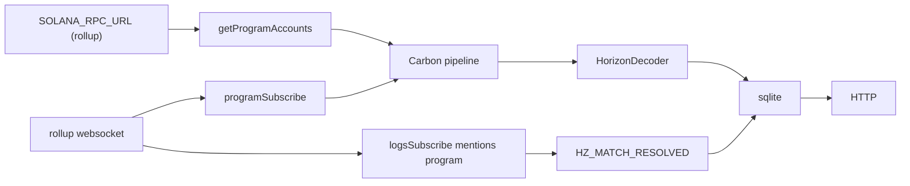

# Indexer and Render

## Indexer

`indexer/` is a Rust service, crate `horizon-indexer`. It uses [Carbon](https://github.com/sevenlabs-hq/carbon) 2.0 (`carbon-core`, `carbon-log-metrics`) and SQLite (`rusqlite`). The old Node process `indexer/server.js` is gone. This is the only indexer.

`SOLANA_RPC_URL` is the MagicBlock ephemeral rollup's RPC, not the base layer. Armies, Behaviors and Battles are ephemeral accounts that exist only in the rollup, and Battlegrounds and Players are delegated to it, so the rollup is the one place that has every account the indexer stores. Locally that is `http://127.0.0.1:7799`.

Carbon's RPC block subscription emits transactions and block details, not account updates, so the pipeline does not use it and does not use a Geyser plugin. Two RPC datasources feed one account pipe, and a third reads the program's logs:

`getProgramAccounts` sends each account once the RPC returns a snapshot that includes a slot. `programSubscribe` then streams account updates for the program. Both ask for base64 at `confirmed`: without an encoding the RPC sends base58, which it refuses for an account over 128 bytes, so every Battleground, Army and Battle would arrive undecodable. Both hand every account to the pipeline as an update. Carbon's own conversion turns an account with 0 lamports into a deletion, and every ephemeral account (Army, Behavior, Battle) holds 0 lamports in the rollup, its rent sitting with the sponsor. `logsSubscribe` with `mentions: [program id]` streams the logs of each transaction that names the program. A refused dial on any of the three is logged with the URL and tried again every 3 seconds until the indexer shuts down. The pipeline stays up, and the HTTP server keeps serving the database. A websocket that closes after it had connected is dialed again the same way. `HorizonDecoder` implements Carbon's `AccountDecoder` and accepts an account only when the Anchor discriminator `SHA-256("account:<Name>")[..8]` and the length both match the layouts in [Accounts and instructions](accounts.md): Behavior, Battleground, Army, and Battle (2147 bytes, including `fee_bps`). Config, Player and Outbox are ignored, as is anything else; the client reads Players straight from the rollup. An army's status change, including an eviction, arrives as an account update, so `HZ_EVICT` is not read.

Carbon has no update type for bare logs, so the logs source is not a Carbon datasource. It skips a failed transaction and hands the logs of each successful one to a task that reads `HZ_MATCH_RESOLVED <battle> <outcome> <fee> <seed hex> <player_b>`. A line counts only while the indexed program is the innermost program invoked, so another program in the same transaction cannot log a resolution for it. A line with the wrong word count, an outcome outside 1 to 3, a fee that is not a `u64`, a seed that is not 64 hex digits, or a bad pubkey is dropped. `settle_match` closes the battle, so this log is the only record of its outcome and fee. Every other `HZ_` log is not read.

A resolution is stored in its own table with the log's seed, then applied to the battle's row only while that row holds the same seed: status `1` (Resolved), the outcome, the fee, and the resolution time. Each later write of the row applies it again under the same rule. A battle's seed is all zeros while it is Awaiting and is set once, by `seed_match`, so:

- A log that arrives before the battle's row, or while the row is still Awaiting, waits. The row stays Awaiting until its Seeded update arrives with that seed, then it is Resolved.
- An update that would take a seeded row back to a zero seed is a stale snapshot and is skipped, so a late Awaiting or Seeded snapshot never undoes a resolution.
- A Seeded update with a different seed is a new battle at a reused address. Battle addresses are `[b"match", battleground, seq]`, and seq restarts after a ledger reset while the database persists. The row starts over: its open time, outcome, fee and resolution time are cleared, and the stored resolution for that address is deleted, since it can never apply. A resolution stored before seeds were recorded has no seed and is deleted the same way.
- A log for the new battle that arrives while the row still holds the old battle replaces the stored resolution and waits for the new Seeded update.

Recording a battle, and storing and applying a resolution, each run in one SQLite transaction. A resolution with no row yet does not appear in `/matches` until the row does. A transaction whose logs end with `Log truncated` is logged as a warning with its signature and slot, since a resolution past the cut is lost. If the logs source or the resolution task stops before shutdown, that is logged as an error.

The logs subscription has no history. A battle settled while the indexer was down, or before it first connected, keeps the last state its account showed, usually Seeded (`2`), because the closed account never arrives again and the log is gone. When the game's Solana adapter sends `settle_match` itself, it reads the outcome from that transaction's log and does not need the row.

The local rollup (ephemeral-validator 0.14.10) serves all five calls the indexer uses for delegated and ephemeral accounts: `getProgramAccounts` lists ephemeral Armies and Behaviors next to delegated Players and Battlegrounds, `programSubscribe` and `logsSubscribe` notify, `getMultipleAccounts` returns them, and `getBlockTime` answers once a slot is about 100 ms old. `pnpm localnet --check` runs the indexer on the stack and requires the settled battle's row with its outcome, fee and both times (see [Testing](testing.md#local-stack)).

`close_army` hands the army account back to the System Program, and `programSubscribe` only reports accounts the program still owns, so a closed army never arrives as an update. Every 30 seconds the indexer reads its stored army keys with `getMultipleAccounts`, 100 at a time, and deletes the rows whose account is gone, empty, or no longer owned by the program. A failed RPC call skips that round. Until the next prune `/armies` can still list a closed army; the game's Solana adapter checks the accounts itself and hides it.

The websocket URL is derived from `SOLANA_RPC_URL`. `http` becomes `ws`, `https` becomes `wss`, and an explicit port is incremented by one, so the local rollup `http://127.0.0.1:7799` uses its websocket port `7800`. A URL that is already `ws` or `wss`, or that omits the port, is not shifted.

Each account update and each logs notification carries a slot. The indexer calls `getBlockTime` for that slot and stores the unix seconds. The rollup answers "not yet available" for a slot until about 100 ms after it, which is when a live update arrives, so the indexer asks up to five times, 200 ms apart. A slot the RPC still cannot time is stored as null. Times are not invented. UTC days (`YYYY-MM-DD`) are indexed for range queries.

| env | default |
| --- | --- |
| `PROGRAM_ID` | `Hm19JfKaKCRphRwF7DbxhJWmLpHgMG1SnEnKGRyN9Z7c` |
| `SOLANA_RPC_URL` | `http://127.0.0.1:7799`, the local rollup. Set it to the ephemeral rollup's RPC, not the base layer |
| `INDEXER_PORT` | `4714`. Preferred local listen port. `pnpm indexer` and `pnpm dev:chain` pass it to this process only. |
| `PORT` | unset locally. Render injects this on the indexer service. Used when `INDEXER_PORT` is unset. |
| `DATABASE_PATH` | `indexer/data/horizon.db`, resolved from the repo root |

Local runs read the repo-root `.env` and do not override variables already set in the process. `pnpm indexer` and `pnpm dev:chain` pass `INDEXER_PORT` to this process only, then build the debug binary with Cargo (cached under `indexer/target/`) and run it. They do not set `PORT`. The binary listens on `INDEXER_PORT`, then `PORT`, then `4714`. The binary needs rustc 1.96.1 or newer, which is Carbon 2.0's minimum. Ctrl+C in `dev:chain` kills the process group, including this binary.

An older Node database, one whose `behaviors` table has no `element_count` column, is dropped and recreated on startup. A `matches` table without the `fee` or `fee_bps` column gains it with `ALTER TABLE matches ADD COLUMN`; its rows keep a null fee. A `resolutions` table without the `seed` column gains it the same way.

### What is stored

Behaviors: pubkey, creator, canonical body, element count, and a compact summary (`1 element: March`, or the same words the client uses for a custom sequence). `created_at` is the earliest block time seen. `updated_at` is the latest. Behaviors are not updated on chain, so the two match unless a later observation has a different slot time.

Battles (the program's Battle accounts, served as matches): pubkey, battleground, both army pubkeys, both player pubkeys, stake (decimal string), seq, grid, unit snapshots, status, seed (hex), outcome, `fee_bps` (Config's rate when the battle opened), and `fee`. The account only ever shows Awaiting (`0`) or Seeded (`2`) with outcome `0`. Status Resolved (`1`), the outcome, and `fee` (lamports the protocol took, a decimal string, `"0"` on a draw) come from `HZ_MATCH_RESOLVED`; `fee` is null until then. `open_at` is the block time of the first observation while status is Awaiting. `resolved_at` is the block time of the slot of the first `HZ_MATCH_RESOLVED` for that battle and seed. A Seeded battle sets neither time. A battle first seen already seeded has a null open time. A settled battle's account is closed, but its row is never deleted: only armies are pruned.

Users: every distinct wallet that creates a behavior, owns an army, or is a player on a battle. `first_seen` and `last_seen` are the earliest and latest block times of those observations. Counts are derived from the behavior, army, and battle rows.

Battlegrounds and armies are stored too, so the game can still list queues and rosters. They have no date filter.

### HTTP

The server listens on `0.0.0.0`. Dates are UTC `YYYY-MM-DD`. `date` is that single day. `from` and `to` are an inclusive range; either bound may be omitted. A bad date is 400 `{"error":"bad date"}`. With no date params, the list is unfiltered.

| method and path | body |
| --- | --- |
| `GET /health` | `{ok: true}` |
| `GET /behaviors` | behaviors. `?date=`, `?from=`, `?to=` match `created_date` or `updated_date` |
| `GET /battlegrounds` | all battlegrounds |
| `GET /armies?owner=` | armies for that owner; a missing owner matches `""` |
| `GET /army/:pubkey` | one army, or `null` |
| `GET /battlegrounds/:pubkey/queue` | the battleground row, including `queue` |
| `GET /matches` | battles ordered by `seq` descending. Same date params as `/battles` |
| `GET /matches/:pubkey` | one battle, or `null` |
| `GET /battles` | same rows as `/matches`. `?date=2026-10-06` or `?from=2026-10-01&to=2026-10-06` matches `open_date` or `resolved_date` |
| `GET /battles/:pubkey` | one battle, or `null` |
| `GET /users` | wallets with `firstSeen`, `lastSeen`, and behavior, army, and battle counts. `?from=2026-10-01` keeps users whose seen span overlaps the range |
| `GET /stats` | game-wide numbers for the landing page, sent with `Access-Control-Allow-Origin: *` and `Cache-Control: public, max-age=10`: `battlesFought` (settled, status 1), `battlesToday` (settled in the 24 hours before `generatedAt`, by `resolved_at`), `battlesAwaiting` (status not 1), `draws`, `players` (rows in `users`), `behaviors`, `armiesLocked` (all queue lengths), `stakedLamports` (both stakes of every battle, a decimal string), and per battleground `{battlegroundId, locked, battlesFought}` |

A behavior or battle with a null time does not match a date filter. A user matches a day when that UTC day is between `first_date` and `last_date` inclusive. Anything else is 404.

Stakes and fees are decimal strings. Unit lists, behavior bodies, and the battleground queue are JSON arrays. The game reads `body`, `queue`, `units`, `unitsA`, `unitsB`, `armyA`, `armyB`, `playerA`, `playerB`, `battlegroundId`, `matchSeq`, and `idx`. Match rows also carry `fee` and `feeBps`.

## App server

`app/server.js` listens on `PORT` or `4715`.

- `/api/...` is proxied to `INDEXER_URL` (default `http://127.0.0.1:4714`). A value without a scheme, which is what Render's private-service hostport looks like, is prefixed with `http://`. A failed proxy is 502 `indexer unavailable`.
- `/assets/...` is served from the repo `assets/` directory. A missing file is 404, not the SPA. `.png` is `image/png` and `.glb` is `model/gltf-binary`. When the request `Origin` is listed in `ASSET_CORS_ORIGINS`, the response includes `Access-Control-Allow-Origin` for that origin. `GET`, `HEAD`, and `OPTIONS` only. `/api` does not send this header.
- every other path is a file under `app/dist`, or `index.html` when the file is missing.

## Render

`render.yaml` defines the game web service, the indexer, and a static landing site. The asset studio is not a service.

| service | type | start / publish | notes |
| --- | --- | --- | --- |
| `horizon-zero` | web, node, starter | `node app/server.js` | build is `pnpm install --frozen-lockfile` and `pnpm --filter app build` |
| `horizon-zero-indexer` | private service, rust, starter | `./indexer/target/release/horizon-indexer` | build is `cargo build --release --locked --manifest-path indexer/Cargo.toml`. Disk `horizon-zero-data` mounted at `/var/data`, 1 GB |
| `horizon-zero-landing` | web, static | `landing/dist` | build is `npm ci && npm run build` inside `landing/`. It does not run the game. |

The web service's `INDEXER_URL` is the indexer hostport. The indexer sets `DATABASE_PATH` to `/var/data/horizon.db`. `SOLANA_RPC_URL` and `PROGRAM_ID` are `sync: false`, so they are set in the dashboard rather than in the blueprint.

`horizon-zero-landing` is the public page for the game: a hero scene, the three steps of a match, an isometric battleground, the units of every race, a live "The front" section, and short lore. The unit section, The line, has one tab per catalog race (Ashborn, Rootborn, Deeplings) with a line on that people's price and origin; picking a race lists its units, Ashborn opening on the Vanguard and the others on their first unit, and each unit's dossier shows its catalog cost, hp, attack, range, speed, and cast. The hero copy and the match steps name all three peoples and the 10-unit cap. The build imports `content/catalog.json`, so battleground names, stakes, budgets, grids, unit stats and casts on the page are the catalog the build saw. The battleground view draws a sample army for each side within budget, each from a different race picked at random on every roll, and lays rubble for a random seed with the blocked-tile rule from [Battle rules](battle.md#blocked-tiles), computed in the browser with SHA-256. It does not replay a fight. The play link is the `horizon-zero` origin. There is no wallet flow on the landing page. Approved files are not bundled. Image URLs are `${VITE_WEB_ORIGIN}/assets/world.png`, `${VITE_WEB_ORIGIN}/assets/units/<race>/<kind>/<kind>.approved.png` (`<race>` is the catalog slug), `board/tile/tile.approved.png`, and `board/rubble/rubble.approved.png`; a missing race path falls back to `assets/units/<kind>/<kind>.approved.png`. The landing page does not load `.glb` models. The hero image loads at once, the board art when the battleground nears the viewport, and the unit art when the roster does. A missing tile or rubble image is drawn as a flat block, a missing unit as a colored bar, and a missing hero or roster image is left empty.

`fromService` `host` is the private-network hostname. Static sites are not on that network, so the blueprint cannot inject the public game URL. `VITE_WEB_ORIGIN` is `sync: false` and is read at build time. Set it to the public `horizon-zero` origin, scheme included. Local `vite` dev uses `http://127.0.0.1:4715` when the variable is unset, which is `app/server.js`. `pnpm dev:all` starts the game process (Vite and the local ledger), landing, and asset studio (`pnpm dev:chain` adds the indexer and the local stack), and sets that landing process's `VITE_WEB_ORIGIN` to `http://127.0.0.1:4710`. The game dev server serves `/assets` and allows the request Origin to read them, so that command does not need a production build. `ASSET_CORS_ORIGINS` on `horizon-zero` is `sync: false`: comma-separated browser origins allowed to read `/assets`. Set it to the landing origin. When it is unset, the server allows `http://127.0.0.1:4711`, `http://localhost:4711`, `http://127.0.0.1:4716`, and `http://localhost:4716`.
