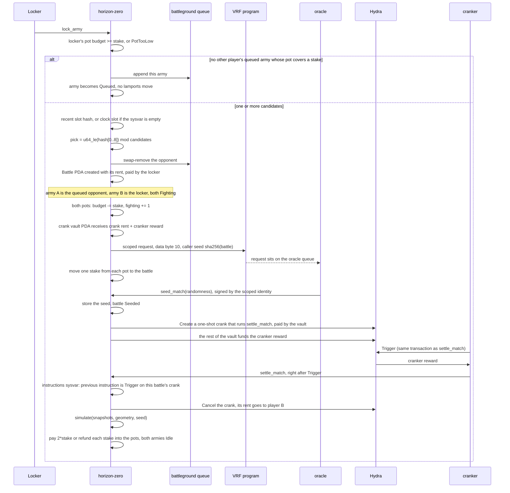
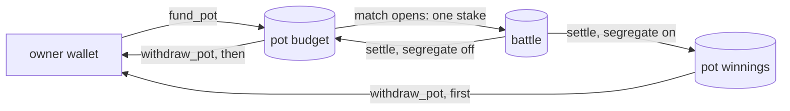
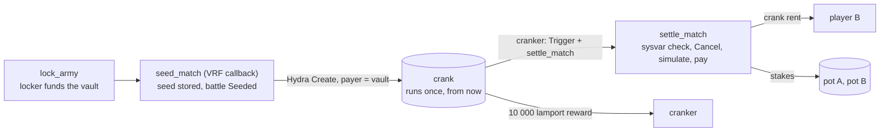

# Matchmaking, pots, and VRF

`lock_army` both queues an unmatched army and opens a match. The opponent is fixed in that instruction. The VRF callback does not pick a player. Stakes come from each player's [pot](#pots) on the battleground, never from an army.

## Slot hash

The program reads `SlotHashes`. When the account has at least 48 bytes and the leading `u64` entry count is non-zero, the hash is bytes `16..48` of the first entry (the `u64` slot, then the 32-byte hash). Otherwise the hash is the clock slot's 8 little-endian bytes repeated four times.

`pick` is the first 8 bytes of that hash as a little-endian `u64`, modulo the candidate count. Candidates stay in queue order.

## Pots

A player sets one battle budget per battleground with `fund_pot`, then locks as many armies there as they like. Every one of them stakes from that pot, and none of them holds lamports while it waits. When a locker matches, the program picks among the queued armies of other players whose pot still covers a stake, so a player never fights their own armies and never stakes more than the pot holds. Locking itself is refused unless the locker's own pot covers one stake.

The budget is spent one stake per match, in the order the owner's armies are met. Once it is under one stake, the owner's remaining queued armies stay in the queue but no locker can meet them, and the owner cannot lock another army there. Funding the pot again makes them reachable without another transaction. `unlock_army` only leaves the queue; it moves no lamports.

Payouts return to the pot. With `segregate` off, the default, they go back into the budget, so a winning player keeps fighting on their winnings. With `set_segregation(true)` they go to `winnings`, which no match stakes; the budget is then a hard cap on what the player risks. `withdraw_pot` takes from the winnings first, then from the budget. `close_pot` returns everything once none of the owner's battles there is unsettled.

## Who pays

`fund_pot` moves lamports from the owner into the pot, and its first call also pays the pot's rent. Unmatched `lock_army` moves nothing.

A match creates the battle account, 2145 bytes, with its rent paid by the locker. The locker also funds the crank vault (see [Settlement crank](#settlement-crank)) with the crank's rent plus one cranker reward, 10 000 lamports. After the VRF request CPI returns, the program moves `stake` lamports from the locker's pot and `stake` from the opponent's pot onto the battle. Net, the locker's wallet has spent the battle rent and the crank funding, each pot one stake, and the battle account holds both stakes above its rent. `settle_match` pays those two stakes into the pots as described in [Accounts and instructions](accounts.md), returns the crank's rent to the locker's wallet, and leaves the battle rent behind. The locker's settlement cost is the 10 000-lamport cranker reward.

There is no timeout instruction. Until the callback lands and the crank runs, both armies stay Fighting, both stakes stay on the battle PDA, and neither pot can close.

## VRF request

`ephemeral-vrf-sdk` 0.17.3 builds the request with `create_request_randomness_ix`, which sets instruction byte `0` to `10` (scoped identity, regular priority). The `#[vrf]` helper forces that byte to `10` unless it is already `3` or `11`, which this call is not. High-priority scoped requests use byte `11`. This program does not send `11`.

The request body after the 8-byte header carries:

- `caller_seed = SHA-256(battle pubkey)`
- callback program = this program
- callback discriminator = `SHA-256("global:seed_match")[..8]`
- callback accounts, none signers: battle, crank vault and crank (writable), the Hydra program and the system program (read-only)
- empty callback args

The CPI is signed by the program identity `[b"identity"]`. The accounts on that CPI are the player, the program identity, the oracle queue, the system program, and slot hashes.

The oracle later invokes `seed_match`. The signer it supplies is the scoped identity `[b"identity", horizon_program_id]` on the VRF program. `randomness` becomes the battle seed and later the `simulate` seed. Deployment does not read it. The seed does choose the blocked tiles between the two starting zones. `settle_match` passes the `cols` and `rows` copied onto the battle at `lock_army`.

The queue is `VITE_ORACLE_QUEUE` when set. Devnet and mainnet use the SDK default `Cuj97ggrhhidhbu39TijNVqE74xvKJ69gDervRUXAxGh`. The local stack serves the SDK test queue `GKE6d7iv8kCBrsxr78W3xVdjGLLLJnxsGiuzrsZCGEvb`, which `vite dev` uses by default. The program accepts any queue the VRF program owns. See [Networks and deployment](deployment.md).

## Settlement crank

A whole battle does not fit in the compute the oracle gives its callback (see [Callback compute](#callback-compute)), so the callback only stores the seed and schedules the battle on [Hydra](https://github.com/magicblock-labs), MagicBlock's crank program (`Hydra17i1feui9deaxu6d1TzSQMRNHeBRkDR1Awy7zea` on devnet and mainnet; `hydra-api` 0.2.0 describes its accounts). The program builds Hydra's instructions itself and does not link `hydra-api`.

- **Vault.** `[b"crank-fund", battle]` under this program, a system account. `lock_army` tops it up to the rent of a crank account plus `CRANKER_REWARD` (10 000 lamports) when it opens a match. The vault is passed in `lock_army`'s remaining accounts after the opponents.
- **Crank.** `[b"crank", vault, battle]` under Hydra, the payer-bound form. `seed_match` signs for the vault and calls Hydra `Create` with seed = battle, cancel authority = battle, start slot = the current slot, interval 0, one run, no priority tip, and a compute limit of 1 400 000. The one scheduled instruction is `settle_match` with its accounts in order: battle, army A, army B, pot A, pot B, player B, crank (all writable), the Hydra program and the instructions sysvar (read-only). `seed_match` derives both pots from the battle's battleground and players. Hydra takes the crank's rent from the vault; the program then moves the rest of the vault, the reward, onto the crank, so the vault ends empty. The crank account is 461 bytes: Hydra's 120-byte header and the 341-byte template.
- **Run.** A cranker sends `SetComputeUnitLimit`, Hydra `Trigger` (crank, cranker, instructions sysvar), and the stored `settle_match`, in that order and in one transaction. `Trigger` checks that the next instruction is byte for byte the stored template, pays the cranker the reward, and counts the crank down to zero runs.
- **Gate.** `settle_match` requires the battle to be Seeded, runs only at the top level, and reads the instructions sysvar: the instruction just before it must be Hydra `Trigger` (data `[1]`) whose first account is this battle's crank, which `settle_match` derives from the battle. A direct call, a call after another crank's `Trigger`, or a crank someone else created with the same template all fail with `NotCranked`.
- **Close.** `settle_match` signs as the battle and calls Hydra `Cancel` with player B as the recipient, before it pays out. The crank's whole balance, its rent, goes to player B, and the emptied account is removed.

If a settlement can never succeed, the crank stays scheduled. Hydra lets anyone `Close` a crank about ten days past due; the refund then goes to its authority, the battle account, where no instruction can move it.

## Callback compute

The oracle sends `provide_randomness` in a transaction capped at 300 000 compute units, and the VRF program spends about 54 000 of it before it invokes the callback, so the callback has roughly 246 000. The request has no field that raises that cap. `seed_match` uses about 65 000 CU, most of it the vault, crank and two pot address derivations and Hydra's `Create`.

The battle itself runs in `settle_match`, in the crank's own transaction with up to 1 400 000 CU. The LiteSVM test `full_armies_resolve_on_every_battleground` measures full-budget armies that approach, cast, and attack:

| battleground | armies | `settle_match` |
| --- | --- | --- |
| Outpost | 4 v 4 | about 207 000 CU |
| Garrison | 5 v 5 | about 331 000 CU |
| Citadel | 10 v 10 | about 799 000 CU |

The worst battle in the compute benchmark ([Testing](testing.md#compute-benchmark)) uses about 898 000 CU, under two thirds of the crank's limit. Its Citadel armies now fill up to 10 units; with the old cap of 6 the worst battle used about 653 000 CU. The engine work described under [On-chain cost](battle.md#on-chain-cost) brought Citadel down from more than 1 270 000 CU, which did not fit even a whole transaction.
