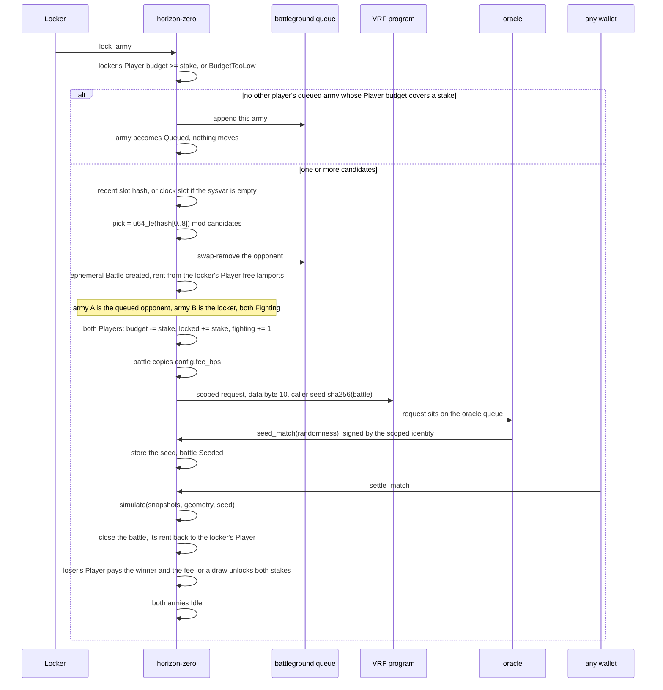
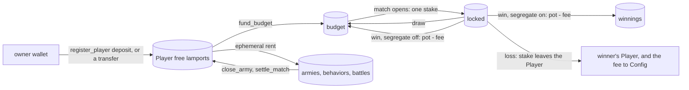
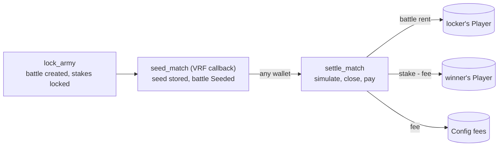

# Matchmaking, stakes, and VRF

`lock_army` both queues an unmatched army and opens a match. The opponent is fixed in that instruction. The VRF callback does not pick a player. Stakes are counters on each player's one [Player](accounts.md#player--68-bytes) account, never lamports on an army or a battle, until `settle_match` moves them.

## Slot hash

The program reads `SlotHashes`. When the account has at least 48 bytes and the leading `u64` entry count is non-zero, the hash is bytes `16..48` of the first entry (the `u64` slot, then the 32-byte hash). Otherwise the hash is the clock slot's 8 little-endian bytes repeated four times.

`pick` is the first 8 bytes of that hash as a little-endian `u64`, modulo the candidate count. Candidates stay in queue order.

## Stakes

A player registers once with `register_player`, which creates their Player and moves a deposit into it. `fund_budget` moves free lamports into the budget. The player then locks as many armies as they like, on any battleground. Every one of them stakes from that one budget, and none of them holds lamports while it waits. When a locker matches, the program picks among the queued armies of other players whose budget still covers a stake, so a player never fights their own armies and never stakes more than the budget holds. Locking itself is refused unless the locker's own budget covers one stake.

Opening a match moves no lamports. Each Player's `budget` drops by the stake, its `locked` grows by it, and its `fighting` count grows by one. The lamports stay on the Player until `settle_match`, because an ephemeral battle cannot hold lamports.

The budget is spent one stake per match, in the order the owner's armies are met. Once it is under one stake, the owner's remaining queued armies stay in the queue but no locker can meet them, and the owner cannot lock another army. Funding the budget again makes them reachable without another transaction. `unlock_army` only leaves the queue; nothing moves.

A won payout goes back to the Player. With `segregate` off, the default, it goes into the budget, so a winning player keeps fighting on their winnings. With `set_segregation(true)` it goes to `winnings`, which no match stakes; the budget is then a hard cap on what the player risks. A draw always returns each stake to its budget.

## Who pays

`register_player` takes the Player's and the Outbox's rent and the deposit from the wallet. A transfer into the Player lands in its free lamports. The free lamports pay ephemeral rent at `(bytes + 60) * 32` lamports: about 5 700 for a behavior, 45 000 for an army, and 71 000 for a battle (see [Ephemeral accounts](accounts.md#ephemeral-accounts)). Unmatched `lock_army` moves nothing.

A match creates the battle as an ephemeral account sponsored by the locker's Player, which must have the rent free (`RentShort`). `settle_match` closes the battle and refunds that rent to the locker's Player, so a battle costs the locker nothing once it settles.

There is no timeout instruction. Until the callback lands and someone settles, both armies stay Fighting and both stakes stay locked on their Players.

## VRF request

`ephemeral-vrf-sdk` 0.17.3 builds the request with `create_request_randomness_ix`, which sets instruction byte `0` to `10` (scoped identity, regular priority). The `#[vrf]` helper forces that byte to `10` unless it is already `3` or `11`, which this call is not. High-priority scoped requests use byte `11`. This program does not send `11`.

The request body after the 8-byte header carries:

- `caller_seed = SHA-256(battle pubkey)`
- callback program = this program
- callback discriminator = `SHA-256("global:seed_match")[..8]`
- one callback account, not a signer: the battle (writable)
- empty callback args

The CPI is signed by the program identity `[b"identity"]`. The accounts on that CPI are the player, the program identity, the oracle queue, the system program, and slot hashes.

The oracle later invokes `seed_match`. The signer it supplies is the scoped identity `[b"identity", horizon_program_id]` on the VRF program. `randomness` becomes the battle seed and later the `simulate` seed. Deployment does not read it. The seed does choose the blocked tiles between the two starting zones. `settle_match` passes the `cols` and `rows` copied onto the battle at `lock_army`.

The queue is `VITE_ORACLE_QUEUE` when set. Devnet and mainnet use the SDK default `Cuj97ggrhhidhbu39TijNVqE74xvKJ69gDervRUXAxGh`. The local stack serves the SDK test queue `GKE6d7iv8kCBrsxr78W3xVdjGLLLJnxsGiuzrsZCGEvb`, which `vite dev` uses by default. The program accepts any queue the VRF program owns. See [Networks and deployment](deployment.md).

## Settlement and fee

A whole battle does not fit in the compute the oracle gives its callback (see [Callback compute](#callback-compute)), so the callback only stores the seed. `settle_match` then plays the battle in its own transaction. It is permissionless: the client sends it after `seed_match`, and anyone else may. It checks the battle, both armies and both Players against the battle's stored keys, so the caller cannot redirect the payout. A second call fails with `AlreadyResolved`, because the first one closed the battle.

The fee is a share of the pot. With `pot = 2 * stake` and the `fee_bps` the battle copied from Config at `lock_army`:

- `fee = pot * fee_bps / 10_000`, rounded down.
- On a win, the loser's Player sends `stake - fee` lamports to the winner's Player and `fee` lamports to Config. The winner's budget, or winnings, grows by `pot - fee`, and `config.fees` grows by `fee`.
- On a draw, no lamports move and no fee is taken. Each Player's budget gets its stake back.
- Both Players drop `locked` by the stake and `fighting` by one.

`fee_bps` is at most `1000`, so the fee never exceeds the loser's stake. The admin sets it with `set_fee`; `initialize` takes the first value.

Example: at Garrison (stake 0.2 SOL) with a 5% fee, the pot is 0.4 SOL and the fee is 0.02 SOL. The loser's Player sends 0.18 SOL to the winner's and 0.02 SOL to Config. The winner nets +0.18 SOL and the loser loses 0.2 SOL.

The `HZ_MATCH_RESOLVED` log carries the outcome and the fee, because the battle account is gone after settlement.

## Callback compute

The oracle sends `provide_randomness` in a transaction capped at 300 000 compute units, and the VRF program spends about 54 000 of it before it invokes the callback, so the callback has roughly 246 000. The request has no field that raises that cap. `seed_match` uses about 42 000 CU, most of it reading and writing back the 2147-byte battle and checking its address.

The battle itself runs in `settle_match`, in its own transaction with up to 1 400 000 CU. The LiteSVM test `full_armies_resolve_on_every_battleground` measures full-budget armies that approach, cast, and attack:

| battleground | armies | `settle_match` |
| --- | --- | --- |
| Outpost | 4 v 4 | about 188 000 CU |
| Garrison | 5 v 5 | about 304 000 CU |
| Citadel | 10 v 10 | about 781 000 CU |

The worst battle in the compute benchmark ([Testing](testing.md#compute-benchmark)) uses about 880 000 CU, under two thirds of the transaction limit. Its Citadel armies now fill up to 10 units; with the old cap of 6 the worst battle used about 653 000 CU. The settlement reads only the battle's filled snapshot slots onto the heap: the SBF heap is 32 KB and the simulation needs most of it. The engine work described under [On-chain cost](battle.md#on-chain-cost) brought Citadel down from more than 1 270 000 CU, which did not fit even a whole transaction.
