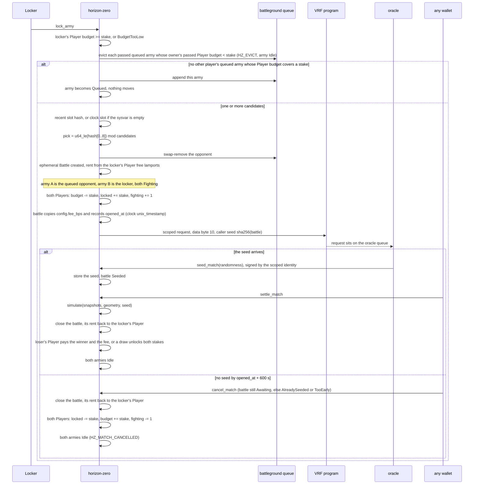
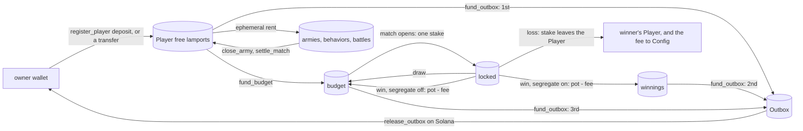
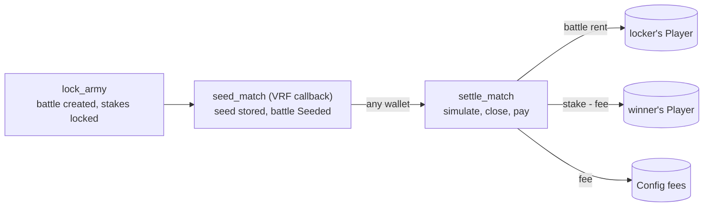

# Matchmaking, stakes, and VRF

`lock_army` both queues an unmatched army and opens a match. The opponent is fixed in that instruction. The VRF callback does not pick a player. Stakes are counters on each player's one [Player](accounts.md#player--68-bytes) account, never lamports on an army or a battle, until `settle_match` moves them.



## Slot hash

The program reads `SlotHashes`. When the account has at least 48 bytes and the leading `u64` entry count is non-zero, the hash is bytes `16..48` of the first entry (the `u64` slot, then the 32-byte hash). Otherwise the hash is the clock slot's 8 little-endian bytes repeated four times.

`pick` is the first 8 bytes of that hash as a little-endian `u64`, modulo the candidate count. Candidates stay in queue order.

The locker chooses which queued armies to pass, and only passed armies are candidates (see [`lock_army`](accounts.md#lock_army)). A locker can therefore pass a single army and meet exactly that opponent, or leave out armies they would rather not face. The slot hash picks only among what the locker offered. This is a known property of the design, not a check the program makes: every queued army accepted the battleground's stake by queuing, and the outcome still depends on the VRF seed, which neither player controls.

## Stakes

A player registers once with `register_player`, which creates their Player and moves a deposit into it. `fund_budget` moves free lamports into the budget. The player then locks as many armies as they like, on any battleground. Every one of them stakes from that one budget, and none of them holds lamports while it waits. When a locker matches, the program picks among the queued armies of other players whose budget still covers a stake, so a player never fights their own armies and never stakes more than the budget holds. Locking itself is refused unless the locker's own budget covers one stake.



Opening a match moves no lamports. Each Player's `budget` drops by the stake, its `locked` grows by it, and its `fighting` count grows by one. The lamports stay on the Player until `settle_match`, because an ephemeral battle cannot hold lamports.

The budget is spent one stake per match, in the order the owner's armies are met. Once it is under one stake, no locker can meet the owner's remaining queued armies, and the owner cannot lock another army. Those armies stay in the queue until a locker passes one of them together with its owner's Player: that `lock_army` evicts the army, which leaves the queue and becomes Idle (`HZ_EVICT <army>`). Without the eviction such armies could fill all 16 queue slots for good. A locker passes no Player, or one that is not authentic, and nothing is evicted. Until then, funding the budget again makes the armies reachable without another transaction; after it, the owner locks them again. `unlock_army` only leaves the queue; nothing moves.

A won payout goes back to the Player. With `segregate` off, the default, it goes into the budget, so a winning player keeps fighting on their winnings. With `set_segregation(true)` it goes to `winnings`, which no match stakes; the budget is then a hard cap on what the player risks. A draw always returns each stake to its budget.

## Who pays

`register_player` takes the Player's and the Outbox's rent and the deposit from the wallet. A transfer into the Player lands in its free lamports. The free lamports pay ephemeral rent at `(bytes + 60) * 32` lamports: about 5 700 for a behavior, 45 000 for an army, and 71 000 for a battle (see [Ephemeral accounts](accounts.md#ephemeral-accounts)). Unmatched `lock_army` moves nothing.

A match creates the battle as an ephemeral account sponsored by the locker's Player, which must have the rent free (`RentShort`). `settle_match` closes the battle and refunds that rent to the locker's Player, so a battle costs the locker nothing once it settles.

Until the callback lands and someone settles, both armies stay Fighting and both stakes stay locked on their Players. If the seed never arrives, anyone may send `cancel_match` once `CANCEL_AFTER_SECS` (600 seconds) have passed since `lock_army` opened the battle (`opened_at`, the clock's `unix_timestamp`). It returns both stakes to their budgets, sets both armies Idle, and closes the battle with its rent back to the locker's Player (`HZ_MATCH_CANCELLED <battle>`). Only an Awaiting battle can be cancelled. A Seeded battle fails with `AlreadySeeded`: its outcome is already fixed and anyone can replay it off-chain, so a loser who could cancel would never lose. Anyone may settle it instead. A VRF callback that arrives after the cancel finds no battle and fails without effect.

## Money in and out

The Player's lamports are split by its counters (see [Player](accounts.md#player--68-bytes)):

| part | what it is | staked | withdrawable |
| --- | --- | --- | --- |
| free | lamports no counter claims; they pay ephemeral rent | no | first |
| winnings | payouts set aside while `segregate` is on | no | second |
| budget | what matches may stake | one stake per match | third |
| locked | stakes in battles that have not settled | already | never |

Money enters and leaves the Player in the rollup, without undelegating the Player.

**Top-up.** A lamport transfer into the Player lands in free lamports. The client sends it on Solana through the eSPL program's delegated lamports transfer (`lamportsDelegatedTransfer` in the TypeScript SDK). The rollup credits the Player with the exact amount. The wallet pays the amount plus 300 000 lamports and the transaction fee. The credit exists only in the rollup. Nothing commits the Player on a timer, so its Solana copy keeps the data and lamports of its last commit; the next withdrawal commits it. `fund_budget` then moves free lamports into the budget.

**Withdrawal.** Lamports leave the rollup through the wallet's one-shot [Outbox](accounts.md#outbox--49-bytes). The client sends one rollup transaction with two instructions:

1. `fund_outbox(amount)` takes `amount` from free lamports, then winnings, then budget, never from locked stakes, and moves it from the Player to the Outbox. `outbox.amount` records it.
2. `withdraw` schedules one intent bundle: a commit of the Player, which stays delegated, and a commit-and-undelegate of the Outbox, with a post-undelegate action that calls `release_outbox` on Solana.

They are two instructions because the rollup refuses one instruction that moves lamports into an account and also schedules that account's commit. The rollup validator then commits the Player, and commits the Outbox, undelegates it, and runs the action on Solana.

The Player commit is what pays for the withdrawal on Solana. The rollup moved the lamports from the Player to the Outbox, but Solana sees only what is committed. Committing the Outbox alone would raise its Solana balance while the Player's Solana copy kept its old balance, and the rollup validator would fund the difference. On the local stack spike, which committed only the Outbox, the validator's own balance paid it. Committing the Player in the same bundle brings its Solana balance down by the same amount. This is the only time a Player is committed: on each withdrawal, never on a timer. `release_outbox` pays `outbox.amount` to `outbox.owner` and sets the amount to 0. On the local stack the release had landed about a second after the rollup transaction.

```mermaid
sequenceDiagram
  participant Wallet as owner wallet
  participant ER as horizon-zero (rollup)
  participant Magic as magic program
  participant Validator as rollup validator
  participant DLP as delegation program
  participant Base as horizon-zero (Solana)
  opt the Outbox is not delegated (a previous withdrawal undelegated it)
    Wallet->>Base: delegate_outbox, refused while outbox.amount != 0 (OutboxBusy)
    Base->>DLP: delegate the Outbox to config.validator
  end
  Wallet->>ER: fund_outbox(amount)
  ER->>ER: free, then winnings, then budget, never locked (BalanceShort)
  ER->>ER: Player to Outbox lamports, outbox.amount = amount (HZ_OUTBOX_FUND)
  Wallet->>ER: withdraw (same transaction, HZ_WITHDRAW)
  ER->>Magic: one bundle: commit the Player; commit-and-undelegate the Outbox, then release_outbox(outbox, owner); paid by the wallet
  Magic-->>Validator: intent queued in the magic context
  Validator->>DLP: commit the Player (it stays delegated): its Solana balance drops by amount
  Validator->>DLP: commit, finalize, undelegate the Outbox
  DLP->>Base: process_undelegation: the Outbox is owned by horizon-zero again
  DLP->>Base: post-undelegate action: release_outbox + 3 escrow accounts
  Base->>Wallet: amount lamports (HZ_RELEASE), outbox.amount = 0
  opt the action did not run
    Wallet->>Base: release_outbox, from any wallet
  end
```

`release_outbox` is permissionless. The delegation program signs the action with an escrow PDA, so the program cannot tell the action from any other caller. That is safe: the instruction pays only the owner recorded in the Outbox, which is the wallet for `[b"outbox", owner]` and the admin for the treasury Outbox, and is checked against the passed account. A second call finds `amount` 0 and does nothing. While the Outbox is still delegated, the delegation program owns it on Solana and the call fails. If the action never runs, the client calls `release_outbox` itself once the Outbox is undelegated.

`release_outbox` runs only on Solana. In the rollup it cannot pay anyone: the owner wallet is not delegated, and the rollup rejects any transaction that changes an undelegated account, whether the account is writable (`InvalidWritableAccount`) or the fee payer (`InvalidAccountForFee`). Once `withdraw` has run, the rollup's Outbox belongs to the delegation program, so the typed Outbox check fails as well. On the local stack, a third-party release sent to the rollup never took effect, and the base action paid exactly once.

**A half-sent withdrawal.** If `fund_outbox` lands without `withdraw`, the lamports wait in the delegated Outbox, and `OutboxBusy` blocks another `fund_outbox`. A later `withdraw` on its own schedules the release. No instruction moves the lamports back to the Player.

A funded Outbox blocks the next `fund_outbox` with `OutboxBusy` until it is released. `fund_outbox` also refuses a move that would leave the Player holding less than its rent plus `budget + winnings + locked` (`BalanceShort`). Every withdrawal also ends the Outbox's delegation, so before the next one the client sends `delegate_outbox` on Solana, paid by the wallet. It delegates to the rollup validator pinned in Config. It refuses an Outbox whose `amount` is not 0 (`OutboxBusy`): a withdrawal that is undelegated but not yet released is released first, so it is never locked back into the rollup. On the local stack one delegation session cost the wallet about 300 000 lamports, or 0.0003 SOL, plus transaction fees: 3 138 960 lamports of delegation record and metadata rent at delegation, of which 2 838 960 come back at undelegation.

**Fee claim.** Fees collect on Config (`config.fees`, on top of its rent). The admin creates the treasury Outbox `[b"outbox", config]` once on Solana with `init_treasury_outbox`. A claim is the same two-instruction rollup transaction: `fund_treasury_outbox` moves all of `config.fees` to the treasury Outbox, records the admin as its owner and sets `config.fees` to 0 (`HZ_OUTBOX_FUND`), and `claim_fees` schedules one bundle that commits Config (it stays delegated) and commits and undelegates the treasury Outbox with the same `release_outbox` action, which pays the admin (`HZ_CLAIM`). As with the Player, the Config commit lowers Config's Solana balance by the fees that left it, and Config is committed only on a claim. Only the admin can send either instruction (`NotAdmin`). With no fees, `fund_treasury_outbox` fails with `NothingToWithdraw`. If `fund_treasury_outbox` lands without `claim_fees`, the fees wait in the delegated treasury Outbox until a later `claim_fees`; no instruction moves them back to Config. Like the player Outbox, every claim ends the treasury Outbox's delegation, so before the next claim the admin sends `delegate_treasury_outbox` on Solana, with the same `OutboxBusy` rule. `init_treasury_outbox` and `delegate_treasury_outbox` read Config by hand, so they work whether or not Config is delegated. See [Delegation](accounts.md#delegation).

## VRF request

`ephemeral-vrf-sdk` 0.17.3 builds the request with `create_request_randomness_ix`, which sets instruction byte `0` to `10` (scoped identity, regular priority). The `#[vrf]` helper forces that byte to `10` unless it is already `3` or `11`, which this call is not. High-priority scoped requests use byte `11`. This program does not send `11`.

The request body after the 8-byte header carries:

- `caller_seed = SHA-256(battle pubkey)`
- callback program = this program
- callback discriminator = `SHA-256("global:seed_match")[..8]`
- one callback account, not a signer: the battle (writable)
- empty callback args

The CPI is signed by the program identity `[b"identity"]`. The accounts on that CPI are the player, the program identity, the oracle queue, the system program, and slot hashes.

The oracle later invokes `seed_match`. The signer it supplies is the scoped identity `[b"identity", horizon_program_id]` on the VRF program. `randomness` becomes the battle seed and later the `simulate` seed. Deployment does not read it. The seed does choose the blocked tiles between the two starting zones. `settle_match` passes the `cols` and `rows` copied onto the battle at `lock_army`.

The web client sends `lock_army` to the rollup, so it asks an ephemeral queue, whose oracle calls back into the rollup. The queue is `VITE_ORACLE_QUEUE` when set. Otherwise a production build uses the SDK's `DEFAULT_EPHEMERAL_QUEUE` `5hBR571xnXppuCPveTrctfTU7tJLSN94nq7kv7FRK5Tc`, and `vite dev` uses the ephemeral test queue `Sc9MJUngNbQXSXGP3F67KvKwVnhaYn6kcioxXNVowYT`, which the local stack serves with a `vrf-oracle` pointed at the rollup. The program accepts any queue the VRF program owns. See [Networks and deployment](deployment.md).

## Settlement and fee

A whole battle does not fit in the compute the oracle gives its callback (see [Callback compute](#callback-compute)), so the callback only stores the seed. `settle_match` then plays the battle in its own transaction. It is permissionless: the client sends it after `seed_match`, and anyone else may. It checks the battle, both armies and both Players against the battle's stored keys, so the caller cannot redirect the payout. A second call fails with `AlreadyResolved`, because the first one closed the battle.



The fee is a share of the pot. With `pot = 2 * stake` and the `fee_bps` the battle copied from Config at `lock_army`:

- `fee = pot * fee_bps / 10_000`, rounded down.
- On a win, the loser's Player sends `stake - fee` lamports to the winner's Player and `fee` lamports to Config. The winner's budget, or winnings, grows by `pot - fee`, and `config.fees` grows by `fee`.
- On a draw, no lamports move and no fee is taken. Each Player's budget gets its stake back.
- Both Players drop `locked` by the stake and `fighting` by one.

`fee_bps` is at most `1000`, so the fee never exceeds the loser's stake. The admin sets it with `set_fee`; `initialize` takes the first value.

Example: at Garrison (stake 0.05 SOL) with a 5% fee, the pot is 0.1 SOL and the fee is 0.005 SOL. The loser's Player sends 0.045 SOL to the winner's and 0.005 SOL to Config. The winner nets +0.045 SOL and the loser loses 0.05 SOL.

The `HZ_MATCH_RESOLVED` log carries the outcome and the fee, because the battle account is gone after settlement.

## Callback compute

The oracle sends `provide_randomness` in a transaction capped at 300 000 compute units, and the VRF program spends about 54 000 of it before it invokes the callback, so the callback has roughly 246 000. The request has no field that raises that cap. `seed_match` uses about 42 000 CU, most of it reading and writing back the 2155-byte battle and checking its address.

The battle itself runs in `settle_match`, in its own transaction with up to 1 400 000 CU. The LiteSVM test `full_armies_resolve_on_every_battleground` measures full-budget armies that approach, cast, and attack:

| battleground | armies | `settle_match` |
| --- | --- | --- |
| Outpost | 4 v 4 | about 188 000 CU |
| Garrison | 5 v 5 | about 304 000 CU |
| Citadel | 10 v 10 | about 781 000 CU |

The worst battle in the compute benchmark ([Testing](testing.md#compute-benchmark)) uses about 880 000 CU, under two thirds of the transaction limit. Its Citadel armies now fill up to 10 units; with the old cap of 6 the worst battle used about 653 000 CU. The settlement reads only the battle's filled snapshot slots onto the heap: the SBF heap is 32 KB and the simulation needs most of it. The engine work described under [On-chain cost](battle.md#on-chain-cost) brought Citadel down from more than 1 270 000 CU, which did not fit even a whole transaction.

## Known limitations

- **No way out for a Player.** The program has no instruction that undelegates a Player. Money leaves through the Outbox, but the Player account itself stays delegated to the validator pinned in Config. If that rollup stops serving it, the Player's latest balance is only in the rollup, and Solana holds the copy from its last withdrawal (or from its delegation). An escape hatch that undelegates a Player is deferred.
- **A seeded battle that cannot settle strands its stakes.** `cancel_match` refuses a Seeded battle, so its stakes stay locked and its armies stay Fighting until `settle_match` succeeds. A battle whose settlement cannot run, for example one that needs more than the 1 400 000 CU a transaction can have, would hold both stakes for good. The compute benchmark keeps the worst known battle well under that limit (see [Callback compute](#callback-compute)).
- **Everything depends on the rollup validator.** Gameplay, top-ups reaching the budget, settlement, withdrawals and fee claims all run in the rollup that serves the validator `initialize` pinned in Config, and nothing changes that validator. While the rollup is down nothing moves; a withdrawal already scheduled pays out only when the validator sends its Solana transaction, and the client's `release_outbox` fallback needs the Outbox undelegated first.
