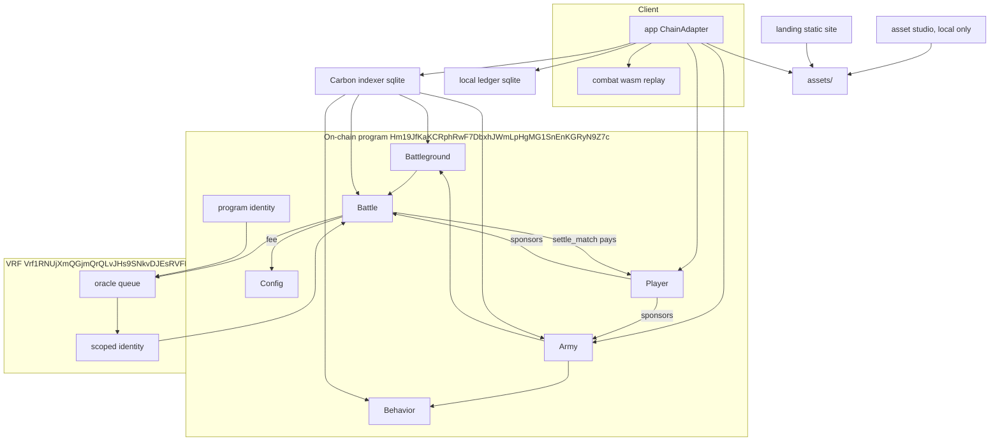

# Overview

Horizon Zero is a Solana auto-battle game. A player builds an army of catalog units, each bound to an immutable behavior, places each unit on a tile in a starting zone, and locks the army into a battleground. Every army a player locks stakes from the budget on that player's one Player account. The program pairs the army with another player's queued army, locks one stake on each Player, and asks MagicBlock VRF for a seed. The VRF callback stores the seed, and anyone may then send `settle_match`, where `crates/combat` resolves the fight and the loser's Player pays the winner and a protocol fee. The same function replays in the browser.

Build this book from the repo root with `mdbook build docs`. Diagrams are mermaid fences. They stay readable as source until `mdbook-mermaid` is installed and enabled in `docs/book.toml`.

## v1 facts

The catalog has three races: Ashborn is race `0`, Rootborn is race `1`, and Deeplings is race `2`. Kind ids start again at `0` for each race, so kind `0` is a Guard in an Ashborn army, a Thornling in a Rootborn one, and a Clawling in a Deeplings one. `create_army` and `update_army` reject a race with no catalog arm and a kind that race does not have. Each race is one arm of `stats_for`, with its own kind enum (`AshbornKind`, `RootbornKind`, `DeeplingsKind`). The interpreter does not know race names. It reads the stats and the cast copied onto each unit.

The program does not hardcode battleground names, budgets, stakes, or grid sizes. `create_battleground` stores the admin's `battleground_id`, `budget`, `stake_lamports`, `cols`, and `rows`. Zone depth is always 2: zone A is rows `0..2`, zone B is the last two rows, and both span every column. The `battlegrounds` list in `content/catalog.json` is the set an admin is expected to create; `app/scripts/bootstrap.mjs` creates it, and the game, the studio and the local ledger read the same list:

| id | name | budget | stake (lamports) | SOL | grid |
| --- | --- | --- | --- | --- | --- |
| 0 | Outpost | 8 | 50,000,000 | 0.05 | 8×6 |
| 1 | Garrison | 16 | 200,000,000 | 0.2 | 10×8 |
| 2 | Citadel | 32 | 1,000,000,000 | 1 | 12×10 |

Stakes stay on the Players until `settle_match`. The winner of a resolved battle gets the pot, `2 * stake`, less a protocol fee of `fee_bps` basis points of the pot (at most `1000`; `DEFAULT_FEE_BPS` is `500`, 5%): the loser's Player sends `stake - fee` to the winner's Player and `fee` to Config, where it counts toward `config.fees`. The admin sets the rate with `set_fee`. A draw takes no fee and returns each stake to its budget. A win credits the winner's budget, or their separate winnings when the owner turned segregation on. `settle_match` closes the battle account and refunds its rent to the Player that paid it.

A player registers once with `register_player`, which creates their Player account and deposits lamports into it, and moves lamports into the budget with `fund_budget`. Behaviors, armies and battles are ephemeral rollup accounts whose rent the Player's free lamports pay. A queued army can `unlock_army`; it holds no stake, so nothing moves. A fighting army cannot. `settle_match` sets both armies back to Idle. An Idle army can be deleted with `close_army`, which returns its rent to the owner's Player.

Behaviors are permissionless. The PDA is `[b"behavior", sha256(canonical body)]`. There is no update and no close.

A behavior is an ordered sequence of at most 4 elements. Each element has at most one movement and at most 3 actions. A movement can stop the rest of that element's steps when an action executes. Movement points for a turn equal the unit's speed. Action points come from the unit's own `actions` stat, not from speed. Every unit of every race has exactly 1: one attack or one cast per turn, and a point left unspent makes it defend.

Ashborn units. `range` is the attack range. Each unit has one cast, copied onto the unit at army creation. A cast is eight numbers (damage, range, area, effect, aim, power, rounds, cooldown); sprint, reach and taunt last 3 rounds and then cool down for 4; the battle rules chapter lists the effects and aims, so a new cast is a new row of values. Hp, atk, cast damage and heal amounts are on a scale about three times the original one, which leaves room to tune by one point at a time; a defending unit still takes 1 less from each hit:

| id | name | cost | hp | atk | range | speed | actions | cast |
| --- | --- | --- | --- | --- | --- | --- | --- | --- |
| 0 | Guard | 2 | 14 | 8 | 1 | 3 | 1 | 9 damage and push a foe 1 tile back, range 2 |
| 1 | Skirmisher | 2 | 10 | 12 | 1 | 5 | 1 | sprint: 2× movement for 3 rounds, on itself |
| 2 | Archer | 3 | 5 | 13 | 3 | 3 | 1 | reach: +2 attack range for 3 rounds, on itself |
| 3 | Vanguard | 4 | 22 | 12 | 1 | 4 | 1 | taunt a foe and foes within 1 of it for 3 rounds, range 2 |
| 4 | Warden | 5 | 17 | 12 | 1 | 4 | 1 | heal one ally or itself up to 5 hp, range 3 |

These numbers were tuned so that draws are rare: with random budget-legal Ashborn armies and random standard behaviors, under 0.1% of Outpost battles, 0.1% of Garrison and 1.3% of Citadel end in a draw, and battles last about 3, 5 and 7 rounds. Change them through the asset studio's Balance tab, which reports the draw rate.

The three races differ first in price. Ashborn is the cheapest army (units cost 2 to 5, 3.2 on average), Deeplings the average one (3 to 6, 4.25 on average), and Rootborn the dearest (4 to 10, 7 on average), so for the same budget Ashborn fields the most bodies and Rootborn the fewest and largest. A combat test keeps that order of mean costs.

Rootborn units. Three kinds, each worth more than its cost in stats. Every Rootborn cast cools down, including the ones that do not last. The Elderoak costs more than Outpost's budget of 8, so Rootborn fields it only from Garrison up:

| id | name | cost | hp | atk | range | speed | actions | cast |
| --- | --- | --- | --- | --- | --- | --- | --- | --- |
| 0 | Thornling | 4 | 24 | 17 | 1 | 4 | 1 | 6 damage to a foe in reach and foes within 1 of it, range 1, cooldown 3 |
| 1 | Briarsling | 7 | 23 | 14 | 3 | 3 | 1 | 12 damage and push one foe 1 tile, range 4, cooldown 4 |
| 2 | Elderoak | 10 | 58 | 19 | 1 | 2 | 1 | heal an ally and allies within 1 of it up to 5 hp, range 3, cooldown 3 |

Deeplings units. Four kinds at middling prices. Every Deeplings cast cools down:

| id | name | cost | hp | atk | range | speed | actions | cast |
| --- | --- | --- | --- | --- | --- | --- | --- | --- |
| 0 | Clawling | 3 | 24 | 12 | 1 | 3 | 1 | crush: 15 damage to one foe in reach, cooldown 2 |
| 1 | Eelsnare | 4 | 19 | 12 | 1 | 5 | 1 | snare: taunt a foe for 2 rounds, range 3, cooldown 3 |
| 2 | Spineshot | 4 | 17 | 12 | 3 | 3 | 1 | 3 damage to a foe and foes within 1 of it, range 3, cooldown 2 |
| 3 | Tidecaller | 6 | 20 | 9 | 1 | 3 | 1 | 9 damage and push 2 tiles, on a foe and foes within 1 of it, range 3, cooldown 2 |

The hp, atk, cast damage and heal of every unit were tuned together so that every pairing of races is close to even on every battleground. The tuning replayed a fixed set of full-budget armies on random standard behaviors and changed one value at a time by one or two points, keeping a change when it brought the nine win rates closer to 50%. On 1000 fresh battles per cell, the first race wins:

| matchup | Outpost | Garrison | Citadel |
| --- | --- | --- | --- |
| Rootborn v Ashborn | 54% | 46% | 52% |
| Deeplings v Ashborn | 49% | 51% | 53% |
| Rootborn v Deeplings | 52% | 49% | 52% |

With 1000 battles a cell moves by about 1.5 points from one sample to the next. Armies that do not spend their whole budget give similar numbers, between 45% and 56%. The Rootborn spread across battlegrounds is the one stats cannot close: at Outpost, Rootborn can only field Thornlings or a lone Briarsling, since the Elderoak costs more than 8.

Each battleground is its own grid. An army holds at most 10 units, one tile each. The cap was 6 until Rootborn: with 6, Citadel's budget of 32 bought six Ashborn units that left points unspent while Rootborn spent all of it, and Rootborn won almost every Citadel battle. A battle lasts at most 12 rounds. Distance is integer Manhattan. The VRF seed changes initiative, tie-breaks, and which tiles between the starting zones are blocked. It does not change deployment.

`lock_army` chooses the opponent from the recent slot hash before it requests randomness. The VRF callback only stores the seed that `simulate` uses; `settle_match`, which anyone may send, plays the battle and pays out.

Program id: `Hm19JfKaKCRphRwF7DbxhJWmLpHgMG1SnEnKGRyN9Z7c`.

VRF program: `Vrf1RNUjXmQGjmQrQLvJHs9SNkvDJEsRVFPkfSQUwGz`, crate `ephemeral-vrf-sdk` 0.17.3. `lock_army` sends a scoped request whose first byte is `10`.

Ephemeral accounts: `ephemeral-rollups-sdk` 0.17.3, through the magic program `Magic11111111111111111111111111111111111111` and its rent vault `MagicVau1t999999999999999999999999999999999`.

`VITE_DEV_MODE=true` renders the app without a Solana connection. Behaviors, battlegrounds, armies, and battles for that run live in the local ledger SQLite file. The asset studio is a local process and is absent from `render.yaml`. `horizon-zero-landing` is a static site in `render.yaml`. It presents the game and loads approved files from the web service. The game remains `horizon-zero`.
